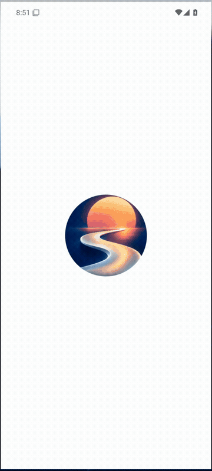
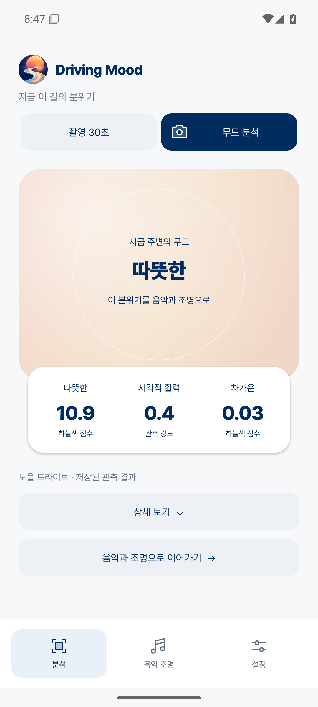
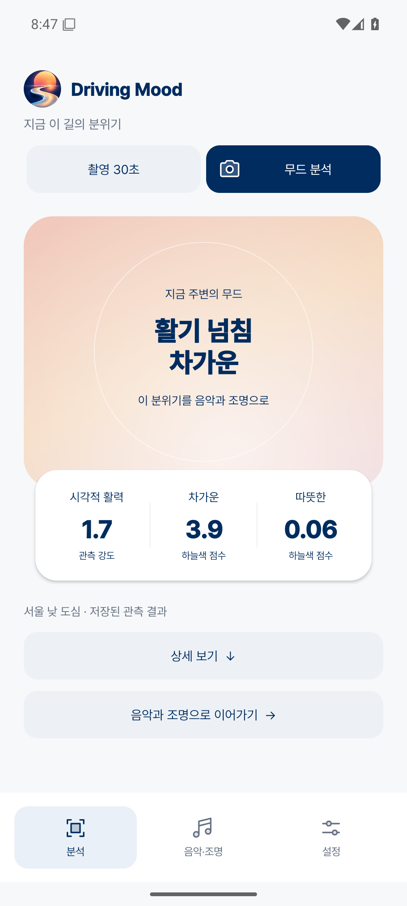
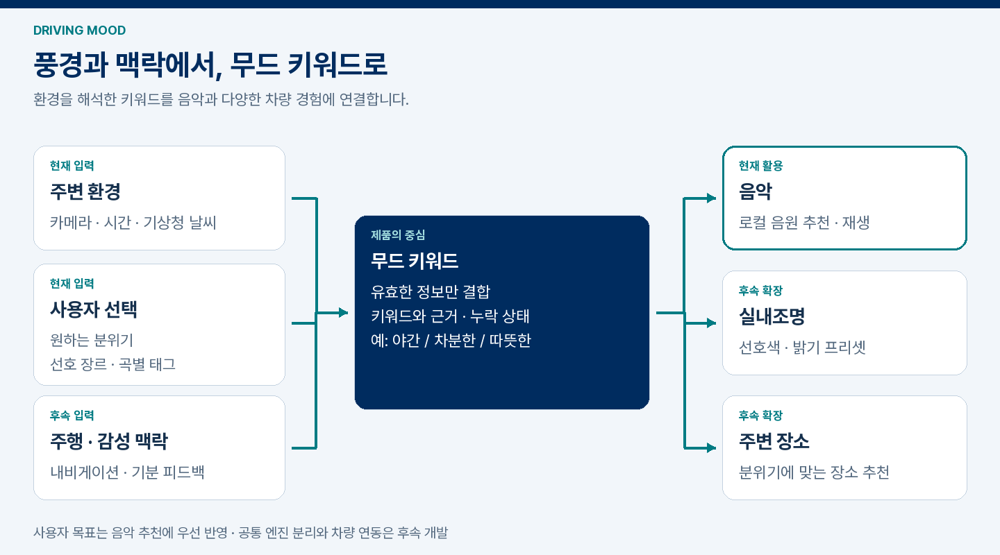
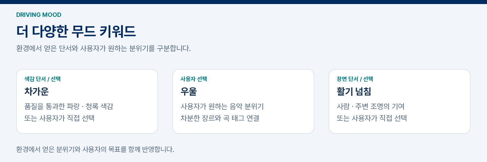
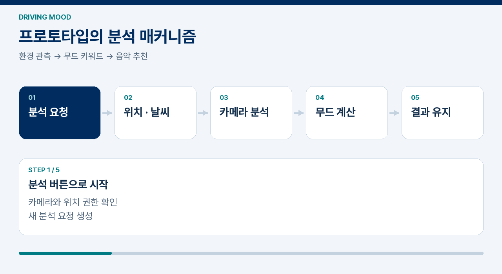
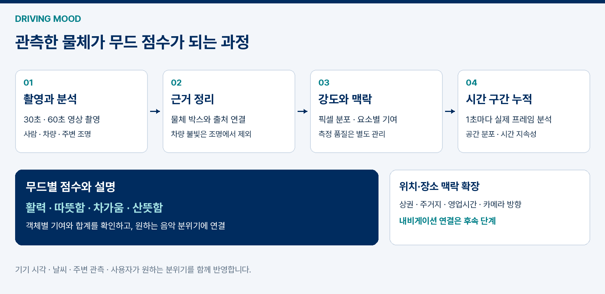
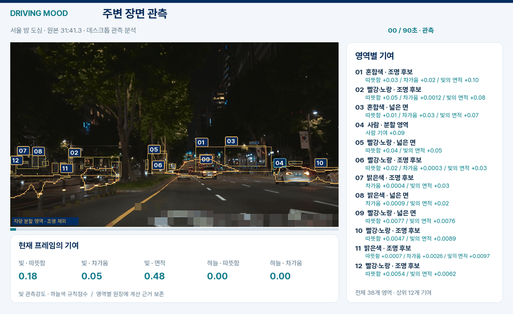
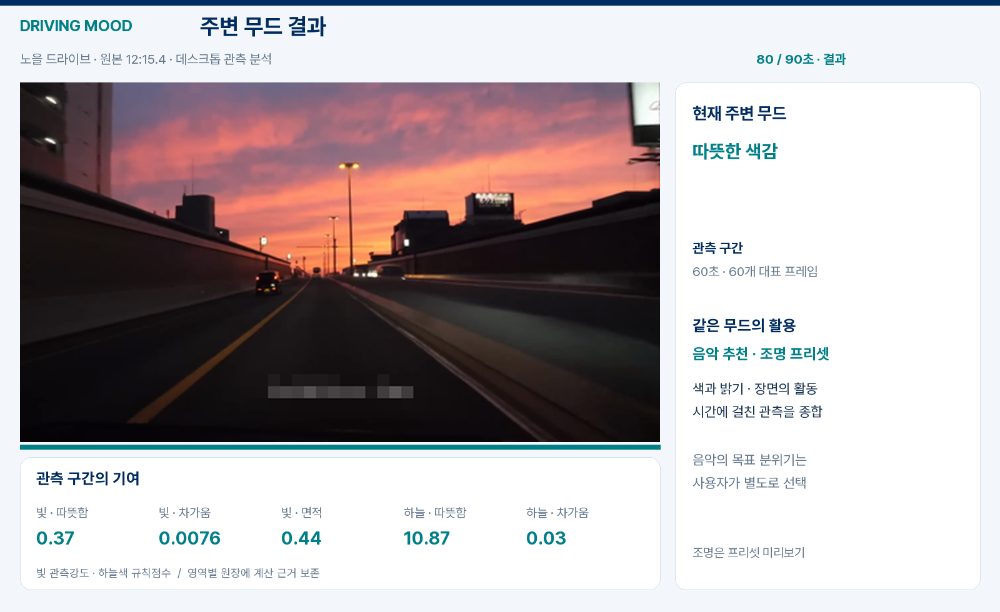

# Driving Mood

주변 환경과 운전자 맥락에서 **무드 키워드를 추출해 음악·조명·장소 추천으로 연결하는 앱**입니다. 카메라가 관측한 빛과 사람, 도로·날씨 정보에 사용자의 취향과 원하는 분위기를 결합합니다.

## 실제 앱 화면

Android 프로토타입 **0.3.3**. 분석 버튼으로 촬영을 시작하고, 완료된 무드와 대표 점수를 한눈에 확인합니다. 배경은 대기 중에도 은은하게 흐르며 결과에 맞는 색으로 바뀝니다.

| 분석 시작 | 노을의 무드 | 도심의 무드 |
|:---:|:---:|:---:|
|  |  |  |

결과 예시는 실제 주행 영상의 저장된 계산 결과를 앱에 표시한 화면입니다.

[음악·조명과 설정 화면 보기](docs/product/APP_UI.md) · [APK 다운로드](https://github.com/oiehnow/driving-mood/releases/tag/v0.3.3)

## 원하는 분위기

**차가운 / 우울 / 활기 넘침**을 비롯해 따뜻한·몽환적인·차분한·잔잔한·편안한·포근한·청량한 분위기를 선택할 수 있습니다. 선택한 목표는 음악 추천에 우선 반영합니다.

환경의 분위기를 **이어가기 / 다른 분위기로 전환하기**를 제안하고, 음악에서 차량 조명과 주변 장소 추천까지 확장하는 것이 목표입니다. [용어 정의](CONTEXT.md)

## 프로토타입의 분석 매커니즘

현재 0.3.3은 **30초·60초 영상 촬영 → 분석 → 완료음 → 무드 결과 → 음악·조명 미리보기**로 동작합니다. 촬영한 영상에서 1초마다 대표 프레임을 분석하고, 요소별 기여와 환경 키워드를 계산합니다. 위치·날씨는 촬영과 함께 확인하며 지역별 날씨 캐시를 재사용합니다.

## 무드 키워드를 만드는 과정

사람·주변 조명은 활력, 색감은 따뜻함·차가움, 하늘·날씨는 산뜻함의 근거로 사용합니다. 차량광을 제외한 뒤 각 요소의 기여를 계산하고 시간 구간별로 평균합니다. 박스별 점수와 계산 원장을 연결해 결과의 근거를 확인할 수 있습니다.

0.3.2에는 [하늘색의 시간 변화에 따른 무드 해석](docs/vision/SKY_COLOR.md)을 추가했습니다. 공통 주변 무드를 음악 취향과 분리해 화면·음악·조명 미리보기에 전달합니다.

[무드 점수 설계](docs/product/MOOD_SCORING.md) · [제품 구조와 Pleos 연동 계획](docs/product/ARCHITECTURE.md) · [설계 보고서 PDF](docs/product/DrivingMood-Design.pdf)

## 실제 주행 영상 분석

실제 차량 주행 영상으로 모델과 점수 규칙을 비교합니다. 데스크톱 연구에서는 작은 간판·넓은 건물 조명을 관측하고 각 영역의 기여를 계산했습니다.

실제 차량 주행 영상과 이미지 자료들을 바탕으로 [장면 다양성을 보강](docs/vision/DATA_COVERAGE.md)했습니다. 주행 영상의 연속 프레임으로 하늘색 계산과 Android 결과 연결을 확인했습니다.

[90초 주행 시연과 결과](docs/product/VIDEO_DEMO.md) · [관측 개선과 구간 비교](docs/product/OBSERVATION_IMPROVEMENT.md) · [시행착오](docs/product/TRIALS.md)

## 시작하기

Android 8.0 이상을 지원합니다. [APK 빌드·설치 안내](docs/BUILD.md)

1. 날씨를 사용하려면 **설정 → 기상청 키 설정**에 초단기실황 API 키를 입력합니다. 키 없이도 영상 분석을 사용할 수 있습니다.
2. 촬영 길이를 **30초 또는 60초**로 선택하고 **무드 분석**을 누릅니다.
3. 촬영·분석이 끝나면 완료음과 함께 무드 키워드·주요 근거·조명 미리보기를 확인합니다.
4. **원하는 분위기**와 **로컬 음원 선택**을 설정하고 곡 태그·선호 장르를 지정해 음악을 재생합니다.

촬영 영상은 앱 내부에 임시 저장하고 분석·취소 후 삭제합니다. 날씨 조회에는 위치를 변환한 기상청 격자를 사용하며, API 키와 음악 목록은 앱 실행 중 유지됩니다.

## 개발 현황

현재 APK는 **YOLO26n-sem-ADE20K 의미분할 + EfficientDet Lite0 사람·차량 검출 + 자체 색·면적 점수 규칙**을 기기 안에서 실행합니다. 내비게이션·실차 조명·장소 추천은 후속 개발 항목입니다. [모델과 재현 자료](docs/vision/SEMANTIC_MODEL.md)

0.3.3은 단위 검사와 최종 APK의 서명·16KB 정렬·업데이트 설치·촬영 및 취소 검사를 통과했습니다. Galaxy S25+ 실기기 검증은 진행할 항목입니다. [검증 기록](docs/VALIDATION.md)

## 기술 문서

- [제품 구조와 개발 계획](docs/product/ARCHITECTURE.md) · [설계 보고서 PDF](docs/product/DrivingMood-Design.pdf)
- [영상 분석](docs/vision/README.md) · [분석 데이터 계약](docs/ANALYSIS_CONTRACT_V2.md) · [무드 점수 설계](docs/product/MOOD_SCORING.md)
- [실제 파인튜닝 과정과 전후 평가](docs/vision/FINETUNING.md) · [학습 코드와 재현 기록](models/semantic/finetuning-pilot01/README.md)
- [환경·음악 출처](docs/context-audio/SOURCES.md) · [외부 라이선스](THIRD_PARTY_NOTICES.md)

앱 소스는 [AGPL-3.0-only](LICENSE)로 공개합니다. 외부 모델·라이브러리·글꼴·영상은 각각의 원래 고지를 따릅니다.
