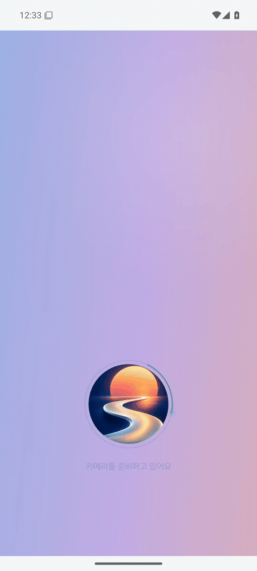
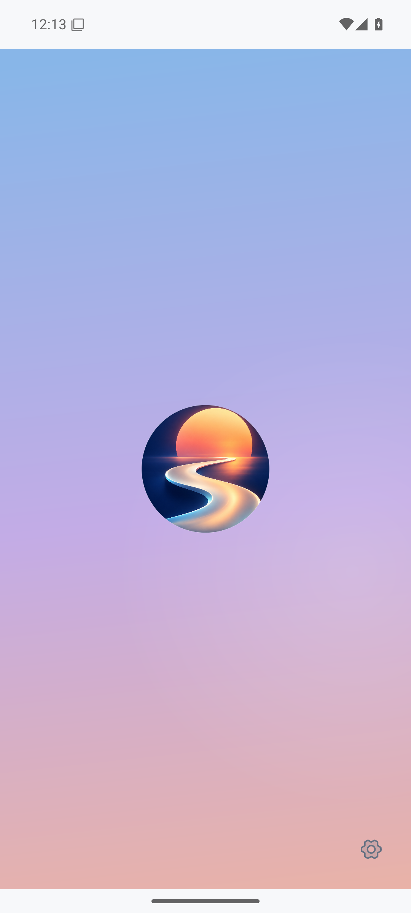
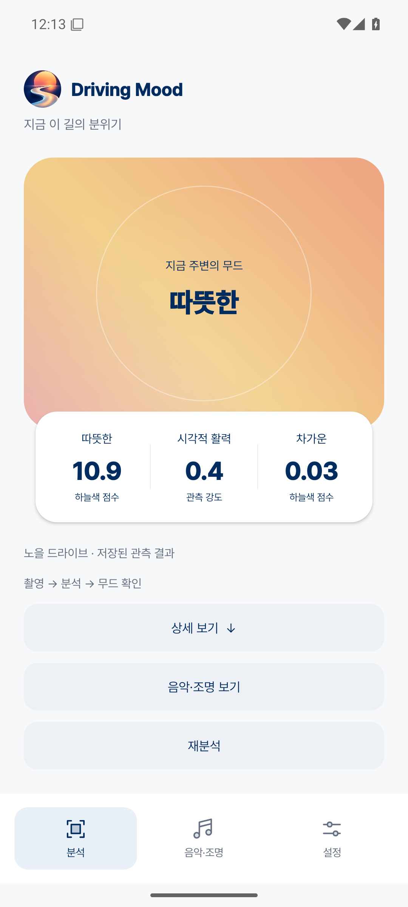
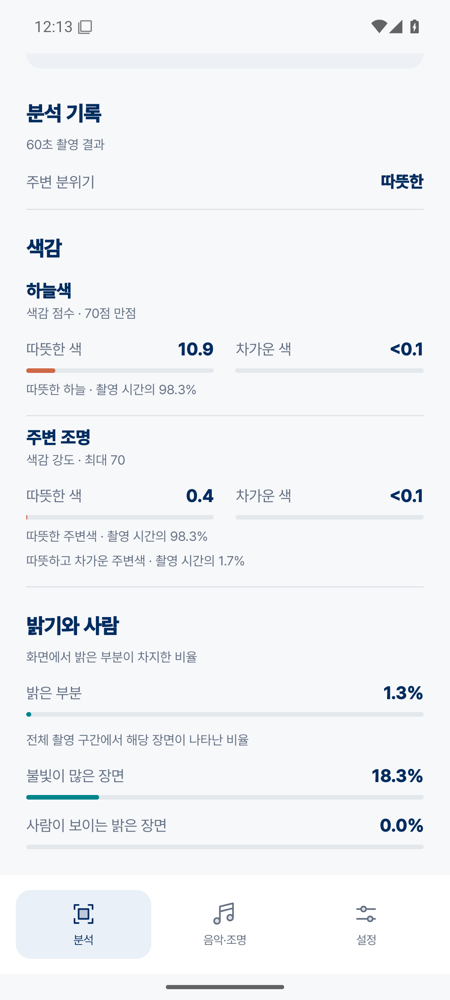

# Driving Mood

  

주변 풍경과 주행 상황을 분석해 **무드 키워드를 만들고, 사용자의 취향에 맞는 음악을 추천하는 앱**입니다. 카메라에 담긴 빛과 사람, 도로·날씨 정보로 주변 분위기를 파악하고, 사용자가 원하는 분위기를 음악 선택에 반영합니다. 같은 결과를 차량 조명과 주변 장소 추천에도 활용하는 것이 목표입니다.

휴대폰 분석 앱 0.3.9는 사람·차량을 찾는 **객체 검출 모델**과 픽셀별로 하늘·건물 등을 나누는 **세 가지 의미 분할 실행 구성**을 사용합니다. 각 구성의 결과에서 실제 색감과 빛을 측정하고, 자체 점수 규칙으로 무드 키워드를 만듭니다.

**실제 차량 주행 영상과 이미지 자료를 활용해 파인튜닝을 수행하고, 검증 결과를 복합 모델 구성에 반영했습니다.** 학습률·정규화 통계·초기 가중치 보존 규제를 비교하고, 간판 오탐과 기존 인식의 퇴행을 함께 확인해 적용 범위를 정했습니다. [파인튜닝 코드·설정·가중치](models/semantic/finetuning03/README.md) · [실험·실패·채택 이유](docs/vision/MODEL_IMPROVEMENT_LOG.md)

## 현재 적용한 모델

### YOLO26n 객체 검출 — 사람·차량의 위치

Ultralytics **YOLO26n** 객체 검출 모델(`yolo26n.pt`)을 640 입력의 Android용 ONNX로 변환했습니다. 사람의 위치·수·면적을 관측하고, 차량 불빛과 교통시설을 조명 계산에서 제외할 영역을 제공합니다. 기존 EfficientDet-Lite0와의 개발 사례 비교에서 명확한 인물 위치 대응이 늘고 제한된 비사람 검수 영역의 오탐이 줄어, 모바일 변환을 확인한 nano 구성을 적용했습니다.

작거나 가려진 사람의 누락과 차량 중복 박스가 남아 있습니다. 최신 시각 검토에서 표시된 보행자 후보의 신뢰도 0.316은 앱 사람 관측 기준 0.5에 미달했습니다. 화면에 박스가 보인다는 사실만으로 앱 관측 성공을 뜻하지 않으며, 개발 사례 비교를 전체 인원 재현율이나 정확도로 확대하지 않습니다. [공식 원본·변환·검증 자료](models/detector/yolo26n-mobile/README.md)

### YOLO26n-sem-ADE20K · n320 — 기본 의미 분할

**YOLO26n-sem-ADE20K** 모델(`yolo26n-sem-ade20k.pt`)을 320 입력으로 실행합니다. 사람·차량·도로·보도·교통시설의 기존 분류를 보존하고, 보조 결과를 적용하지 않는 픽셀의 기본값을 제공합니다. 건물·창문·간판을 함께 구분하는 ADE20K 클래스 구성과 기존 모바일 실행 경로가 도시 조명의 위치를 찾는 목적에 맞아 선택했습니다.

기존 분류를 보존하는 규칙은 이미 놓친 사람·차량이나 차도·보도 오분류를 고치지 못합니다. 작은 창문과 노을 하늘의 누락도 남아 있습니다. [공식 원본과 변환 자료](models/semantic/README.md) · [분할 역할과 입력 계약](docs/vision/SEMANTIC_MODEL.md)

### YOLO26n-sem-ADE20K · n640 — 하늘 보완

**YOLO26n-sem-ADE20K**를 640 입력으로 실행하는 보조 구성입니다. 입력을 더 세밀하게 살펴 기본 모델의 보호 영역 밖에서 하늘로 분류한 픽셀만 반영합니다. 단독 교체에서는 사람·보도의 퇴행이 나타나 하늘 보완 역할로 제한했습니다.

최신 AI 시각 검토에서는 가지 사이 하늘, 어두운 밤하늘, 흐린 하늘의 누락 감소를 확인했습니다. 요금소의 노을 하늘과 세밀한 가지 경계는 여전히 어렵습니다. n640이 사람·차량으로 분류한 픽셀은 현재 결합 규칙에서 채택하지 않으므로, 그 보조 출력만으로 최종 사람·차량 누락이 복구되지는 않습니다. [해상도 후보 비교와 고정 결합 규칙](docs/vision/finetuning03/README.md)

### YOLO26n-sem-ADE20K 기반 C320 — 건물·창문·간판 보완

**C320은 YOLO26n-sem-ADE20K를 기반으로 한 건물·창문·간판 보조 모델**이며, 프로젝트의 C 실험에서 선택한 체크포인트를 뜻합니다. 앱에서는 320 입력으로 실행해 보호 영역과 하늘을 제외한 구조 판단에 사용합니다.

C 모델은 단독 교체 시 차량 분류의 허용 하락 폭을 넘었으므로 전체 분할을 맡기지 않았습니다. 역할을 제한한 F2 구성이 사전 개발 기준과 후속 보조 평가를 통과해 적용됐지만, 창문 개선은 확인되지 않았고 최신 검토에서도 외벽·창·트럭을 간판으로 넓게 분류하는 오류가 남았습니다. 주석은 사람이 모든 픽셀을 확인한 정답이 아닙니다. [실제 학습 코드·설정·가중치](models/semantic/finetuning03/README.md) · [체크포인트 출처와 텐서 동일성](models/semantic/finetuning03/weights/provenance.json) · [후보별 성공·실패 기록](docs/vision/MODEL_IMPROVEMENT_LOG.md)

### F2 결합과 자체 무드 계산

**F2는 위 의미 분할 결과를 합치는 고정 규칙의 이름입니다.** 모든 프레임에 **n320 보호 영역 → n640 하늘 → C320 구조 → n320 기본값** 순서로 적용합니다. YOLO26n 객체 검출은 이 분할 결합과 별도로 실행합니다. 빛과 색은 합쳐진 영역의 실제 RGB에서 측정하며, 시간에 따른 관측을 누적해 자체 무드 점수 규칙에 전달합니다.

최신 검토는 원본을 먼저 관찰하고 모델 이름을 가린 A/B를 비교한 **AI 정성 교차검수**입니다. 하늘의 국소 개선과 간판 과확장 악화를 함께 확인했으며 검토자 이견도 보존했습니다. 기존 개발 영상을 다시 사용했으므로 독립 시험이나 전체 정확도·개선율로 해석하지 않습니다. 새로운 영상과 실제 앱의 누적 관측 검증이 필요합니다. [장면별 시각 검토](docs/vision/VISUAL_REVIEW_20261025.md) · [현재 앱의 모델 연결과 한계](docs/vision/SEMANTIC_MODEL.md)

## 실제 앱 화면

Android 프로토타입 **0.3.9** · 아래 화면은 동일 UI의 0.3.8 촬영본입니다.

0.3.8 실제 앱 화면 · 저장된 주행 분석 결과 재생.

| 로고를 눌러 시작 | 무드 결과 | 분석 상세 |
|:---:|:---:|:---:|
|  |  |  |

[음악·조명과 설정 화면 보기](docs/product/APP_UI.md) · [APK 다운로드](https://github.com/oiehnow/driving-mood/releases/tag/v0.3.9)

## Pleos 차량 화면

Pleos **0.1.1** · 무드 수동 시연, 로컬 음악 재생, 내비게이션 조회, 조명 미리보기.

- [큰 화면 녹화 보기 · YouTube](https://www.youtube.com/watch?v=xvGNWKhK-sA)
- [3분할 화면 녹화 보기 · YouTube](https://www.youtube.com/watch?v=PEK9LYrkSss)

[차량 화면과 연결 설계](docs/product/PLEOS_EXPERIENCE.md) · [Pleos APK](https://github.com/oiehnow/driving-mood/releases/tag/pleos-preview-v0.1.1)

## 원하는 분위기

**차가운 / 우울 / 활기 넘침**을 비롯해 따뜻한·몽환적인·차분한·잔잔한·편안한·포근한·청량한 분위기를 선택할 수 있습니다. 선택한 목표는 음악 추천에 우선 반영합니다.

환경의 분위기를 **이어가기 / 다른 분위기로 전환하기**를 제안하고, 음악에서 차량 조명과 주변 장소 추천까지 확장하는 것이 목표입니다. [용어 정의](CONTEXT.md)

## 프로토타입의 분석 매커니즘

현재 0.3.9는 **로고 터치 → 30초 영상 촬영 → 분석 → 완료음 → 무드 결과 → 음악·조명 미리보기**로 동작합니다. 휴대폰 후면 카메라로 전방을 담고, 촬영한 영상에서 1초마다 대표 프레임을 분석해 요소별 기여와 환경 키워드를 계산합니다. 위치·날씨는 촬영과 함께 확인하며 지역별 날씨 캐시를 재사용합니다.

## 무드 키워드를 만드는 과정

사람·주변 조명은 활력, 색감은 따뜻함·차가움, 하늘·날씨는 산뜻함의 근거로 사용합니다. 차량광을 제외한 뒤 각 요소의 기여를 계산하고 시간 구간별로 평균합니다. 박스별 점수와 계산 원장을 연결해 결과의 근거를 확인할 수 있습니다.

0.3.2에는 [하늘색의 시간 변화에 따른 무드 해석](docs/vision/SKY_COLOR.md)을 추가했습니다. 공통 주변 무드를 음악 취향과 분리해 화면·음악·조명 미리보기에 전달합니다.

[무드 점수 설계](docs/product/MOOD_SCORING.md) · [제품 구조와 Pleos 연동 계획](docs/product/ARCHITECTURE.md) · [설계 보고서 PDF](docs/product/DrivingMood-Design.pdf)

## 실제 주행 영상 분석

실제 차량 주행 영상으로 모델과 점수 규칙을 비교합니다. 데스크톱 연구에서는 작은 간판·넓은 건물 조명을 관측하고 각 영역의 기여를 계산했습니다.

실제 차량 주행 영상과 이미지 자료들을 바탕으로 [장면 다양성을 보강](docs/vision/DATA_COVERAGE.md)했습니다. 주행 영상의 연속 프레임으로 하늘색 계산과 Android 결과 연결을 확인했습니다.

[90초 주행 시연과 결과](docs/product/VIDEO_DEMO.md) · [관측 개선과 구간 비교](docs/product/OBSERVATION_IMPROVEMENT.md) · [시행착오](docs/product/TRIALS.md)

## 시작하기

Android 8.0 이상을 지원합니다. [APK 빌드·설치 안내](docs/BUILD.md)

1. 카메라가 전방을 향하도록 두고 **Driving Mood 로고**를 누릅니다. 30초 촬영 후 분석이 자동으로 이어집니다.
2. 완료음과 함께 나타나는 무드 키워드·대표 점수를 확인하고, **상세 보기**에서 근거를 펼칩니다. 새로 관측하려면 결과 아래의 **재분석**을 누릅니다.
3. 날씨를 연결하려면 처음 화면 오른쪽 아래 **설정 → 기상청 키 설정**에 초단기실황 API 키를 입력합니다. 키 없이도 영상 분석을 사용할 수 있습니다.
4. **원하는 분위기**와 **로컬 음원 선택**을 설정하고 곡 태그·선호 장르를 지정해 음악을 재생합니다.

촬영 영상은 앱 내부에 임시 저장하고 분석·취소 후 삭제합니다. 날씨 조회에는 위치를 변환한 기상청 격자를 사용하며, API 키와 음악 목록은 앱 실행 중 유지됩니다.

## 개발 현황

휴대폰 APK는 **F2 복합 의미분할 + YOLO26n 사람·차량 검출 + 자체 색·면적 점수 규칙**을 기기 안에서 실행합니다. 정확도 비교는 부분 주석의 개발 평가이며, 실제 휴대폰의 처리 시간·메모리·발열은 추가 확인이 필요합니다. Pleos 0.1.1은 내비게이션과 음악을 연결한 별도 UI 시연 앱으로, 이 복합 모델을 실차 카메라에 연결한 빌드는 아닙니다. [모델과 재현 자료](docs/vision/SEMANTIC_MODEL.md)

버전별 빌드·촬영·분석 검사 결과는 [검증 기록](docs/VALIDATION.md)에서 확인할 수 있습니다. Galaxy S25+ 실기기 검증은 진행할 항목입니다.

## 기술 문서

- [제품 구조와 개발 계획](docs/product/ARCHITECTURE.md) · [설계 보고서 PDF](docs/product/DrivingMood-Design.pdf)
- [영상 분석](docs/vision/README.md) · [분석 데이터 계약](docs/ANALYSIS_CONTRACT_V2.md) · [무드 점수 설계](docs/product/MOOD_SCORING.md)
- [실제 파인튜닝 과정과 전후 평가](docs/vision/FINETUNING.md) · [학습 코드와 재현 기록](models/semantic/finetuning-pilot01/README.md)
- [환경·음악 출처](docs/context-audio/SOURCES.md) · [외부 라이선스](THIRD_PARTY_NOTICES.md)

앱 소스는 [AGPL-3.0-only](LICENSE)로 공개합니다. 외부 모델·라이브러리·글꼴·영상은 각각의 원래 고지를 따릅니다.
