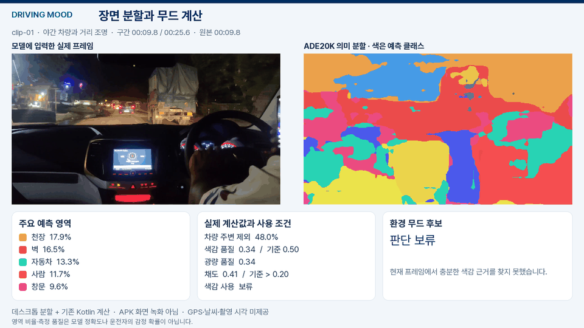

# Driving Mood

주변 환경과 운전자 맥락에서 **무드 키워드를 추출해 음악·조명·장소 추천으로 연결하는 앱**입니다. 카메라가 관측한 빛과 사람, 도로·날씨 정보에 사용자의 취향과 원하는 분위기를 결합합니다.

## 원하는 분위기

**차가운 / 우울 / 활기 넘침**을 비롯해 따뜻한·몽환적인·차분한·잔잔한·편안한·포근한·청량한 분위기를 선택할 수 있습니다. 선택한 목표는 음악 추천에 우선 반영합니다.

환경의 분위기를 **이어가기 / 다른 분위기로 전환하기**를 제안하고, 음악에서 차량 조명과 주변 장소 추천까지 확장하는 것이 목표입니다. [용어 정의](CONTEXT.md)

## 프로토타입의 분석 매커니즘

현재 0.2.5는 분석 버튼으로 위치·날씨 조회와 50초 카메라 관측을 시작합니다. 1초마다 대표 관측을 모아 요소별 기여와 환경 키워드를 계산하고, 완료된 결과를 음악 추천에 사용합니다. 날씨는 지역별 캐시를 재사용합니다.

다음 버전은 **30초·60초 영상 촬영 → 분석 → 완료음 → 무드 결과 → 음악·조명 미리보기**의 흐름으로 개발하고 있습니다.

## 무드 키워드를 만드는 과정

사람·주변 조명은 활력, 색감은 따뜻함·차가움, 하늘·날씨는 산뜻함의 근거로 사용합니다. 차량광을 제외한 뒤 각 요소의 기여를 계산하고 시간 구간별로 평균합니다. 박스별 점수와 계산 원장을 연결해 결과의 근거를 확인할 수 있습니다.

[무드 점수 설계](docs/product/MOOD_SCORING.md) · [제품 구조와 Pleos 연동 계획](docs/product/ARCHITECTURE.md) · [설계 보고서 PDF](docs/product/DrivingMood-Design.pdf)

## 실제 주행 영상 분석

실제 주행 영상 6개로 모델과 점수 규칙을 비교합니다. 다음은 초기 데스크톱 분할 실험이며, 작은 간판·넓은 건물 조명과 색감 관측을 개선하고 있습니다.

[장면별 실험 결과](docs/product/DRIVING_DEMO.md) · [시행착오와 개선 근거](docs/product/TRIALS.md)

## 시작하기

Android 8.0 이상을 지원합니다. [APK 빌드·설치 안내](docs/BUILD.md)

1. 날씨를 사용하려면 **기상청 키 설정**에 초단기실황 API 키를 입력합니다. 키 없이도 영상 분석을 사용할 수 있습니다.
2. **무드 분석**을 누르고 카메라·위치 권한을 허용합니다.
3. 관측이 끝나면 무드 키워드와 주요 근거를 확인합니다.
4. **원하는 분위기**와 **로컬 음원 선택**을 설정하고 곡 태그·선호 장르를 지정해 음악을 재생합니다.

0.2.5는 카메라 프레임을 처리 후 해제합니다. 날씨 조회에는 위치를 변환한 기상청 격자를 사용하며, API 키와 음악 목록은 앱 실행 중 유지됩니다.

## 개발 현황

현재 APK는 **EfficientDet Lite0 사람·차량 검출과 픽셀 기반 조명·색감 측정**을 사용합니다. 의미분할 모델은 데스크톱에서 비교 중이며, 내비게이션·실차 조명·장소 추천은 후속 개발 항목입니다.

0.2.5는 자동 검사 208개와 빌드·Lint·서명·정렬 검사를 통과했습니다. Galaxy S25+ 실기기 검증은 진행할 항목입니다. [검증 기록](docs/VALIDATION.md)

## 기술 문서

- [제품 구조와 개발 계획](docs/product/ARCHITECTURE.md) · [설계 보고서 PDF](docs/product/DrivingMood-Design.pdf)
- [영상 분석](docs/vision/README.md) · [분석 데이터 계약](docs/ANALYSIS_CONTRACT_V2.md) · [무드 점수 설계](docs/product/MOOD_SCORING.md)
- [환경·음악 출처](docs/context-audio/SOURCES.md) · [외부 라이선스](THIRD_PARTY_NOTICES.md)
