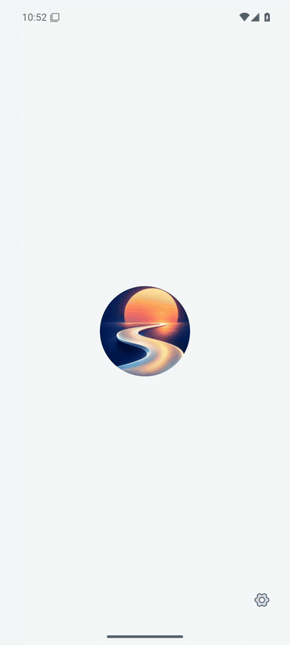
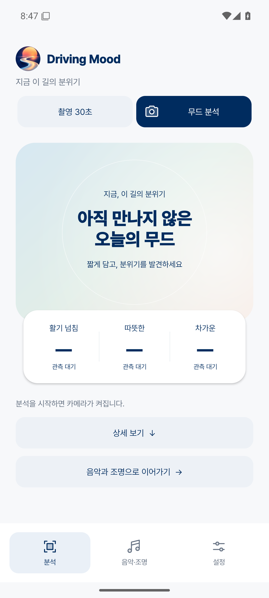
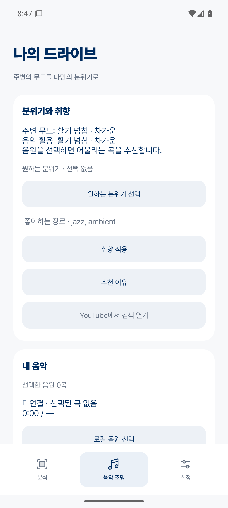
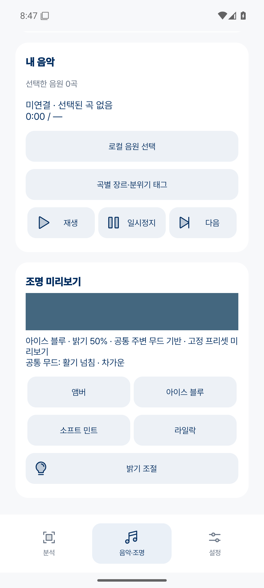
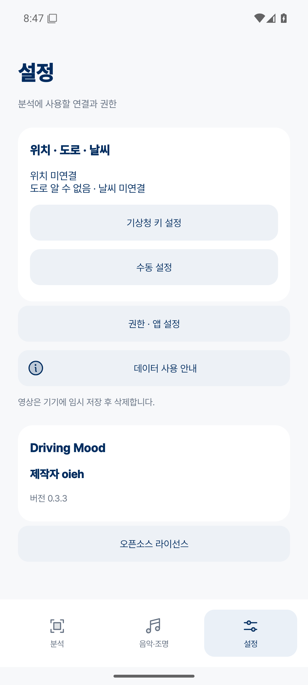
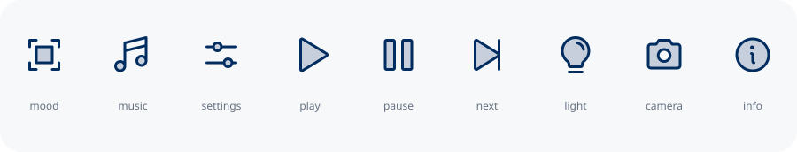

# Driving Mood 앱 화면

Android 15 에뮬레이터에서 실행한 앱 화면이다. 전환 GIF는 0.3.4, 기본 화면 스크린샷은 0.3.3이다. **분석 / 음악·조명 / 설정**으로 화면을 나누고, 홈은 분석 시작과 무드 결과에 집중한다.

## 분석과 무드 결과

0.3.4에서는 촬영 시간에 맞춰 차오르는 원, 분석 중 색과 빛의 움직임, 결과 키워드와 점수의 순차 등장을 추가했다.

앱 전환 미리보기에는 실제 주행 영상의 저장된 계산 결과를 사용했다. 촬영 원은 경과 시간, 분석 문구는 처리한 구간 수에 연결된다. 움직이는 색은 대기 연출이며 결과 색은 계산된 무드에 따라 결정된다.

상단에서 30초·60초 촬영을 선택하고 무드 분석을 시작한다. 촬영 중 경과 시간과 취소 버튼, 분석 중 로딩을 표시한다. 완료 후 대표 키워드와 실제 기여 점수를 보여주며 **상세 보기**에서 근거를 펼친다.

| 분석 전 | 따뜻한 무드 | 도심의 무드 |
|---|---|---|
|  |  |  |

결과 화면에는 실제 주행 영상의 저장된 점수와 키워드를 사용했다. 색감의 하늘색 점수와 시각적 활력의 관측 강도를 구분하며 측정하지 않은 값은 ‘—’로 표시한다.

## 은은하게 흐르는 배경

분석 전에는 블루·민트·살구색이 천천히 흐른다. 완료되면 같은 움직임을 유지하면서 무드에 맞는 색으로 전환한다. 다른 탭이나 앱으로 이동하면 멈추며 기기의 애니메이션 설정을 따른다.

## 음악·조명과 설정

원하는 분위기와 선호 장르, 로컬 음원을 설정한다. 조명 프리셋과 밝기를 미리 볼 수 있고 위치·날씨 연결과 앱 권한은 설정에 모았다.

| 음악과 취향 | 조명 미리보기 | 설정·제작자 |
|---|---|---|
|  |  |  |

## 아이콘

네이비 바탕의 노을과 굽이치는 길을 대표 이미지로 사용한다. 화면 안에는 [Phosphor Icons](https://github.com/phosphor-icons/core)의 듀오톤 아이콘을 적용했다. [출처와 라이선스](assets/brand/phosphor/sources.json)

제작자 **oieh**.

[APK 다운로드](https://github.com/oiehnow/driving-mood/releases/tag/v0.3.4) · [실제 주행 영상 분석](VIDEO_DEMO.md) · [검증 기록](../VALIDATION.md)
