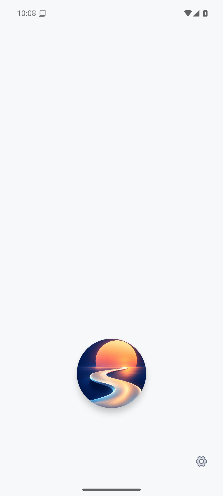
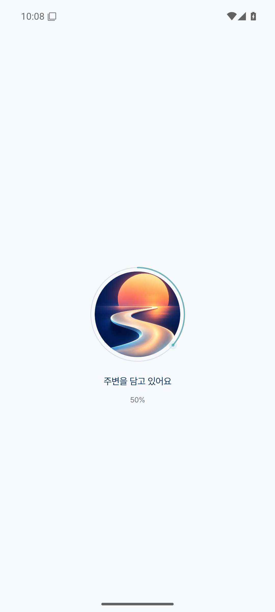
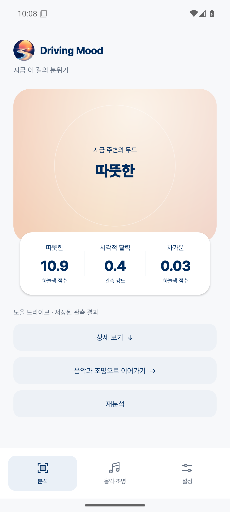

# Driving Mood 앱 화면

Driving Mood **0.3.5**.

## 분석과 무드 결과

로고를 누르면 30초 촬영 후 분석이 이어진다. 결과에서 **상세 보기**로 관측 근거를 확인하고, **재분석**으로 새로 관측한다.

앱 전환 미리보기 · 실제 주행 영상의 저장된 계산 결과 사용.

| 시작 | 관측 | 결과 |
|---|---|---|
|  |  |  |

색감의 하늘색 점수와 시각적 활력의 관측 강도를 구분하며 측정하지 않은 값은 ‘—’로 표시한다.

## 음악·조명과 설정

원하는 분위기와 선호 장르, 로컬 음원을 설정한다. 조명 프리셋과 밝기를 미리 볼 수 있고 위치·날씨 연결과 앱 권한은 설정에 모았다.

| 음악과 취향 | 조명 미리보기 | 설정·제작자 |
|---|---|---|
|  |  |  |

## 아이콘

[Phosphor Icons](https://github.com/phosphor-icons/core) · [출처와 라이선스](assets/brand/phosphor/sources.json)

제작자 **oieh**.

[APK 다운로드](https://github.com/oiehnow/driving-mood/releases/tag/v0.3.5) · [실제 주행 영상 분석](VIDEO_DEMO.md) · [검증 기록](../VALIDATION.md)
