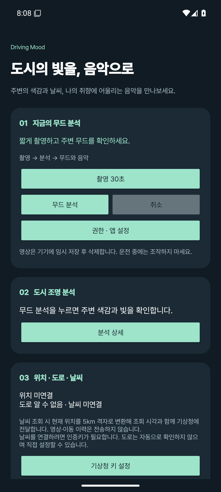
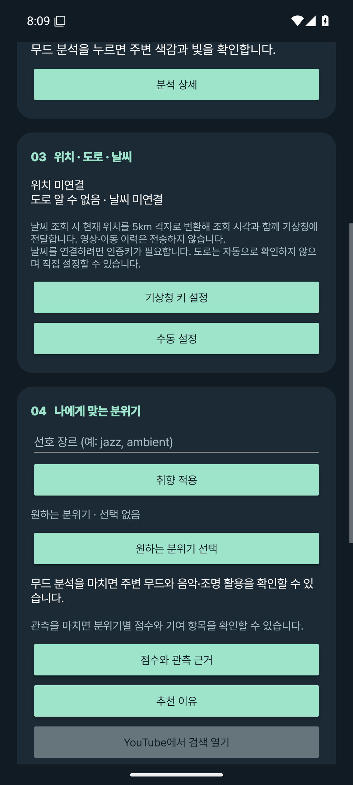
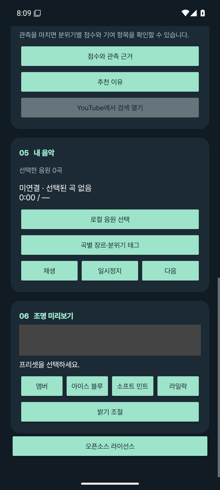

# Driving Mood 앱 화면

0.3.2 APK를 Android 15 에뮬레이터에서 실행한 화면이다. 메인 화면을 위에서 아래로 스크롤하며 촬영·환경 설정·음악·조명 기능을 사용할 수 있다.

## 촬영과 무드 분석

30초 또는 60초를 선택해 촬영을 시작한다. 촬영 후 저장 영상을 분석하고 완료음과 함께 주변 무드와 관측 근거를 표시한다.

## 환경과 원하는 분위기

위치·날씨 연결 상태를 확인하고 선호 장르와 원하는 분위기를 설정한다. 분석을 마치면 점수·관측 근거·추천 이유를 확인할 수 있다.

## 음악과 조명 미리보기

로컬 음원을 등록해 곡별 장르·분위기 태그를 지정하고 재생한다. 조명은 앰버·아이스 블루·소프트 민트·라일락 프리셋과 밝기를 미리 볼 수 있다.

[APK 다운로드](https://github.com/oiehnow/driving-mood/releases/tag/v0.3.2) · [실제 주행 영상 분석](VIDEO_DEMO.md) · [앱 검증 기록](../VALIDATION.md)
