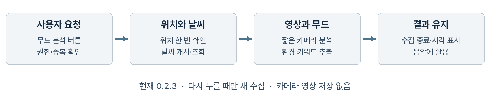
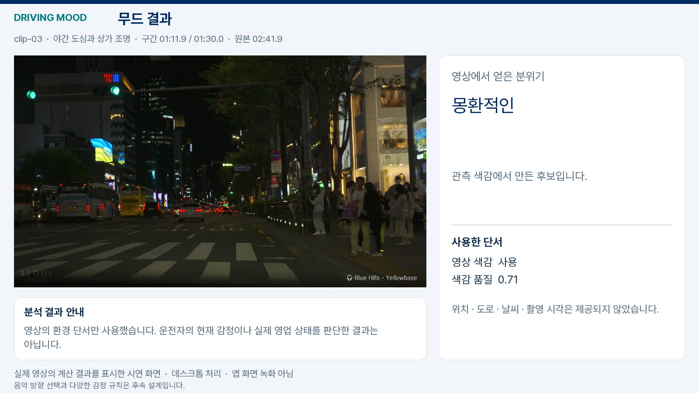

# Driving Mood 무드 분석과 차량 경험 설계

무드 키워드 추출 알고리즘과 Pleos Connect 연동 계획

기준일 2026년 10월 24일 · 현재 앱 0.2.3 · 제품 및 기술 설계

## 1 제품의 핵심과 목표

Driving Mood의 핵심은 주변 환경과 운전자 맥락에서 무드 키워드를 추출하는 공통 분석 엔진이다. 음악, 차량 실내조명, 근처 갈 만한 곳 추천은 이 결과를 사용하는 확장 기능이다. 최종적으로 운전자의 현재 감성 맥락과 원하는 분위기를 이해하고 다양한 차량 경험에 연결하는 앱을 목표로 한다.

당장은 환경 분석에서 키워드를 만들고 간단한 음악 추천으로 확인하는 작은 흐름을 다듬는다. 모든 활용 기능을 동시에 구현하지 않는다. 확장 항목은 공통 키워드의 유용성을 확인한 뒤 하나씩 검토한다.

카메라는 도시의 빛과 공간을 관측한다. 내비게이션은 주행·경로 맥락을 제공하고, 시간·날씨는 장면 해석을 보완한다. 운전자의 선택과 피드백은 같은 풍경을 사람마다 다르게 느끼는 차이를 반영한다. 환경의 분위기, 운전자가 직접 알려준 현재 기분, 앞으로 원하는 분위기를 각각 구분해 다룬다.

| 구분 | 현재 0.2.3 | 최종 개발 방향 |
|---|---|---|
| 공통 분석 | 추천기 내부에서 환경 키워드 생성 | 독립적인 무드 엔진과 공통 출력 계약 |
| 영상 | 차량 검출과 색감·밝기 측정 | 경량 의미 분할과 시간에 따른 안정화 |
| 개인화 | 원하는 분위기·선호 장르·곡 태그 | 현재 기분·수정 피드백과 개인화 학습 |
| 활용 | 로컬 음악 추천과 재생 | 음악·실내조명·주변 장소 추천 등으로 확장 |
| 차량 연결 | 휴대폰에서 동작 | Pleos 내비게이션 입력과 조건부 조명 제어 |

주변이 어둡다고 운전자가 우울하다고 판단하지 않는다. 환경 키워드는 관측에 대한 해석이고, 운전자 감성 추정은 사용자의 확인을 통해 수정할 수 있는 가설이다. 현재 앱에는 운전자 감정 인식 모델이나 차량 조명 제어 기능이 없다.

이 문서는 현재 소스에서 확인한 동작과 앞으로 구현할 설계를 구분한다. Pleos 연동은 공식 문서의 API 존재 여부를 조사한 단계이며, 차량·에뮬레이터에서 검증한 결과가 아니다.

## 2 현재 파이프라인과 알고리즘

앱을 열기만 하면 위치·날씨·카메라를 수집하지 않는다. 사용자가 무드 분석을 누르면 위치와 날씨를 한 번 확인한 뒤 최신 카메라 샘플을 얻는다. 완료·취소·제한 시간 도달 시 수집을 종료하고 결과와 분석 시각을 보관한다. 새 수집은 다음 분석 요청에서만 시작한다.

기상청 초단기실황은 같은 지역의 최근 유효 결과를 재사용한다. 실행 중 중복 요청을 막고, 조회 실패와 한도 초과 시 재시도를 제한한다. 자료는 매시 10분 이후 제공되며 10분마다 갱신될 수 있어 캐시도 갱신 주기를 고려한다.[11] 계정별 일일 허용량은 별도 확인이 필요하며 이 문서에 임의의 횟수를 정하지 않는다.

CameraX 입력은 방향과 비율을 보정해 축소하고 최신 프레임을 우선 처리한다. 분석 도중의 프레임 샘플 간격은 실제 FPS 측정값이 아니다. 결과 표시와 음악 재생은 카메라·GPS의 지속 실행을 요구하지 않는다.

EfficientDet Lite0가 차량 등을 검출하면 차량 상자와 주변 영향 영역을 제외한다. 이어 픽셀의 HSV 색상, 밝기, 국소 대비와 연결 영역을 이용해 빛의 특징을 측정한다. 도로 쪽 영역·반사광·번짐 등을 줄이는 규칙이 있으나, 건물·창문·간판을 픽셀 단위로 구분하는 의미 분할은 아직 아니다.

색감 반영에는 분석 시점 기준 10초 이내 프레임, 차량 제외 처리, 제외 비율 40% 미만, 측정 품질 0.5 이상과 채도 0.2 초과 조건을 적용한다. 실패·미준비·미래 시각 입력은 제외한다. 이는 현재 코드의 사용 기준이며 정확도 확률이 아니다.

고속도로로 지정된 경우 영상 색감의 분위기 반영을 막는다. 유효한 색상각이 65도 미만 또는 330도 초과이면 ‘따뜻한’, 그 외에는 ‘몽환적인’으로 연결한다. 파랑·청록에 해당하는 165도 이상 255도 미만에서는 ‘차가운’을 추가한다. 이는 초기 색감 규칙이며 기온이나 실제 감정의 측정이 아니다.

‘원하는 분위기’에서 차가운·우울·활기 넘침 등 10개 항목을 선택한다. 선택한 목표가 있으면 환경에서 얻은 분위기는 근거에 남기고 추천에는 목표를 우선 반영한다. 우울·활기 넘침을 영상으로 자동 판정하지 않는다. 선택 변경은 완료된 분석으로 추천만 갱신한다.

`가중치 = 1 + 3 × 장르 일치 수 + 2 × 환경 태그 일치 수 + 6 × 선택 목표 일치 수`

후보는 `−ln(U) / 가중치`와 최근 재생 이력으로 정렬한다. 완료된 분석을 음악에 사용하며 재생 중인 곡은 끊지 않는다. 현재 도로는 자동 인식하지 않으며 수동 정보와 미확인 상태를 구분한다.

근거: `VisionMeasurementPolicy`, `SceneInterpreter`, `MoodRecommendationEngine` 및 [검증 기록](../VALIDATION.md). 현재 영상의 의미 신뢰도는 미평가이고 전체 분석 상태는 저신뢰를 유지한다.

## 3 공통 무드 엔진의 목표 구조

현재 추천기에 있는 키워드 생성을 독립적인 MoodEngine으로 옮기는 것이 향후 구조 변경의 시작이다. 입력 제공자는 영상·내비게이션·시간·날씨·사용자 피드백을 표준 형식으로 전달하고, 각 활용 기능은 같은 MoodState를 받는다. 이 구조와 계약은 제안이며 현재 Kotlin API에 구현된 것은 아니다.

| 제안 출력 필드 | 의미와 사용 원칙 |
|---|---|
| environmentKeywords | 따뜻한 색감, 낮은 조도 등 관측에서 얻은 분위기 |
| driverReportedMood | 운전자가 직접 선택한 현재 기분과 입력 시각 |
| desiredMood | 운전자가 원하는 분위기이며 현재 기분과 별개 |
| resolvedKeywords | 입력 품질과 사용자 선택을 반영한 공통 무드 키워드 |
| evidence와 quality | 출처·시각·누락·측정 품질·해석 근거를 함께 전달 |
| status와 validity | 유효·부분 가용·미확인 상태와 결과의 유효 기간 |

최종 키워드는 사용자 선택을 우선하고, 유효한 관측만 보조 근거로 쓴다. 사용자가 ‘차분하게’를 원하면 밝은 상권을 지나도 이를 곧바로 ‘활기차게’로 덮어쓰지 않는다. 실제 감정과 추천 목표를 혼동하지 않도록 화면에서도 ‘현재 기분’과 ‘원하는 분위기’를 분리한다.

운전자 감성은 초기에는 명시적인 선택·좋아요·수정 피드백으로 파악한다. 얼굴·음성·생체 신호 수집은 현재 계획의 필수 전제가 아니다. 피드백 기반 학습을 도입할 때는 저장 범위와 초기화 방법을 먼저 정하고, 개인화 전후의 적합도를 비교한다.

음악 어댑터는 키워드를 곡의 분위기 태그와 연결한다. 조명 어댑터는 사용자 프리셋에 연결하고, 장소 추천 어댑터는 위치와 사용자가 원하는 분위기에 맞는 후보를 제시한다. 장소 데이터의 출처·영업 정보·이동 거리·경로 이탈 정도는 별도로 확인해야 한다. 지원하지 않는 출력은 비활성화하고 무드 분석과 다른 출력은 계속 제공한다.

## 4 영상 모델과 맥락 결합 전략

모든 해석을 하나의 파운데이션 모델에 맡기지 않는다. 경량 영상 모델은 차량·도로·건물 같은 영역을 구분하고, 색감·광량 계산은 해당 마스크 안에서 수행한다. 내비게이션과 날씨는 별도 입력으로 결합하며 최종 무드 정책은 설명 가능한 규칙부터 시작한다.

| 모델 또는 방법 | 맡길 역할 | 검토 상태 |
|---|---|---|
| EfficientDet Lite0와 픽셀 규칙 | 현재 차량 제외와 색감 측정 | 0.2.3에 포함 |
| YOLO26n sem Cityscapes | 차량·도로·건물 구획 | 데스크톱 예비 비교 |
| YOLO26n sem ADE20K | 창문·간판 등을 포함한 장면 분할 | 데스크톱 예비 비교 |
| YOLOE26n 및 s | 지정 개념의 영역 후보 검출 | 데스크톱 예비 비교 |
| 대형 모델 | 필요시 오프라인 표본 검토·주석 보조 | 런타임의 필수 구성 아님 |

공식 문서는 YOLO26의 Cityscapes와 ADE20K 의미 분할 모델을 제공한다.[6] 실제 주행 영상 6개·4,757프레임에 ADE20K 분할과 기존 Kotlin 색감 규칙을 연결했다. 차량 실내·반사광 오분할과 도로 표지판 혼동이 확인됐고, 색감 사용 조건은 2프레임만 통과했다. 이는 데스크톱 실험이며 현재 APK의 실행 결과가 아니다. 정답 마스크가 없어 정확도를 확정할 수 없다. [실제 주행 결과](DRIVING_DEMO.md)에 원본과 분할·계산 화면을 함께 제시했다.

작은 가중치 파일이 작은 실행 메모리를 보장하지도 않는다. ADE20K의 640 × 640 × 150 FP32 점수 텐서는 출력만 약 234.4 MiB이다. 실제 런타임에서 후처리 결합·해상도 축소·양자화가 메모리와 정확도에 미치는 영향을 함께 확인해야 한다. 데스크톱 ONNX 실행은 확인했으나 Android 모델 전환과 지속 성능 검증은 남아 있다.

최종 채택 기준은 야간·비·터널·고속도로에서의 오류, 대상 단말 지연·최대 메모리·발열, 변환 가능성, 코드와 가중치의 사용 조건이다. Ultralytics 후보의 AGPL 또는 상용 조건과 추가 인코더 조건은 도입 전에 확인한다. 현재 앱의 모델을 교체했다는 뜻은 아니다.

내비게이션 정보도 출처와 의미를 확인한다. 경로 옵션의 HIGHWAY를 현재 고속도로 주행으로 해석하거나, 차량 진행 방향을 카메라 시선 방향으로 대체하지 않는다. 확인되지 않은 도로 종류는 미확인으로 남긴다.

## 5 Pleos Connect 연동 가능성과 조건

Pleos Connect는 Android Automotive 기반 차량 인포테인먼트 플랫폼이다.[1] 공식 NaviHelper와 Vehicle SDK에 필요한 연결 경로가 있으므로 목표 구조와 맞는다. 다만 문서상의 API 존재, 프로젝트에 허용된 권한, 대상 차량의 실제 지원은 각각 확인해야 한다.

| 연결 항목 | 공식 문서에서 확인한 내용 | Driving Mood 적용 판단 |
|---|---|---|
| 내비게이션 | 현재 위치·경로 상태·TBT 등 이벤트 제공 [2] | 입력 어댑터 개발 가능성 확인 |
| 도로 의미 | 경로·안내 정보와 현재 도로 분류는 다름 | 필드 의미 확인 전 자동 분류 주장 불가 |
| 실내조명 | Light 도메인에 앰비언트 색상·밝기 제어 경로 [3] | 조건부 제어 대상으로 설계 |
| 제어 사용 권한 | 사용 신청 안내는 Vehicle Control을 준비 중으로 표시 [4] | 프로젝트 접근 상태를 별도 확인 |
| 차종별 지원 | checkXXXCapabilities로 가용성 확인 [5] | 지원 범위·값·실패 처리를 동적으로 확인 |
| 차량 카메라 | 본 조사에서 외부 앱용 원본 영상 경로 미확인 [7] | 기존 차량 카메라 사용을 전제하지 않음 |

Light API 목록에는 `setAmbientLightBrightnessColor`, `setAmbientLightBrightness`와 관련 capability 메서드가 있다. Virtual Console에도 앰비언트 색상·밝기 상태를 바꾸는 항목이 있다.[3][8] 그러나 콘솔에서 상태를 설정할 수 있다는 사실은 외부 앱의 실차 제어 권한을 보장하지 않는다.

조명 어댑터는 기능 지원과 사용 권한을 확인한 뒤 현재 상태 조회, 제어 요청, 성공·실패 및 실제 상태 확인 순서로 구성한다. 색상 표현과 값 범위는 SDK 계약에서 확인하고 임의 RGB 지원을 가정하지 않는다. 미지원·권한 거부 시 조명 프리셋 미리보기로 대체한다. 변경을 허용한 경우에도 사용자의 수동 조작을 우선한다.

내비게이션 연결은 공식 샘플을 참고하되 필요한 부분만 도입한다.[9] 내비게이션 앱과 서비스가 갖춰진 시험 환경에서 이벤트 의미·누락·재연결을 검증한다. 휴대폰 APK를 그대로 설치하면 모든 차량 기능이 작동한다고 설명하지 않는다. 적용 대상은 기능이 지원되는 Pleos Connect 차량이며 현대의 모든 기존 차량이 아니다.

## 6 입력에서 차량 경험까지의 동작 설계

다음은 구현할 처리 순서다. 구체적인 가중치와 전환 시간은 고정된 성능 수치가 아니라 검증으로 조정할 설계 변수다.

1. 입력마다 관측 시각과 수신 시각, 출처와 가용 상태를 기록한다. 없는 측정 시각을 수신 시각으로 가장하지 않는다.
2. 프레임 품질과 영역 마스크를 검사하고 차량광·반사광의 영향이 큰 장면은 색감 기여를 낮추거나 제외한다.
3. 환경 키워드 후보를 만들고 내비게이션·날씨와 대조한다. 근거가 충돌하면 미확인 또는 제한된 결과를 반환한다.
4. 운전자가 선택한 현재 기분과 원하는 분위기를 별도로 반영한다. 명시적 원하는 분위기를 자동 환경 추정보다 우선한다.
5. 여러 관측의 지속성과 유효 기간을 검사해 키워드를 안정화한다. 최소 유지 시간과 변경 조건을 두어 화면·곡·조명이 짧게 반복 전환되는 일을 줄인다.
6. 같은 MoodState를 음악과 조명에 전달한다. 음악은 다음 곡에 반영하고, 조명은 허용된 범위에서 점진적으로 바꾼다. 사용자 취소·수동 변경 시 자동 출력을 멈춘다.

| 예시 상황 | 공통 무드 해석 | 출력 예시 |
|---|---|---|
| 따뜻한 도시 조명과 차분함 선호 | 따뜻한 색감과 차분한 목표를 함께 유지 | 잔잔한 곡 후보와 낮은 밝기의 선호색 |
| 비 오는 고속도로 | 차량광 기여 제한과 원하는 분위기 우선 | 안정적인 곡 후보와 유지되는 조명 |
| 밝은 상권이지만 휴식을 선택 | 밝은 환경과 휴식 목표를 분리 | 환경 변화로 목표 분위기를 덮어쓰지 않음 |
| 카메라 또는 내비게이션 중단 | 남아 있는 유효 입력으로 부분 가용 | 사용자 프리셋 유지와 출처 안내 |

색과 감정의 대응은 보편적 사실로 고정하지 않고 사용자 프리셋으로 시작한다. 기분 파악은 의료적 진단이나 졸음·위험 운전 판단을 의미하지 않는다. 조명 범위는 실내 앰비언트 조명이며 전조등·제동등 같은 안전 관련 외부등을 무드 출력으로 제어하지 않는다.

주행 중 화면은 짧은 키워드와 간단한 조작을 중심으로 구성하고 CarUxRestrictions 및 지역·앱 카테고리 조건을 반영한다.[10] 복잡한 분할 영상은 정차 시연·검증 화면에 두며, 내비게이션 안내의 오디오 우선순위를 존중한다.

## 7 단계별 개발 계획

완료 여부는 기능 이름이나 일정 추정으로 판단하지 않고 다음 단계에 필요한 증거로 판단한다. 현재 0.2.3은 입력에서 음악 추천까지 연결한 출발점이며 최종 제품의 완성을 뜻하지 않는다.

| 단계 | 작업과 산출물 | 다음 단계 진입 기준 |
|---|---|---|
| 1 공통 무드 계약 | MoodState와 입력·출력 인터페이스 확정 | 현재 음악 동작 보존과 출처·누락 처리 검사 |
| 2 영상 분석 개선 | 경량 모델 비교와 장면별 품질 규칙 | 정답 표본 평가와 대상 단말 지속 실행 |
| 3 감성 피드백 | 현재 기분·수정 기능과 선택 이력 활용 | 사용자 의도 우선과 초기화 동작 확인 |
| 4 내비게이션 연동 | Pleos 입력 어댑터와 에뮬레이터 시나리오 | 실제 필드 의미·연결 중단·복구 검증 |
| 5 실내조명 연동 | 프리셋·기능 검사·제어·수동 해제 | 사용 권한과 대상 차량 상태 확인 |
| 6 통합 검증 | 동일 무드의 음악·조명 적용과 시연 | 오해석·전환 안정성·사용자 적합도 평가 |

지금 할 일은 기존 무드 키워드와 판단 근거를 이해하기 쉽게 정리하고, 입력 누락·수동 입력을 명확히 표시하며, 음악 추천까지의 흐름을 실제 기기에서 확인하는 것이다. 아래 확장 설계를 위해 조명·장소 기능을 즉시 구현하거나 SDK를 일괄 도입하지 않는다.

공통 엔진은 플랫폼 입력과 출력으로부터 분리한다. 입력 제공자가 같은 품질·시각·출처 규칙을 만족하도록 하고, 음악이 없어도 키워드를 확인할 수 있게 한다. 근처 갈 만한 곳 추천은 후속 후보이며 장소 검색 데이터와 사용자 선택을 거쳐 경로 안내로 넘긴다. NaviHelper 화면 열기를 주변 장소 목록 데이터 제공으로 해석하지 않는다.

내비게이션·조명 통합에는 SDK 버전, 프로젝트 접근 상태, 차량 capability와 실제 시험 장비가 필요하다. 권한이나 카메라 입력 경로가 확보되지 않으면 해당 부분을 미연동으로 명시하고 휴대폰 입력 및 조명 미리보기로 기능 경계를 검증한다. 이를 실차 통합 완료로 제시하지 않는다.

새 기능은 공식 예제와 유지보수되는 라이브러리를 먼저 검토한다. 외부 코드·모델을 도입할 때 필요한 사용 범위와 출처·라이선스를 기록하고 기존 저작권 고지를 보존한다. 샘플 저장소의 존재만으로 복제·재배포 조건이 해결됐다고 보지 않는다.

시연 영상은 모델과 출력 계약이 정해진 후 만든다. 모든 영상 파일에서 대표 구간 90초를 선택하고, 같은 구간을 세 가지로 제공한다. 원본은 구간 추출 외 자막·분석 표시를 넣지 않는다. 앱 분석 화면에는 실제 세그멘테이션 분류와 무드 계산 과정을 표시한다. 사용자 화면에는 계산된 무드 결과를 보여준다. 세 출력의 시각을 동기화하며, 90초보다 짧은 파일은 실제 길이를 사용한다. GitHub용 GIF는 별도 짧은 요약본으로 만든다.

## 8 시행착오와 개선 근거

평가 자료는 새 결과로 덮어쓰거나 삭제하지 않고 비교 기준으로 남긴다. 초기 정지사진 평가, 분할 모델 예비 비교, 실제 주행 영상 실험을 구분한다. 원본 사진의 출처·라이선스와 모델 출력, 설정·측정값을 함께 유지한다.

| 시험 단계 | 확인한 한계 | 다음 비교의 기준 |
|---|---|---|
| 차량 검출과 색감 측정 | 차량 제외만으로 건물·창문·간판을 분리할 수 없음 | 의미 분할과 관측 영역 연결 |
| 범용·도로 분할 예비 비교 | 필요한 클래스 범위와 도로 장면 적합성이 다름 | 같은 입력에서 차량·도로·창문·표지판 비교 |
| 실제 주행 6개·4,757프레임 | 실내·반사광 혼동과 낮은 색감 사용률 | 오류 원인과 측정 조건을 나누어 검증 |

실제 계산 연결에서 색감 조건을 통과한 예시는 아래와 같다. 야간 도심 원본 161.928초 프레임에서 색감 품질 0.714와 유효 조건을 확인해 ‘몽환적인’ 후보가 나왔다. 이는 픽셀 색감 규칙의 결과이며 운전자의 감정을 확인한 것은 아니다.

전체 실행에서 이 조건을 통과한 프레임은 2개였다. 모델 개선 전후의 성공률 향상은 아직 측정하지 않았다. 이후 비교에서 같은 원본 시각의 개선 전후, 성공한 장면의 범위와 반복성을 확인해 본문 사례를 확장한다. 대표 오류는 [4개 장면으로 제한한 검토 자료](TRIALS.md)에 모았으며, 전체 결과는 별도 검증 자료에 보존한다.

## 9 검증 계획과 기대 효과

현재 버전의 빌드·자동 검사·Lint·서명·정렬 결과는 [검증 기록](../VALIDATION.md)에 정리한다. 실제 휴대폰의 카메라·네이티브 추론·GPS·날씨 수신·음악 청취와 Pleos 차량 연결은 별도 검증이 필요하다. 자동 검사 통과는 야간 인식 정확도나 운전자 감성 파악 능력의 증명이 아니다.

| 검증 대상 | 확인할 지표와 방법 |
|---|---|
| 영상 분할 | 차량·도로·건물·창문·간판의 클래스별 IoU와 누락 사례 |
| 차량광 억제 | 고속도로·정체·젖은 노면에서 잘못 포함된 빛의 비율 |
| 시간 안정성 | 같은 장면에서 키워드가 불필요하게 바뀌는 횟수 |
| 단말 성능 | 전체 처리 지연 p50·p95, 최대 메모리, 발열과 지속 동작 |
| 감성 적합도 | 사용자 자기보고와 제안 키워드의 일치·수정·수락 비율 |
| 공동 출력 | 음악·조명의 무드 일관성, 수동 해제와 실패 복구 |
| 요청형 동작 | 대기 중 요청 0회, 캐시 재사용, 중복 탭·취소·시간 초과 후 수집 종료 |

환경만 사용하는 방식, 환경에 내비게이션을 더한 방식, 사용자 피드백까지 더한 방식을 같은 조건에서 비교한다. 그래야 어느 입력이 효과를 냈는지 구분할 수 있다. 표본은 도심·주거지·고속도로·터널, 야간·비·역광을 포함하고 촬영 원본 단위로 개발·평가 자료를 나누어 비슷한 프레임이 양쪽에 섞이는 일을 피한다.

기대 효과는 공통 키워드를 통해 음악과 조명이 서로 다른 분위기로 바뀌는 일을 줄이고, 운전자가 원하는 환경을 적은 조작으로 유지하도록 돕는 것이다. 개인화 효과는 수락·수정 비율과 직접 선택 대비 만족도로 평가한다. 현재 자료만으로 만족도 향상, 스트레스 감소, 사고 예방 또는 특정 정확도 수치를 주장하지 않는다.

피드백 수집은 정차 상태에서 간단히 진행하고 주행 중 반복 응답을 요구하지 않는다. 사용자가 선택한 기분은 기준이 되는 자기보고이며 심리 상태의 객관적 진단값이 아니다. 샘플 영상에 실제 운전자 피드백이 없으면 그 결과를 운전자 감정 분석 성공 사례로 표시하지 않는다.

## 10 근거 자료와 확인 범위

공식 웹 문서 확인일은 2026년 10월 24일이다. 아래 자료는 API와 설계 제약을 확인하기 위한 근거이며 실차 시험 결과를 대체하지 않는다. SDK 안내와 사용 신청 상태가 다를 경우 프로젝트 접근 상태와 대상 차량에서 재확인한다.

1. [Pleos Connect 플랫폼](https://document.pleos.ai/en/docs/connect/guide/connect) — Android Automotive 기반과 차량 앱 환경.
2. [NaviHelper 이벤트](https://document.pleos.ai/docs/pleos-only/connect-sdk-pleos/NaviHelper/event-listeners) — 위치·경로·안내 이벤트와 구현별 차이.
3. [Vehicle SDK 개요](https://document.pleos.ai/en/docs/pleos-only/connect-sdk-pleos/Vehicle/intro) 및 [Light API](https://document.pleos.ai/en/api-reference/connect-sdk-pleos/Vehicle/vehicle/ai.pleos.playground.vehicle.api/light/entry) — 앰비언트 제어와 비동기 결과 처리.
4. [프로젝트 생성과 SDK 사용 신청](https://document.pleos.ai/docs/pleos-only/create-my-project) — Vehicle Control 준비 중과 State·NaviHelper 사용 가능 안내.
5. [API 호환성과 가용성](https://document.pleos.ai/docs/pleos-only/vehicle-app-planning-guide/api-compatibility-availability) — 차량별 지원과 capability 검사.
6. [Ultralytics 의미 분할](https://docs.ultralytics.com/tasks/semantic/) — YOLO26 의미 분할 모델과 데이터셋.
7. [하드웨어 접근 정책](https://document.pleos.ai/docs/pleos-only/vehicle-app-planning-guide/platform-api-architecture) — 플랫폼 SDK를 통한 접근과 하드웨어 제약.
8. [Virtual Console 사용 가이드](https://document.pleos.ai/docs/pleos-only/app-test-guide/virtual-console-guide) — 앰비언트 밝기·색상 상태 에뮬레이션.
9. [Pleos 공식 내비게이션 샘플](https://github.com/Pleos-Playground/pleos-sample-navi-app) — 연동 구조 참고. 코드 도입 전 라이선스 범위 확인 필요.
10. [주행 안전 설계](https://document.pleos.ai/docs/pleos-only/vehicle-app-planning-guide/driver-distraction-guideline) — 화면 제약과 운전 중 상호작용 기준.
11. [기상청 단기예보 조회서비스](https://www.data.go.kr/data/15084084/openapi.do) — 초단기실황 사용과 2026년 10월 19일 활용 가이드. 발급 경로에 따라 엔드포인트와 인증 매개변수를 구분한다.

영상 분석의 기준선은 저장소의 분석 계약·영상 분석 문서와 실제 구현이다. 0.2.3에는 요청형 1회 수집, 차가운 색감 키워드와 원하는 분위기 선택을 추가했다. 빌드·검사 결과는 검증 문서를 따른다. 실제 주행 분할은 데스크톱 개발 실험이며 야간 정답 데이터 평가와 휴대폰 검증이 남아 있다. 보고서의 독립 MoodEngine, MoodState와 조명 어댑터는 목표 설계이며 현재 APK의 기능 목록이 아니다.
