# Driving Mood 무드 분석과 차량 경험 설계

무드 키워드 추출 알고리즘과 Pleos Connect 연동 계획

기준일 2026년 10월 24일 · Android 휴대폰 프로토타입과 차량 연동 설계

## 1 제품의 핵심과 목표

Driving Mood의 핵심은 주변 풍경과 주행 상황을 분석해 무드 키워드를 만드는 것이다. 음악 추천은 이 결과에 사용자의 취향과 원하는 분위기를 반영한다. 같은 분석 결과를 차량 실내조명과 근처 갈 만한 곳 추천에도 활용해, 운전자가 원하는 분위기를 쉽게 선택하는 앱을 목표로 한다.

휴대폰 프로토타입은 로고 선택 후 30초 촬영, 저장 영상 분석, 완료음, 무드 결과, 음악 추천·조명 미리보기를 하나의 흐름으로 연결한다.

카메라로 주변의 빛과 공간을 살피고, 내비게이션의 위치·경로 정보와 시간·날씨를 함께 참고한다. 같은 풍경을 보더라도 사람마다 느끼는 기분과 듣고 싶은 음악은 다르므로 사용자의 선택과 피드백을 반영한다. 주변의 분위기, 사용자가 직접 알려준 현재 기분, 앞으로 원하는 분위기는 구분해 다룬다.

| 구분 | 현재 프로토타입 | 최종 개발 방향 |
|---|---|---|
| 공통 분석 | 공용 점수기와 요소별 기여 원장 | 규칙 검증과 개인화 |
| 영상 | 30초 녹화·프레임 분석과 관측 누적 | 장소별 조명 구별과 경량 모델 최적화 |
| 개인화 | 원하는 분위기·선호 장르·곡 태그 | 현재 기분·수정 피드백과 개인화 학습 |
| 활용 | 로컬 음악 추천·재생과 조명 미리보기 | 음악·실내조명·주변 장소 추천 등으로 확장 |
| 차량 연결 | 휴대폰 분석·Pleos 별도 UI 실행 | Pleos 내비게이션 입력과 조건부 조명 제어 |

## 2 현재 파이프라인과 알고리즘

로고를 누르면 30초 영상을 녹화하며 위치·날씨를 병행 확인한다. 저장 후 실제 영상 시각을 기준으로 1초마다 대표 프레임을 분석한다. 결과 확정 후 완료음을 내고 음악·조명 미리보기에 연결한다. 임시영상은 분석·취소 후 삭제한다.

의미분할과 객체 검출로 차량 영역을 제외하고 조명·사람·하늘의 근거를 측정한다. 관측 강도와 품질은 분리하며, 실제 픽셀량으로 영역별 기여를 배분한다.

| 계산 항목 | 프레임별 규칙 |
|---|---|
| 따뜻한 색감 강도 | 70 × 빨강·노랑 픽셀의 채도 합 ÷ 전체 픽셀 수 |
| 차가운 색감 강도 | 70 × 청록·파랑 픽셀의 채도 합 ÷ 전체 픽셀 수 |
| 밝은 면적 강도 | 35 × 중복 없는 관측 픽셀 수 ÷ 전체 픽셀 수 |
| 사람 기여 | 55 × min(검출 수 ÷ 5, 1) × 측정 품질 |
| 하늘색 강도 | 70 × 하늘 색상군의 채도 합 ÷ 전체 픽셀 수 |

조명 색감은 화면 점유율 0.1% 이상에서 색상군의 비중을 해석한다. 활력은 밝은 면적 2% 이상과 2×2 구역 중 두 구역 이상의 분포를 사용한다. 하늘색은 면적 2%·평균 인코딩 밝기 0.10·평균 채도 0.05 이상일 때 해석한다.

한 색상군의 채도 비중 60% 이상은 따뜻한·차가운 후보, 두 색상군이 각각 20% 이상·합계 60% 이상이면 혼재 후보다. 하늘색 혼재는 ‘다채로운’으로 표현한다. 각 조건이 전체 관측 창의 절반 이상 지속되어야 키워드로 채택하며 누락 구간도 분모에 포함한다.

공통 주변 무드를 한 번 계산해 화면·음악·조명 미리보기에 전달한다. 음악 취향은 이후 활용 단계에서 반영한다. 빛의 관측 강도와 하늘·사람·날씨 점수는 별도 근거로 남긴다.

[세부 점수 식과 영역 배분](MOOD_SCORING.md) · [하늘색 계산과 Android 검증](../vision/SKY_COLOR.md)

## 3 공통 무드 엔진의 목표 구조

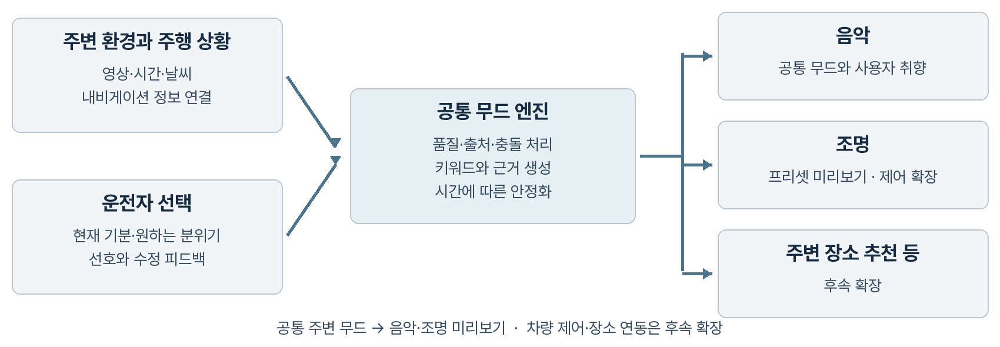

공통 계산 경로는 순수 Kotlin 점수기와 관측 창을 분리해 앱과 데스크톱이 같은 규칙을 호출한다. 입력 제공자는 시간·날씨·영상 관측을 전달하고 음악과 조명 미리보기가 같은 결과를 활용한다. 아래의 확장 MoodState와 차량 출력 구조는 목표 설계다.

| 제안 출력 필드 | 의미와 사용 원칙 |
|---|---|
| environmentKeywords | 따뜻한 색감, 낮은 조도 등 관측에서 얻은 분위기 |
| driverReportedMood | 운전자가 직접 선택한 현재 기분과 입력 시각 |
| desiredMood | 운전자가 원하는 분위기이며 현재 기분과 별개 |
| resolvedKeywords | 입력 품질과 사용자 선택을 반영한 공통 무드 키워드 |
| evidence와 quality | 출처·시각·누락·측정 품질·해석 근거를 함께 전달 |
| status와 validity | 유효·부분 가용·미확인 상태와 결과의 유효 기간 |

환경 관측은 보존하고 음악 활용 단계에서 사용자가 원하는 분위기를 우선한다. 예를 들어 밝은 상권에서도 ‘차분하게’라는 목표를 유지할 수 있다.

개인화는 현재 기분·좋아요·수정 피드백에서 시작한다. 선택 이력의 저장과 초기화 기능을 제공하고 개인화 전후의 추천 적합도를 비교한다.

음악 어댑터는 키워드를 곡 태그에, 조명 어댑터는 프리셋에 연결한다. 장소 추천은 원하는 분위기와 위치·이동 거리·경로 이탈 정도를 함께 사용한다.

‘원하는 분위기’는 환경 결과와 별개로 음악에 우선 반영한다. 곡의 가중치는 장르 일치에 3, 환경 태그 일치에 2, 선택 목표 일치에 6을 기본값 1에 더한다. 최근 곡의 반복을 줄이고 가중 무작위로 후보를 정한다. 선택 변경은 완료된 관측으로 추천만 갱신한다.

## 4 영상 모델과 주변 정보의 결합

경량 모델로 차량·도로·건물 영역을 구분하고 해당 영역의 빛과 색을 측정한다. 내비게이션·날씨를 별도 입력으로 결합해 설명 가능한 규칙으로 무드를 해석한다.

| 모델 또는 방법 | 맡길 역할 | 검토 상태 |
|---|---|---|
| YOLO26n 객체 검출과 픽셀 규칙 | 사람 관측·차량 제외·색감 측정 | 0.3.9에 적용, 이전 EfficientDet-Lite0와 비교 |
| YOLO26n sem Cityscapes | 차량·도로·건물 구획 | 데스크톱 예비 비교 |
| YOLO26n sem ADE20K 복합 F2 | 기존 보호 영역·고해상도 하늘·추가 학습한 구조 판단 결합 | 0.3.9에 적용, 창문 개선은 미확인 |
| YOLOE26n 및 s | 지정 개념의 영역 후보 검출 | 데스크톱 예비 비교 |
| 대형 모델 | 필요시 오프라인 표본 검토·주석 보조 | 런타임의 필수 구성 아님 |

YOLO26의 Cityscapes·ADE20K 의미분할을 비교했다.[6] 실제 차량 주행 영상의 프레임에서 차량 실내·반사광 오분할, 도로 표지판 혼동과 색감 채택률 문제를 확인했다. [주행 실험 자료](DRIVING_DEMO.md)에 원본·분할·계산 결과를 보존했다.

ADE20K 모델은 건물·창문·간판·사람·차량을 함께 제공한다. 창문과 상점 간판의 별도 클래스가 없는 Cityscapes보다 도시 조명의 위치를 찾는 목적에 맞아 선택했다. nano 크기는 기존 장면 비교와 모바일 변환 경로를 기준으로 채택했다. 큰 모델에서도 반사·차량 내부 등의 오류가 남아, 같은 구조의 주행 장면 추가 학습을 먼저 검증했다.

0.3.1은 320 입력과 150종 uint8 클래스맵 출력을 사용하며 색과 면적은 원본 RGB에서 측정한다. 모델 채택 기준은 야간·비·터널·고속도로의 오류, 단말 지연·최대 메모리·발열과 변환 가능성이다. 내부 중간 텐서도 메모리를 사용하므로 파일 크기만으로 실행 비용을 판단하지 않는다. 앱 소스와 모델 고지는 AGPL-3.0 조건으로 공개하며 원본 가중치와 변환 소스를 함께 제공한다.

### 실제 파인튜닝과 평가

원본 영상 단위로 학습·검증·시험 자료를 분리하고, 실제 RGB를 검토한 AI 보조 부분 주석으로 추가 학습했다. 명확한 영역만 표시하고 불확실한 픽셀은 학습에서 제외했다. Ultralytics 공식 학습기로 30회 반복·180회 가중치 갱신을 수행했으며 검증 집합에서 2회차 모델을 선택했다. 초기 대비 104개 가중치·통계 텐서가 바뀌었고 실행 설정·기록·파일 해시를 보존했다.

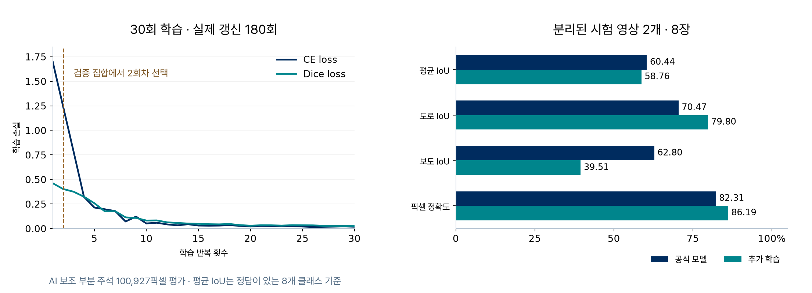

별도로 분리한 시험 영상에서는 도로 IoU가 70.47%→79.80%로 높아졌지만 보도는 62.80%→39.51%로 낮아졌다. 정답이 있는 8개 클래스 평균 IoU도 60.44%→58.76%로 내려가 기본 모델은 공식 가중치를 유지했다. 부분 주석 표본의 결과이며, 이 오류를 줄일 수 있는지 차량 주행 영상과 이미지 자료를 보강한 2차 실험에서 확인했다. [학습 과정과 평가 원장](../vision/FINETUNING.md)에 전후 수치와 실제 학습 증거를 정리했다.

### 2차 파인튜닝과 모델 유지 결정

실제 차량 주행 영상과 이미지 자료들을 바탕으로 장면 다양성을 보강했다. 학습·개발 검증 자료를 분리하고 AI 보조 부분 다각형 주석을 작성했다. 기존 설정으로 30에폭·360회 업데이트를 수행하고 개발 검증에서 5에폭 체크포인트를 선택했다. 초기와 비교해 104개 가중치·통계 텐서의 변화를 확인했다.

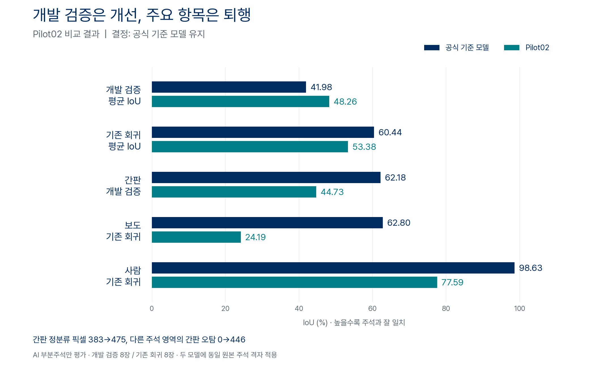

개발 검증 평균 IoU는 41.98%→48.26%로 높아졌지만 기존 회귀 자료의 평균은 60.44%→53.38%로 낮아졌다. 간판 정분류는 383→475픽셀로 늘었으나 다른 주석 영역의 간판 오탐도 0→446픽셀로 늘었다. 간판 오탐과 보도·사람 퇴행을 고려해 공식 기준 모델을 유지했다.

두 모델은 같은 RGB와 원본 주석 격자에서 비교했다. 수치는 AI 부분주석의 개발 검증·기존 회귀 결과이며 새 독립 시험은 아니다. 두 차례의 학습 설정·실행·평가 자료는 보존했고 [2차 검증 기록](../vision/finetuning02/README.md)에 수치와 해시를 제공한다.

### 후속 개선 실험과 복합 구성 선택

두 차례의 실패 뒤에도 추가 학습을 이어갔다. 학습률 축소(A), 정규화 이동 통계 고정(B), 초기 가중치를 보존하는 L2-SP 규제 추가(C)를 순서대로 비교했다. 각 후보는 공식 가중치에서 새로 시작했으며 한 번에 바꾼 조건을 구분했다. C의 규제 강도는 학습 자료만 사용한 예비 실행에서 정하고, 그 가중치를 버린 뒤 본 학습을 시작했다.

| 후보 | 기대한 효과 | 주행 영상 회귀 평균 IoU | 혼합 개발 평균 IoU | 실제 결과와 판단 |
|---|---|---:|---:|---|
| 공식 n320 | 기존 성능 비교 기준 | 60.44% | 41.98% | 기준 유지 |
| A · 학습률 축소 | 기존 판단의 큰 변화 억제 | 56.31% | 38.54% | 평균 하락, 비채택 |
| B · A+정규화 통계 고정 | 작은 배치의 통계 변화 억제 | 60.69% | 46.67% | 간판 오탐·사람/차량 퇴행 |
| C · B+초기 가중치 보존 | 추가 학습과 기존 능력 보존 | 61.59% | 43.61% | 개발 차량 IoU 2.51%p 하락, 전면 교체 보류 |
| n640 | 작은 영역의 정보 보존 | 59.62% | 54.42% | 하늘·간판 개선, 사람·보도 퇴행 |
| s640 | 모델 용량 확대 | 61.35% | 50.72% | 영상 사람·간판 개선, 보도·간판 정밀도 퇴행 |
| 복합 F1 | 기존 보호 영역+n640의 하늘·구조 | 66.15% | 43.64% | 평균은 높지만 간판 오탐 제한 미통과 |
| 복합 F2 | 기존 보호 영역+n640 하늘+C 구조 | 60.57% | 45.27% | 사전 개발 기준·후속 보조 평가 통과 |

표의 정답 지원 평균 IoU는 같은 원본 주석 격자에서 계산했다. 학습기 내부 검증 점수와 섞지 않았다. 혼합 개발에는 주행 영상과 이미지 자료가 함께 포함되며, 주행 영상 회귀와 합쳐 하나의 성공 수치로 제시하지 않는다. 실패한 후보의 가중치·학습 설정·실행 기록·클래스별 결과도 보존했다.

평균만 보면 F1이 가장 좋아 보이지만 간판 오탐 때문에 탈락했다. B 역시 혼합 개발의 간판 재현율이 62.18%에서 99.03%로 높아지는 동안 정밀도가 100%에서 18.72%로 낮아졌다. 더 많이 찾았다는 사실만으로 더 정확해졌다고 판단하지 않은 이유다. C는 같은 개발 범위의 간판 IoU를 93.18%까지 높였지만 별도 주행 영상 회귀의 간판은 여전히 0%였다.

이 차이에서 사람·차량, 하늘, 광원 주변 구조를 역할별로 처리하는 복합 구성을 도출했다. 기존 앱도 객체 검출과 장면 분할을 함께 사용한다. 후속 F2는 기존 장면 분할이 찾은 사람·차량·도로·보도·교통시설을 먼저 보존하고, 남은 영역에서 고해상도 하늘과 추가 학습한 건물·창문·간판 판단을 합친다. 같은 픽셀을 두 번 계산하지 않고, 하늘색 측정에도 실제 평가한 합성 마스크를 사용한다. 결합 규칙은 후속 비교 전에 고정했다.

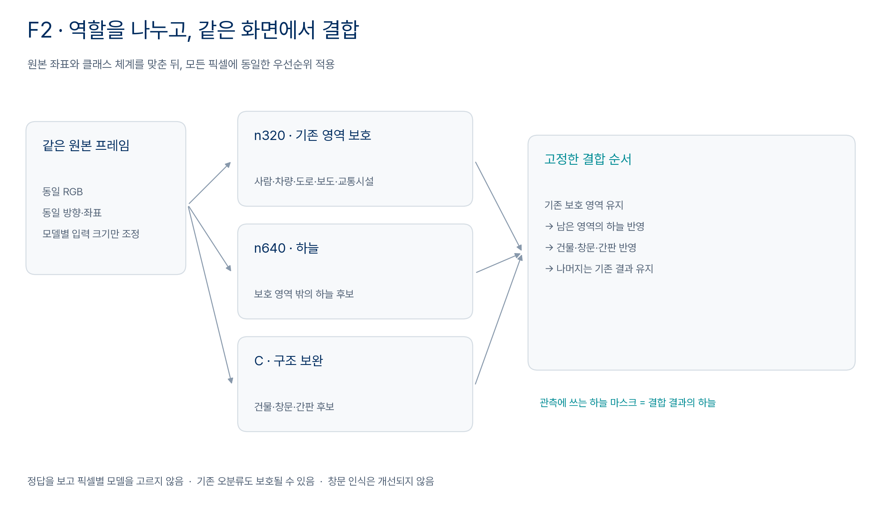

F2 선택 후, 후보 판단에 사용하지 않은 출처 그룹의 이미지 부분 주석으로 보조 평가를 한 번 수행했다. 평균 IoU는 56.58%에서 57.35%, 간판은 27.04%에서 33.70%로 높아졌고 하늘과 차량은 유지됐다. AI 보조 부분 주석이며 사람 정답이 없으므로 완전한 독립 시험이나 사람 인식 검증으로 확대하지 않는다. 평가 결과를 보고 결합 규칙이나 체크포인트를 다시 고르지 않았다.

사람 검출은 별도 비교했다. 기존 사용자 영상의 명확한 가시 인물 앵커에 대해 EfficientDet-Lite0보다 YOLO26n/s가 더 많은 위치를 대응했고, 계기판·중앙 화면의 제한된 비사람 검수 영역에서는 잘못 검출한 사례가 줄었다. 이는 부분 AI 박스 검수로 확인한 개발 사례이며 전체 인원 재현율이나 mAP는 아니다. 공식 YOLO26n 객체 검출 모델을 모바일 변환해 적용했다. 객체 검출 모델은 추가 학습하지 않았으며, 실제 파인튜닝한 구성은 F2의 C 의미분할 모델이다.

### 기대 효과, 확인한 결과와 남은 문제

| 기대 효과 | 확인한 결과 | 남은 개선과 확인 방법 |
|---|---|---|
| 기존 판단 보존과 간판 보완 | F2 개발 기준 통과, 별도 보조 간판 IoU 개선 | 더 다양한 사용자 주행·장소의 전체 영역 검수 |
| 하늘색 관측의 안정성 | 고해상도 하늘과 기존 보호 영역의 결합 검증 | 역광·전선·나뭇가지 경계와 시간에 따른 변동 비교 |
| 사람 검출 누락 감소 | 전문 객체 검출기의 개발 앵커 대응 개선 | 군중·작은 인물·가림을 포함한 완전한 박스 정답 확보 |
| 광원 종류 구별 | 구조·RGB·차량 제외를 분리한 구현 방향 | 자발광·반사·차량광의 속성 주석과 광원별 평가 필요 |
| 작은 창문 복구 | 현재 비교 범위에서는 개선되지 않음 | 원본 영역 확대, 창문 주석 검수와 학습 불균형 보완 |
| 차량에서 실행 | 모델별 변환·실행 비용 비교 | 복합 실행의 지연·메모리·발열을 실제 단말에서 측정 |

광원은 단순히 밝은 픽셀이나 간판 클래스와 같지 않다. 가로등은 도로 조명으로 별도 관측하되 상점의 활기로 자동 가산하지 않는 방향을 검토한다. 모델별 실행 주기와 입력 크기는 측정 결과에 따라 결정하고, 이전 프레임의 마스크를 새 프레임에 적용하지 않는다. 하나의 분석기 실패가 다른 분석기의 정상 관측을 조용히 지우거나 실제 관측 0으로 표시되지 않게 한다.

세부 지표와 성공·실패의 연결은 [모델 개선 실험 기록](../vision/MODEL_IMPROVEMENT_LOG.md)에 정리한다. 휴대폰 0.3.9의 실제 분석 경로에 F2와 YOLO26n을 연결했고, Android에서 동결한 실제 입력의 분할 결과와 관측 통계가 일치하는지 확인했다. Pleos 0.1.1은 음악·내비게이션을 연결한 UI 시연 앱이며, 이 모델을 차량 카메라와 연결한 빌드는 아니다.

조명 관측 격자도 기존 320에서 원본 최대 640으로 바뀌었다. 동일 모델·동일 차량 박스의 한 주행 프레임에서 밝은 면적 비율은 9.77%에서 11.76%로 바뀌었고, 같은 640 격자에서 F2를 사용하면 11.50%였다. 따라서 조명 관측량의 변화를 모두 모델의 정확도 향상으로 설명하지 않는다. 광원 속성 정답을 확보한 뒤 모델 변경과 해상도 변경을 분리해 평가해야 한다.

### Android 실행 비용과 최적화

빛 계산의 반복 최솟값·최댓값 탐색을 줄이고 Gaussian 계산의 경계 인덱스를 재사용했다. 계산 순서와 임계값을 유지했으며, 기존 구현과 실제 입력의 마스크·통계·관측 영역이 같은지 검사했다. ONNX Runtime의 CPU arena와 memory pattern 사전할당도 비활성화해 모델별 중간 버퍼가 누적되는 부담을 줄였다. 모델 자체와 입력 해상도는 유지했다.

Android 15 x86_64 에뮬레이터의 실제 앱 분석 경로에서 첫 호출은 2.12초, 이후 호출 중앙값은 1.65초, 범위는 1.60~2.15초였다. 입력 준비·모델 추론·결합·사람 검출·빛과 하늘 관측은 포함하고 영상 디코딩·화면·전체 구간 누적은 제외했다. 최종 호출 후 PSS는 약 173MiB였으며 이는 시점별 측정이지 추론 중 최대 메모리가 아니다. 설정 변경 전 실행에서는 약 1,588MiB가 남아 있었다. 측정 시각과 컴퓨터 부하가 통제되지 않았으므로 시간 단축률을 일반화하지 않는다.

이 결과는 저장 영상 분석 프로토타입의 실행 확인이다. Galaxy S25+나 Pleos 실차의 성능·발열·실시간 처리율을 뜻하지 않는다. 다음 단계는 대상 기기에서 동일 영상의 첫 실행과 반복 실행, 전체 요청 시간, 추론 중 최대 메모리와 온도 변화를 함께 측정하는 것이다. INT8 변환·실행 주기 조정·원본 영역 확대는 각각 별도 후보로 만들고 현재 클래스별 퇴행 제한과 원본 프레임 정합을 다시 검사한다. [Android 실행 원장](../vision/android-f2-039/README.md)

## 5 Pleos Connect 연동 가능성과 조건

Driving Mood의 최종 실행 환경은 차량 인포테인먼트다. Pleos Connect의 Android 기반을 활용해 무드 계산을 재사용하고, 카메라·내비게이션 입력과 음악·조명 출력을 차량용 연결부로 바꾼다.[1] 현재 숫자 중심 점수기는 분리되어 있지만 영상·음원 계약에는 Bitmap·Uri 참조가 남아 있어, 차량 모듈을 만들 때 자원 관리 경계를 함께 정리한다.

| 연결 항목 | 공식 문서에서 확인한 내용 | Driving Mood 적용 판단 |
|---|---|---|
| 내비게이션 | 현재 위치·경로 상태·TBT 등 이벤트 제공 [2] | 입력 어댑터 개발 가능성 확인 |
| 도로 의미 | 경로·안내 정보와 현재 도로 분류는 다름 | 도로 종류 필드와 매핑 확인 필요 |
| 실내조명 | Light 도메인에 앰비언트 색상·밝기 제어 경로 [3] | 조건부 제어 대상으로 설계 |
| 제어 사용 권한 | 사용 신청 안내는 Vehicle Control을 준비 중으로 표시 [4] | 프로젝트 접근 상태를 별도 확인 |
| 차종별 지원 | checkXXXCapabilities로 가용성 확인 [5] | 지원 범위·값·실패 처리를 동적으로 확인 |
| 차량 카메라 | 본 조사에서 외부 앱용 원본 영상 경로 미확인 [7] | 휴대폰 카메라로 시작 |

Light API의 `setAmbientLightBrightnessColor`, `setAmbientLightBrightness`와 capability 메서드, Virtual Console의 앰비언트 상태 항목을 연동 후보로 검토했다.[3][8]

조명 어댑터는 지원·권한 확인 → 상태 조회 → 제어 요청 → 결과 확인 순서로 구성한다. 미지원 환경에서는 프리셋 미리보기를 제공하고 사용자의 수동 조작을 우선한다.

차량 빌드는 공식 가이드에 따라 minSdk 28 이상으로 구성하고 API 34 Pleos 에뮬레이터에서 설치·모델 로딩·서비스 연결을 확인한다.[9] NaviHelper의 위치·경로 입력부터 연결하며, 점포 영업시간 제공과 영상 속 간판의 점포 대응은 별도 확인한다. Galaxy S25+의 성능 측정은 휴대폰 검증에 사용하고, 차량에서는 처리 지연·최대 메모리·발열을 다시 측정한다.

이식은 공통 계산 계약 고정 → 차량 빌드·내비게이션 연결 → 주행 제한·오디오·절전 복귀 검증 → 승인된 카메라·조명 연결 순서로 진행한다. 상세 영상과 분석 근거는 주차 중 화면으로 제공하고, 주행 중에는 차량의 UI 제한에 맞춰 결과와 조작을 줄인다.[10] 분석 엔진은 Android 휴대폰 환경에서 검증했으며, Pleos 에뮬레이터에서는 차량용 UI 프로토타입의 실행과 화면 전환을 확인했다.

## 6 Pleos UI 프로토타입과 차량 경험

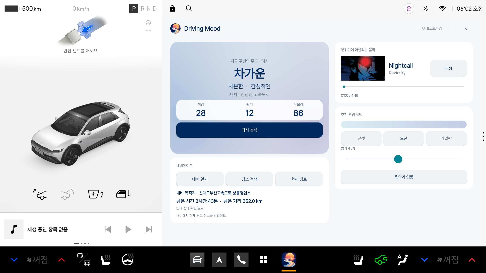

앱 목록에서 Driving Mood 아이콘을 길게 눌러 하단 GNB의 편집 가능 영역으로 끌어 고정하고, 로고를 눌러 앱을 연다. 사용자가 바로가기를 배치하는 Pleos 공식 편집 흐름을 따른다.[12]

캡처의 하단 로고는 실행 후 표시된 최근 앱 영역이다.

**앱 진입 → 주변 관측·분석 → 무드 결과 → 음악·조명·장소 선택**

0.1.1의 무드·점수는 새벽 고속도로 수동 시연 예시다. 로컬 음악의 실제 재생·앨범 이미지 읽기·출력 녹음과 내비 목적지·남은 시간·거리 조회를 확인했다. 최소화 중 재생, 결과 화면 복귀와 닫기 시 재생 종료도 검증했다.

| 연결 | 활용할 정보·기능 | 적용 계획 |
|---|---|---|
| 음악 | 로컬 음원·앨범 이미지·미디어 세션 | 최소화·복귀·종료 확인, 내비 안내와 오디오 포커스 검증 확대 |
| 실내조명 | 색상·밝기와 재생 시간 기반 화면 미리보기 | 순정 음악 동기화·지원 영역·권한 확인 후 차량 연결 |
| 내비게이션 | 위치·경로·남은 거리와 시간 | 주행 상황을 분석에 반영하고, 사용자가 고른 장소를 목적지로 전달 |
| 영상·날씨 | 주행 영상과 위치 기반 기상청 실황 | 파일 입력부터 검증, 요청당 한 번 조회와 유효 캐시 재사용 |

### Pleos 내비게이션과 함께 사용

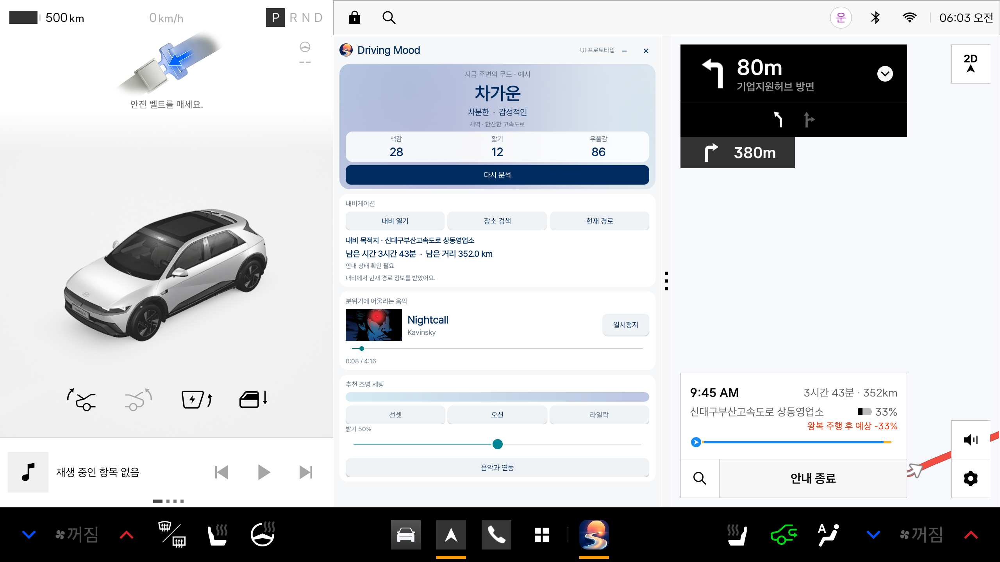

새벽의 한산한 고속도로를 가정해 차가운·차분한·감성적인 분위기와 음악을 연결했다. 무드와 점수는 수동 예시이며 실제 모델의 계산값은 바꾸지 않았다. 사용자는 분위기를 이어가거나 활기찬 음악으로 전환하는 방향을 선택하도록 확장한다.

내비는 수신한 목적지·남은 시간·거리를 표시하며 미수신은 ‘—’, 안내 상태 불일치는 확인 필요로 남긴다.[2] 음악 원본은 APK에 포함하지 않는다.[13] ‘음악과 연동’은 재생 시간에 따른 밝기 미리보기다. 비트 분석·차량 조명 제어와 위치의 무드 계산 반영은 구현하지 않았다.[3][5]

## 7 입력에서 차량 경험까지의 동작 설계

현재 휴대폰 프로토타입의 흐름은 **30초 촬영 → 영상 분석 → 완료음 → 무드 결과 → 음악·조명 미리보기**다. 이후 차량 연결에서도 같은 입력·출력 구조를 확장한다.

1. 입력의 관측 시각·수신 시각·출처·가용 상태를 기록한다.
2. 프레임 품질과 영역 마스크를 검사하고 차량광·반사광의 영향이 큰 장면은 색감 기여를 낮추거나 제외한다.
3. 환경 키워드 후보를 만들고 내비게이션·날씨와 대조한다. 근거가 충돌하면 미확인 또는 제한된 결과를 반환한다.
4. 운전자가 선택한 현재 기분과 원하는 분위기를 별도로 반영한다. 명시적 원하는 분위기를 자동 환경 추정보다 우선한다.
5. 여러 관측의 지속성과 유효 기간을 검사해 키워드를 안정화한다. 최소 유지 시간과 변경 조건을 두어 화면·곡·조명이 짧게 반복 전환되는 일을 줄인다.
6. 현재는 같은 공통 주변 무드 목록을 음악과 조명 미리보기에 전달한다. 차량 확장에서는 목표 MoodState와 승인된 출력 어댑터로 연결한다. 음악은 다음 곡에 반영하고, 조명은 허용된 범위에서 점진적으로 바꾼다. 사용자 취소·수동 변경 시 자동 출력을 멈춘다.

| 예시 상황 | 공통 무드 해석 | 출력 예시 |
|---|---|---|
| 따뜻한 도시 조명과 차분함 선호 | 따뜻한 색감과 차분한 목표를 함께 유지 | 잔잔한 곡 후보와 낮은 밝기의 선호색 |
| 비 오는 고속도로 | 차량광 기여 제한과 원하는 분위기 우선 | 안정적인 곡 후보와 유지되는 조명 |
| 밝은 상권이지만 휴식을 선택 | 밝은 환경과 휴식 목표를 분리 | 휴식 목표에 맞춘 음악과 조명 |
| 카메라 또는 내비게이션 중단 | 남아 있는 유효 입력으로 부분 가용 | 사용자 프리셋 유지와 출처 안내 |

조명 출력은 사용자 선호를 반영한 실내 앰비언트 프리셋으로 시작한다.

주행 화면은 짧은 키워드와 간단한 조작으로 구성하고, 상세 분석은 별도 화면으로 제공한다. CarUxRestrictions와 내비게이션 오디오 우선순위를 적용한다.[10]

## 8 단계별 개발 계획

요청형 녹화·분석과 의미분할에 하늘색 해석을 더해 공통 주변 무드를 음악·조명 미리보기에 연결했다. 다음 단계는 대상 단말에서의 지속 실행과 사용자 피드백, 차량 입력·출력 연결을 검증하는 것이다.

| 단계 | 작업과 산출물 | 다음 단계 진입 기준 |
|---|---|---|
| 1 공통 무드 계약 | MoodState와 입력·출력 인터페이스 확정 | 현재 음악 동작 보존과 출처·누락 처리 검사 |
| 2 영상 분석 개선 | 경량 모델 비교와 장면별 품질 규칙 | 정답 표본 평가와 대상 단말 지속 실행 |
| 3 감성 피드백 | 현재 기분·수정 기능과 선택 이력 활용 | 사용자 의도 우선과 초기화 동작 확인 |
| 4 내비게이션 연동 | Pleos 입력 어댑터와 에뮬레이터 시나리오 | 실제 필드 의미·연결 중단·복구 검증 |
| 5 실내조명 연동 | 프리셋·기능 검사·제어·수동 해제 | 사용 권한과 대상 차량 상태 확인 |
| 6 통합 검증 | 동일 무드의 음악·조명 적용과 시연 | 오해석·전환 안정성·사용자 적합도 평가 |

공통 엔진은 입력 제공자와 출력 기능을 분리한다. 장소 추천은 검색 결과와 사용자 선택을 거쳐 경로 안내로 연결한다.

차량 통합은 SDK 접근 권한과 capability를 확보한 뒤 에뮬레이터와 대상 차량에서 검증한다.

기존 영상의 실험 자료를 보존하고 추가 차량 주행 영상의 대표 구간을 분석했다. 원본·분석·결과의 3종 90초 영상과 영역별 기여를 보여주는 그림·GIF를 구성한다.

장면 해석에는 개별 물체뿐 아니라 시간·날씨·장소와 주변의 움직임도 함께 반영한다. 기기 시각과 위치에 따른 일출·일몰 시각을 사용해 계절 차이를 고려한다. 하늘색과 건물·간판의 빛을 따로 측정해, 같은 밝기라도 낮의 햇빛인지 밤의 조명인지 구분한다.

| 장면 조합의 예 | 확장할 환경 무드 |
|---|---|
| 밤·어두운 하늘·여러 네온과 사람 | 활기 있는 도시 분위기 |
| 맑은 낮·푸른 하늘·녹지 | 산뜻함·개방감·청량함 |
| 해질녘·주황빛 하늘·부드러운 조명 | 따뜻함·부드러움 |
| 비·낮은 시야·조용한 거리 | 촉촉함·차분함 |
| 새벽·드문 차량·변화가 적은 긴 주행 | 적막함·단조로움·쓸쓸함 |

운전자가 원하는 방향에 따라 분위기를 이어가는 음악과 기분을 전환하는 음악을 제안한다. 현재 기분과 졸림은 사용자 피드백으로 구별해 다룬다.

## 9 시행착오와 개선 근거

초기 정지사진, 분할 모델 비교와 주행 실험의 원본·출력·설정·측정값은 비교 자료로 보존한다. 대표 색조만으로 야간 도심을 ‘몽환적인’이라고 해석했던 오류에서 출발해, 물체 영역의 빛·색·사람과 구간 지속성을 분리하는 방식으로 개선했다.

| 시험 단계 | 확인한 한계 | 개선 방향 |
|---|---|---|
| 차량 검출과 색조 해석 | 작은 간판·건물 조명 누락 | 의미분할과 RGB 대비 관측 결합 |
| 색감 품질로 일괄 제외 | 실제 색과 관측 강도까지 소실 | 원시 강도와 품질을 분리 |
| 파인튜닝·대체 모델·복합 구성 비교 | 일부 클래스 개선과 다른 클래스 퇴행, F2 보조 평가 통과 | 실패 원장을 보존하고 역할별 결합과 단말 검증으로 연결 |

대표 분할 오류 4개와 초기 결과는 [시행착오 자료](TRIALS.md), 작은 간판·넓은 면 복구와 기존 Android 비교는 [관측 개선 기록](OBSERVATION_IMPROVEMENT.md)에 보존했다.

### 새 영상에서 영역별 기여 확인

차량 주행 영상에서 고정한 관측 구간을 분석했다. 실제 시각을 가진 RGB와 공식 모델의 분할 예측을 공용 계산기에 입력하고, 같은 시간 구간의 중복 표본을 제외해 관측을 누적했다.

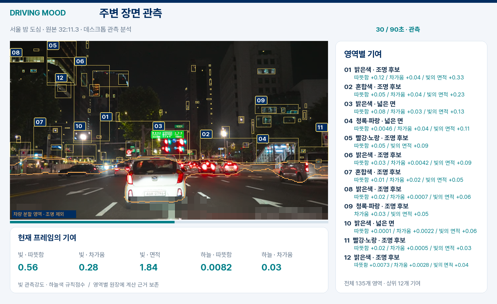

차량 분할 영역은 주황색 경계로 표시하고 조명 계산에서 제외한다. 번호가 붙은 조명·사람 영역은 오른쪽 원장의 실제 기여와 연결된다. 하늘색과 빛의 관측 강도는 별도로 표시한다.

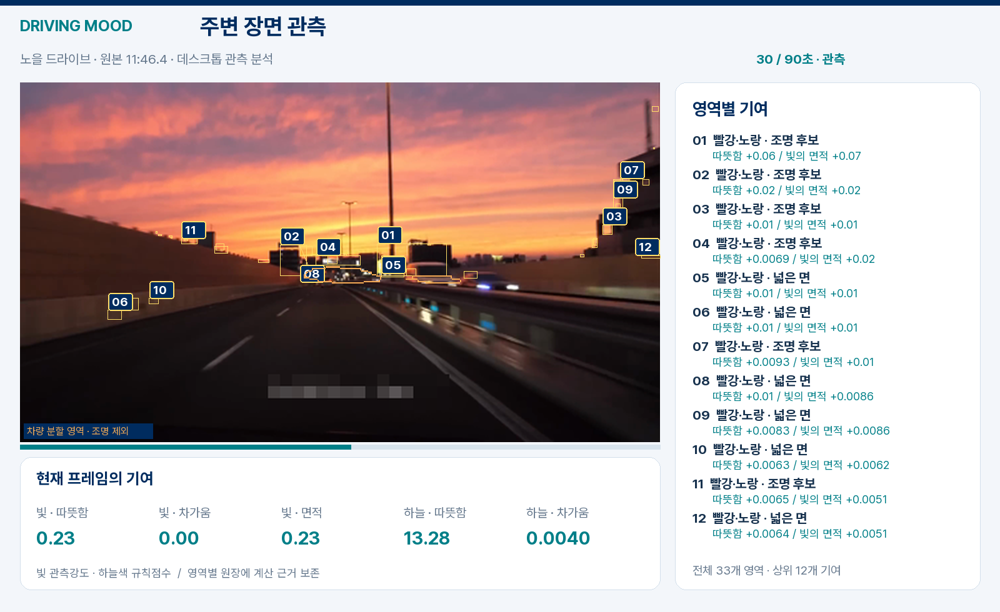

### 구간 전체의 공통 무드 결과

| 장면 | 공통 주변 무드 | 구간 지속 근거 |
|---|---|---|
| 노을 드라이브 | 따뜻한 | 따뜻한 조명과 하늘색 각각 59/60 |
| 서울 낮 도심 | 활기 넘침·차가운 | 밝은 면적·분포 55/60, 차가운 하늘 60/60 |
| 서울 밤 도심 | 활기 넘침 | 밝은 면적·분포 49/60 |
| 흐린 날 도로 | 주요 후보 없음 | 차가운 하늘 28/60으로 절반 미만 |

‘활기 넘침’은 이 실행에서 밝은 면적과 공간 분포의 지속성을 해석한 키워드다. 촬영 날짜·위치·날씨와 사람 검출 수는 제공되지 않았다. 밤 영상의 시각 경계에서 같은 구간에 들어간 4개 표본은 중복으로 처리했고, 결과를 만들기 위해 누락 구간이나 기준을 바꾸지 않았다. [원본 출처와 계산 원장](VIDEO_DEMO.md)을 함께 제공한다.

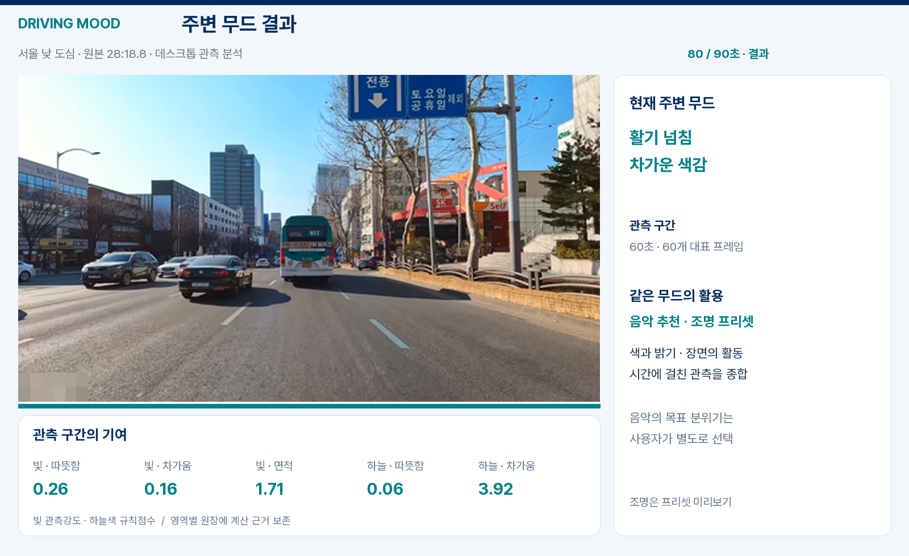

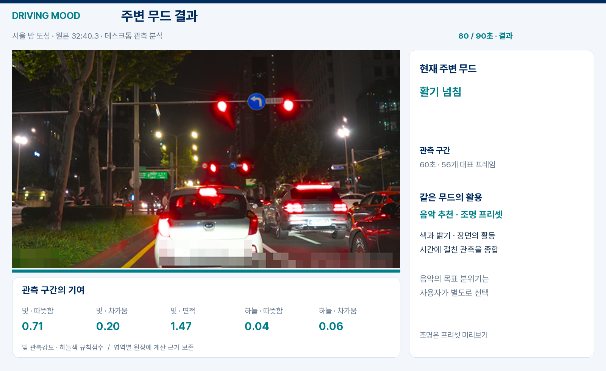

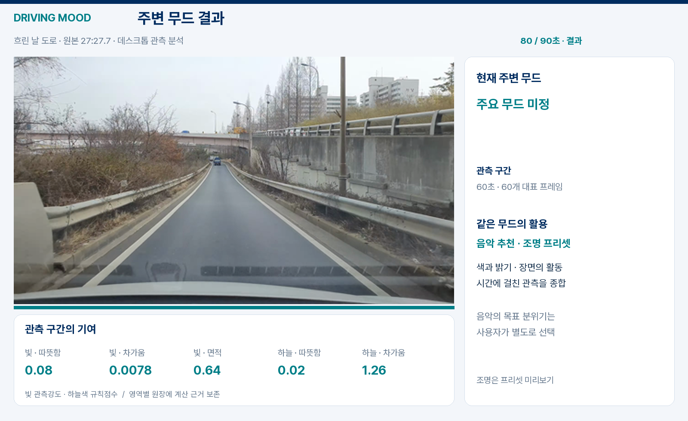

## 10 개선 과제와 실행 방법

개선의 목표는 장면을 더 많이 검출하는 데 그치지 않고, 어떤 관측 때문에 무드가 바뀌었는지를 재현하는 것이다. 실제 차량 주행 영상과 이미지 자료들을 바탕으로 장면 다양성을 보강하고, 아래 순서로 인식 품질·점수의 타당성·단말 실행을 함께 개선한다.

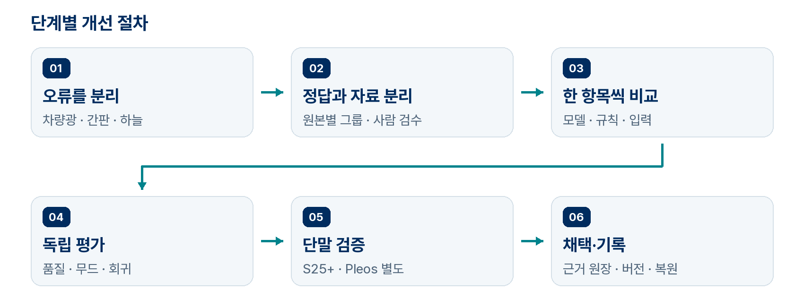

| 우선순위 | 해결할 문제 | 다음 단계로 넘길 산출물 |
|---|---|---|
| 1 · 평가 기반 | 반복 평가에 의한 과적합·부분 정답의 한계 | 원본별 분리표·사람 검수 정답·고정 평가 절차 |
| 2 · 영상 관측 | 차량광 혼입·작은 간판 누락·하늘 오분할 | 동일 장면의 전후 영역·제외 사유·오류 지표 |
| 3 · 무드 해석 | 고정 가중치·시간대별 차이·개인차 | 규칙별 비교·평가자 의견·환경과 목표 분리 |
| 4 · 실행 품질 | 실기기 지연·자원 해제·API 실패 | 단계별 성능·취소·캐시·권한 검증 기록 |
| 5 · 차량 적용 | Pleos 예시 화면과 실제 엔진·서비스 연결 | 파일 입력 분석→내비·음악→지원 조명 적용 |

다음 절의 수치는 **후속 개발의 제안 채택 기준**이다. 현재 달성한 성능과 구분하며, 기준선 실측과 개발 검증에서 확정한 뒤 독립 시험에는 같은 기준을 적용한다. 목표를 맞추기 위해 시험 결과를 본 뒤 문턱을 바꾸지 않는다.

### 10.1 자료 분리와 파인튜닝의 채택 절차

**현재 한계.** 실제 추가 학습과 대체 모델 비교에서 일부 클래스는 개선됐지만 다른 클래스가 퇴행했다. 후속 복합 F2는 개발 기준과 별도 보조 평가를 통과했으나, 창문 인식과 광원 종류 구분은 해결되지 않았다. 반복해서 검토한 영상은 이후 회귀 검사에는 유용하지만 새로운 독립 시험 자료가 되지는 않는다. 부분 주석 밖의 오탐 역시 현재 지표만으로 충분히 평가하기 어렵다.

**개선 방법.** 먼저 촬영 출처·주행·장소·시간 조건으로 그룹을 만들고 학습, 개발 검증, 독립 시험을 나눈다. 같은 주행에서 자른 클립과 인접 프레임, 같은 이미지의 파생본은 같은 그룹에 둔다. 독립 시험 목록은 모델·가중치를 정하기 전에 잠그고, 지금까지 본 시험 결과는 회귀 자료로 보존한다.

사람이 차량 본체·차량광·반사광·간판·창문·하늘 경계를 검수한다. 평가용 장면은 전 영역을 확인하고, 식별할 수 없는 부분은 명시적으로 제외한다. 학습에서 주석하지 않은 영역을 배경 정답으로 채우지 않는다. 모델의 자동 주석은 초안으로만 사용하고 사람이 수정한 이력을 남긴다.

다음 학습은 공식 기준 모델에서 시작한다. 공통 클래스 자료와 오류 사례를 함께 사용해 기존 분류 능력을 유지하고, 학습률·클래스 가중치·미세조정 범위를 한 항목씩 비교한다. 체크포인트는 개발 검증의 종합 기준으로 선택한다. 색이 무드의 근거이므로 임의 색상 회전으로 정답 의미를 바꾸는 증강은 배제하고, 실제 카메라 범위의 노출·노이즈 변화부터 평가한다.

| 검증 항목 | 비교 방법·제안 채택 기준 |
|---|---|
| 클래스 품질 | 같은 검수 정답에서 클래스별 IoU와 평균을 비교. 주요 클래스 평균 +3%p 이상, 차량·사람·하늘·보도의 하락은 각각 2%p 이내를 목표로 설정 |
| 실제 오류 | 간판 오탐·차량광 누출과 최종 무드 적합도도 함께 확인. 평균 IoU가 높아져도 핵심 오류가 악화되면 채택하지 않음 |
| 일반화 | 장소·시간·날씨별 결과를 분리하고 원본 주행 단위로 불확실성을 추정. 인접 프레임을 독립 표본처럼 세지 않음 |

**채택과 기록.** 개발 검증·회귀 검사·단말 최적화를 마친 뒤 전처리·모델·가중치·시간 규칙을 고정하고 독립 시험을 최종 수행한다. 결과를 보고 다시 조정했다면 해당 시험은 회귀 자료로 전환하고 새 독립 시험을 확보한다. 개선 폭을 구분하기 어려우면 기준 모델을 유지한다. 그룹·주석 버전·학습 설정·난수 시드·모델 해시·전후 지표를 연결해 실패한 후보도 보존한다.

### 10.2 차량광 억제와 작은 도시 조명의 복구

**현재 한계.** 차량 검출 박스와 분할 영역을 확장해 빛을 제외하면 먼 후미등은 남고 실제 간판은 함께 지워질 수 있다. 작은 간판과 넓은 밝은 창면을 회수하더라도 상점·주거 창문·교통시설을 구별하는 문제는 남는다.

**차량광 개선.** 차량 본체와 발광 픽셀을 따로 표시한 정답을 만든다. 분할·검출의 합집합에서 시작하되 박스 전체를 무조건 넓히지 않고, 밝은 연결 영역과 경계를 따라 번짐 후보를 확장한다. 반사광은 도로 영역·차량과의 위치 관계·색 유사성이 함께 맞을 때 제외하고 건물 경계에서 끊는다. 프레임 간 추적은 자차 이동을 보정한 뒤 보조 근거로 사용한다. 추적이 불안정하면 단일 프레임 판단으로 돌아온다.

**간판 개선.** 전체 장면은 경량 모델로 처리하고 작은 간판 후보 구역만 원본에서 확대 분석한다. 상업 간판·매장 창면·주거 창문·교통시설·불명의 구별을 추가 분류 후보로 시험한다. 간판 전체 사각형과 실제 빛나는 픽셀을 분리해 글자 사이의 어두운 배경을 발광 면적으로 합산하지 않는다. 같은 빛을 여러 경로에서 찾으면 픽셀 합집합으로 한 번만 계산하고, 잘게 분할된 하나의 간판이 개수 가산점을 중복해서 받지 않게 한다.

| 핵심 지표 | 정의와 제안 채택 기준 |
|---|---|
| 차량광 누출률 | 차량광 정답 중 최종 도시 조명에 남은 픽셀 비율. 기준선보다 상대 30% 이상 감소 목표 |
| 비차량 조명 손실률 | 실제 도시 조명 정답 중 제외한 픽셀 비율. 기준선 대비 증가 3%p 이내 |
| 작은 간판 회수 | 검수 간판의 검출 재현율 +10%p 이상, 정밀도 하락 2%p 이내. 크기 구간별로 별도 집계 |
| 잘못된 상업성 | 새 분류의 정밀도·오탐 허용 기준은 검수 정답으로 먼저 고정. 기존 대비 비교는 도시 활력 오인율로 수행 |

**비교 방법.** 야간 도심·정체·한산한 고속도로·젖은 노면에서 분할만, RGB 대비만, 결합, 후보 확대를 같은 프레임으로 비교한다. 원장의 관측량·제외량·최종 기여 합계를 대조하고, 차량광을 제거한 뒤 차량 수로 다시 감점하지 않는다. 확대 분석의 p95 처리시간 증가가 20%를 넘으면 후보 범위와 빈도를 줄여 다시 평가한다.

### 10.3 다양한 하늘색과 시간·장소의 영향

**현재 한계.** 하늘색은 여러 색상군으로 측정하지만 여명과 일몰을 색만으로 구별할 수 없다. 자동 노출·화이트밸런스·HDR 변환과 하늘 오분할도 결과에 영향을 준다. 현재 RGB 밝기는 광학적 조도 측정값이 아니다.

**하늘 개선.** 청색·보라 여명, 금빛·주황 노을, 붉은 잔광, 분홍·보라 혼합, 흐림·안개, 정오, 도시 빛이 반사된 야간 구름을 조건표로 구성한다. 전체 평균 외에 색상별 면적·채도와 상하 방향의 분포를 유지해 붉은 하단과 푸른 상단을 한 색으로 지우지 않는다. 예측 하늘 마스크와 사람 검수 마스크에 같은 RGB를 넣어 분할 오류와 색 계산 오류를 따로 찾는다.

촬영 시각·위치·시간대가 유효하면 태양의 위치와 일출·일몰 시각을 함께 확인한다. 시간 정보가 없는 영상에는 이를 임의로 채우지 않는다. 노을이나 여명임을 뒷받침할 정보가 충분할 때 감성적인 분위기에 가산점을 주는 방식을 시험한다. 따뜻함·차가움 같은 색감과는 별도로 평가하며, 특정 하늘색을 운전자의 우울함으로 단정하지 않는다.

**빛의 종류 구별.** 밤의 어두운 하늘과 밝은 간판이 함께 보이면 차량 불빛을 제외한 인공조명의 양과 분포를 활력의 근거로 삼는다. 낮에 햇빛을 받아 밝아진 외벽은 스스로 빛을 내는 조명과 구분한다. 하늘과 건물빛의 점수를 따로 남겨 무엇이 가산됐는지 확인할 수 있게 한다.

| 시험 조건 | 확인할 결과 |
|---|---|
| 색·노출 다양성 | 개발에서 제외한 색상군·카메라 출처로 평가. 허용 노출 범위의 같은 장면에서 색감 키워드 일치율 90% 이상 목표 |
| 잘못된 시간 추정 | 야간 반사 구름의 노을 오인이 증가하지 않아야 함. 시각 없는 입력에서 여명·일몰을 확정하지 않음 |
| 하늘 관측 상태 | 하늘 없음·무채색 하늘·관측 실패를 서로 구별. 하늘 오탐률과 색 분포 오차를 별도 기록 |

**점포 연결.** 상업성 판단에는 위치뿐 아니라 정확도·카메라 방향·시야각·거리·가림을 함께 검사한다. 실제 공급자가 제공하는 점포 유형·등록 영업시간이 영상 근거와 맞을 때만 상업 활동 후보를 강화한다. 방향이나 위치가 불확실하면 시각 근거를 유지한다. 상가가 섞인 아파트·도로 건너편 점포·영업 종료 후 밝은 매장에서 대응 오류를 비교한다. 등록 영업시간은 실제 영업 확인과 구별하며, 현재 Pleos 내비 API가 이 정보를 제공한다고 가정하지 않는다.

### 10.4 근거별 점수와 사용자 선택의 보정

**현재 한계.** 현재 가산점·문턱은 초기 규칙이며 감정의 확률이 아니다. 큰 밝은 면이 작은 여러 간판보다 높은 수치를 만들 수 있고, 같은 어두운 풍경도 사람마다 이어가고 싶은 분위기와 바꾸고 싶은 분위기가 다르다.

**점수 개선.** 원시 관측→입력 유효성→특징별 정규화→가산·감점→시간창 집계→키워드 채택 순서를 고정한다. 빛 면적·분포·상업 조명 근거·사람 밀도·하늘색의 역할과 상한을 정하고, 서로 단위가 다른 수치를 그대로 합산하지 않는다. 사람이 추가될 때의 가산은 품질과 상한을 적용하고, 인식 실패를 0명으로 바꾸지 않는다.

모델을 고정한 점수 규칙 비교와 규칙을 고정한 모델 비교를 먼저 수행한다. 여러 평가자가 장면의 활기·차분함·따뜻함·차가움·혼재를 평가하고 의견 분포를 보존한다. 가중치는 개발 검증에서만 보정한다. 사람·조명·시간·날씨를 하나씩 제외한 비교로 각 근거의 효과와 중복 가산을 확인한다.

**여러 조건을 함께 반영.** 새벽 시간, 확인된 고속도로 주행, 적은 통행량, 비, 단조로운 풍경의 지속이 함께 나타나면 ‘한산한·적막한 환경’으로 해석할 수 있는지 시험한다. 짧은 촬영 결과를 장거리 주행 전체로 확대하지 않고, 어두워서 인식하지 못한 장면을 적막함의 근거로 삼지 않는다. 주변 환경, 사용자가 알려준 기분, 원하는 분위기는 별도 값으로 유지한다.

| 평가 축 | 구체적인 검증·채택 조건 |
|---|---|
| 점수의 일관성 | 차량광만 늘었을 때 도시 활력이 높아지지 않는지, 추가 네온의 기여가 원장에 생기는지 확인. 중복 가산·이중 감점 없음 |
| 환경 묘사의 적합도 | 영상 단독과 시간·날씨 결합을 같은 장면에서 평가. 새 규칙이 특정 장소에만 유리하지 않고 독립 평가에서 기준선보다 개선 |
| 개인 추천의 적합도 | ‘분위기 이어가기/전환하기’를 선택한 뒤 수락·건너뛰기·직접 수정과 만족도를 비교. 환경 키워드는 선택 때문에 변경하지 않음 |

**개인화 방법.** 곡 추천의 후보 태그와 선호 가중치부터 보정하고, 다음 곡 선택에 피드백을 반영한다. 일시적인 현재 기분에는 입력 시각과 유효 기간을 둔다. 음악 만족도와 환경 해석의 적합도를 다른 질문으로 수집한다. 사용자가 선택한 목표가 다음 추천에 반영되는지 검증하며, 밝기·차량 수만으로 우울함이나 졸림을 확정하는 출력은 만들지 않는다.

**사용자에게 근거 전달.** 상세 화면은 색 견본·출처별 카드·비교 막대로 관측→특징→추천의 연결을 보여준다. 하늘색과 주변빛, 실제 0과 미관측을 구별하고 기술 용어·원시 수치는 접힌 정보로 옮긴다. 보존한 장면이 없으면 가짜 장면을 만들지 않고 실제 집계의 도식을 사용한다. 사용자가 핵심 근거와 빠진 입력을 설명할 수 있는지 과제로 확인한다.

### 10.5 실기기 성능과 요청·실패 처리

**현재 한계.** 에뮬레이터의 실행·화면 검증만으로 Galaxy S25+의 지연·발열 또는 차량 성능을 설명할 수 없다. 현재 순차 영상 분석에서 디코딩·모델·픽셀 계산 중 무엇이 병목인지 실기기에서 분리 측정해야 한다.

**측정과 최적화.** 요청 ID별로 촬영 종료, 파일 마무리, 모델 로딩, 디코딩, 전처리, 추론, 픽셀 계산, 집계, 첫 결과 표시 시간을 기록한다. 냉시작·재실행과 반복 사용을 나누고 OS·모델 해시·영상·충전·화면 밝기 조건을 고정한다. 전체 지연 p50·p95, 최대 메모리, 발열 상태, 취소 후 해제 시간을 남긴다. 앱 전환은 Android 벤치마크와 추적으로 함께 검사한다.

측정한 병목부터 순차 디코딩·불필요한 복사·화면 갱신 빈도를 개선한다. 이미 있는 입력 버퍼 재사용은 유지한다. 그다음 입력 크기·스레드 수·실행 제공자·양자화를 한 항목씩 비교한다. ONNX Runtime의 정적 양자화 후보는 대표 조건으로 보정하고 부동소수점 모델과 품질을 비교한다. uint8 출력 클래스맵을 가중치 INT8 양자화로 오해하지 않는다. 표본을 줄일 때는 누락 구간과 키워드 지속성까지 다시 평가한다.

| 제안 채택 기준 | 측정 범위 |
|---|---|
| 처리 지연 개선 | 같은 품질 조건에서 분석 p95를 기준선 대비 20% 이상 단축 목표. 촬영 후 처리 p95는 입력 촬영 길이 이내를 우선 목표로 설정 |
| 취소 반응·해제 | UI 반응 300ms 이내와 자원 해제 p95 2초 이내를 별도 측정. 실행 중인 네이티브 추론 반환 시간 포함 |
| 수명주기 안정성 | 반복 요청·취소·화면 이탈 후 메모리·파일·리스너 누적 없음. 이전 요청의 늦은 결과·완료음·재생이 새 요청에 섞이지 않음 |

**날씨·실패 처리.** 기존 격자·발표 시각 캐시와 재요청 제한을 유지하고 실제 응답에서 발표 경계·빈 응답·오프라인·키 오류·할당량 초과를 확인한다. 대기·유효 캐시 적중 시 호출 0회, 허용된 사용자 요청당 최대 1회인지 기록한다. 오래된 위치·다른 격자·미래 시각은 배제한다. 실패 후 캐시를 쓸 경우 유효 기간과 출처를 남기며, 날씨가 없어도 유효한 영상 계산은 진행한다. 취소 시 요청 ID를 무효화하고 이전 작업이 자원을 놓기 전에 새 네이티브 작업을 겹쳐 실행하지 않는다.

### 10.6 Pleos에서 실제 분석과 차량 기능 연결

**현재 출발점.** Pleos의 무드·점수는 수동 시연 예시다. 0.1.1의 실제 음악 재생·미디어 세션과 내비 SDK 조회를 확인했으며 휴대폰 분석 연결과는 별개다. 다음 단계는 공통 분석 연결이며, 차량 카메라는 승인된 영상 경로를 확인한 뒤 추가한다.

| 단계 | 구현 방법 | 완료를 판단할 증거 |
|---|---|---|
| 실제 분석 | 요청 ID·영상 시각·출처·해제 책임을 입력 계약으로 분리. 실제 주행 파일 어댑터와 공통 엔진을 먼저 연결 | 고정 점수·타이머를 실제 계산·진행도로 교체. 동일 영상의 폰/Pleos 프레임·근거·결과 일치 |
| 내비·위치 | 지원·권한 확인 후 분석 요청 동안 이벤트 구독. 시각·정확도를 검증한 위치·방향·경로 스냅샷 전달 | 경로 없음·재탐색·목적지 변경·연결 단절 재현. 이전 위치·경로가 현재 점수에 섞이지 않음 |
| 음악 | 실제 음원과 Media3 세션·브라우징 서비스를 연결. 앱과 차량 버튼이 같은 재생 상태 사용 | 곡·재생·일시정지·다음 일치. 내비 안내·통화·포커스 복귀 후 의도치 않은 재생 없음 |
| 조명 | 지원 영역·색·밝기 capability 조회→현재 상태 읽기→단일 프리셋 쓰기→응답·상태 재조회 | 실제 상태와 요청값 일치. 미지원·오류는 성공 처리하지 않고 사용자 수동 변경 시 자동 전환 중단 |

**음악 연동은 순정 기능부터.** 기아 DA_GEN2_V의 Sound Mood Lamp에는 음악 동기화가 있다. 대상 차량의 기능 탑재를 확인하고 설정에서 활성화한 뒤 순정 재생과 Driving Mood의 같은 음원을 비교한다. 재생·일시정지·음소거·곡 변경에 순정 조명이 반응하면 이를 활용한다. Pleos 호환·제3자 출력 지원·전용 설정 진입과 활성화 API는 별도 확인 대상이다. 공개 Light API에서 음악 모드가 확인되지 않았다는 이유만으로 자체 비트 분석·조명 엔진을 만들지 않는다.

**호환성과 실패 복구.** 도로 종류는 실제 제공 필드가 있을 때 사용하며 경로 옵션 HIGHWAY를 현재 도로로 대체하지 않는다. 카메라·서비스가 없거나 파일이 손상됐을 때 예시 성공값을 반환하지 않는다. 음악 포커스를 얻지 못하면 재생 상태를 확정하지 않고, 조명 응답이 실패하면 화면 미리보기로 남긴다. 에뮬레이터 기능 검증과 대상 차량의 지연·메모리·발열·권한 검증을 별도 기록한다.

**출시 조건.** S25+와 Pleos에서 큰 글꼴·좁은 창·화면 복귀·애니메이션 끄기·중복 탭·중간 취소를 확인한다. 실측 전후 표, 같은 장면의 근거 비교, 실제 화면 기록, 사용한 모델·규칙·빌드 버전을 함께 남긴다. 기능별 완료 조건을 통과한 범위만 배포하고 이전 정상 APK·모델·설정을 복원할 수 있게 보존한다.

## 11 검증 현황과 기대 효과

휴대폰 0.3.9는 단위 검사 350개와 실제 모델·분할 정합·제품 분석 경로의 native 검사 3개를 통과했다. 최종 서명·정렬·APK 검사 결과는 버전별 검증 기록으로 연결한다. 0.3.8의 기존 화면 촬영본은 UI 참고로 유지하며, 저장된 주행 계산 원장의 화면 재생과 이번 실제 모델 추론 검사를 구분한다. Pleos 0.1.1은 실제 음악 재생·출력 녹음, 최소화·복귀·종료, 내비 정보 조회와 분할 화면 조작을 확인했다. 차량용 무드·점수는 수동 시연 예시다.

차량 주행 영상의 연속 프레임에서는 관측 출처·기여 배분·하늘색 수치의 일치를 확인했다. Galaxy S25+ 실기기의 처리 지연·발열, 환경 API 실통신과 Pleos 실차 연결은 대상 환경에서 검증한다. [버전별 검증 기록](../VALIDATION.md)에 실제 실행 범위를 정리했다.

| 검증 대상 | 확인할 지표와 방법 |
|---|---|
| 영상 분할 | 차량·도로·건물·창문·간판의 클래스별 IoU와 누락 사례 |
| 차량광 억제 | 고속도로·정체·젖은 노면에서 잘못 포함된 빛의 비율 |
| 시간 안정성 | 같은 장면에서 키워드가 불필요하게 바뀌는 횟수 |
| 단말 성능 | 전체 처리 지연 p50·p95, 최대 메모리, 발열과 지속 동작 |
| 감성 적합도 | 사용자 자기보고와 제안 키워드의 일치·수정·수락 비율 |
| 공동 출력 | 음악·조명의 무드 일관성, 수동 해제와 실패 복구 |
| 요청형 동작 | 대기 중 요청 0회, 캐시 재사용, 중복 탭·취소·시간 초과 후 수집 종료 |

환경 입력 단독, 내비게이션 결합, 사용자 피드백 결합을 동일 조건에서 비교한다. 평가 자료는 도심·주거지·고속도로·터널과 야간·비·역광을 포함하고, 촬영 원본 단위로 개발·평가 집합을 분리한다.

공통 무드 키워드로 음악과 조명의 분위기를 일관되게 연결하고, 운전자가 적은 조작으로 원하는 환경을 선택하도록 돕는다. 효과는 제안 수락·수정 비율과 직접 선택 대비 만족도로 평가한다.

기분·선호 피드백은 정차 상태에서 간단히 수집한다.

## 12 참고 자료

공식 문서 확인일: 2026년 10월 24일.

1. [Pleos Connect 플랫폼](https://document.pleos.ai/en/docs/connect/guide/connect) — Android Automotive 기반과 차량 앱 환경.
2. [NaviHelper 이벤트](https://document.pleos.ai/docs/pleos-only/connect-sdk-pleos/NaviHelper/event-listeners) — 위치·경로·안내 이벤트와 구현별 차이.
3. [Vehicle SDK 개요](https://document.pleos.ai/en/docs/pleos-only/connect-sdk-pleos/Vehicle/intro) 및 [Light API](https://document.pleos.ai/en/api-reference/connect-sdk-pleos/Vehicle/vehicle/ai.pleos.playground.vehicle.api/light/entry) — 앰비언트 제어와 비동기 결과 처리.
4. [프로젝트 생성과 SDK 사용 신청](https://document.pleos.ai/docs/pleos-only/create-my-project) — Vehicle Control 준비 중과 State·NaviHelper 사용 가능 안내.
5. [API 호환성과 가용성](https://document.pleos.ai/docs/pleos-only/vehicle-app-planning-guide/api-compatibility-availability) — 차량별 지원과 capability 검사.
6. [Ultralytics 의미 분할](https://docs.ultralytics.com/tasks/semantic/) — YOLO26 의미 분할 모델과 데이터셋.
7. [하드웨어 접근 정책](https://document.pleos.ai/docs/pleos-only/vehicle-app-planning-guide/platform-api-architecture) — 플랫폼 SDK를 통한 접근과 하드웨어 제약.
8. [Virtual Console 사용 가이드](https://document.pleos.ai/docs/pleos-only/app-test-guide/virtual-console-guide) — 앰비언트 밝기·색상 상태 에뮬레이션.
9. [Pleos 개발 환경](https://document.pleos.ai/en/docs/connect/guide/getting-started/application-development/setup-connect-sdk-emulator) — minSdk 28 이상과 API 34 에뮬레이터 구성.
10. [주행 안전 설계](https://document.pleos.ai/docs/pleos-only/vehicle-app-planning-guide/driver-distraction-guideline) — 화면 제약과 운전 중 상호작용 기준.
11. [기상청 단기예보 조회서비스](https://www.data.go.kr/data/15084084/openapi.do) — 초단기실황 사용과 2026년 10월 19일 활용 가이드. 발급 경로에 따라 엔드포인트와 인증 매개변수를 구분한다.
12. [Pleos GNB 편집](https://document.pleos.ai/docs/connect/guide/docs-design/components/gnb) — 앱 아이콘 길게 누르기와 편집 가능한 하단 영역으로 이동.
13. [Pleos Music/Audio 개발 가이드](https://document.pleos.ai/docs/pleos-only/vehicle-app-developer-guide/music-audio-app-developement-guide) — 미디어 탐색·세션과 차량 재생 연결.
14. [ONNX Runtime 양자화](https://onnxruntime.ai/docs/performance/model-optimizations/quantization.html) — 정적 양자화·보정 자료와 정확도 비교 절차.
15. [Android 앱 벤치마크](https://developer.android.com/topic/performance/benchmarking/benchmarking-overview) — 앱 시작·상호작용·애니메이션의 반복 성능 측정.
16. [기아 Sound Mood Lamp](https://ownersmanual.kia.com/ivi/DA_GEN2_V/AV/KOR/English/002_Features_soundmoodlamp.html) — DA_GEN2_V의 순정 음악 동기화 사례. Pleos 호환은 별도 확인 대상.
