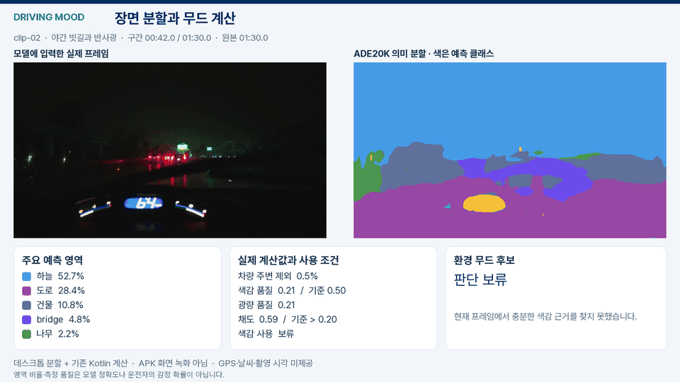
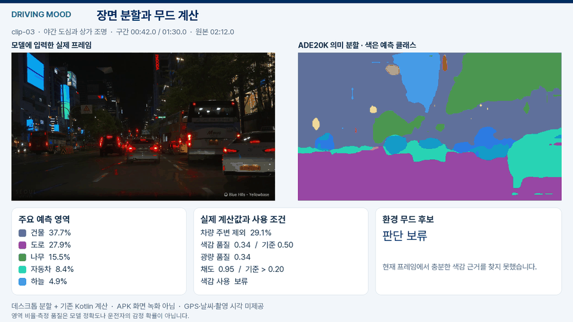
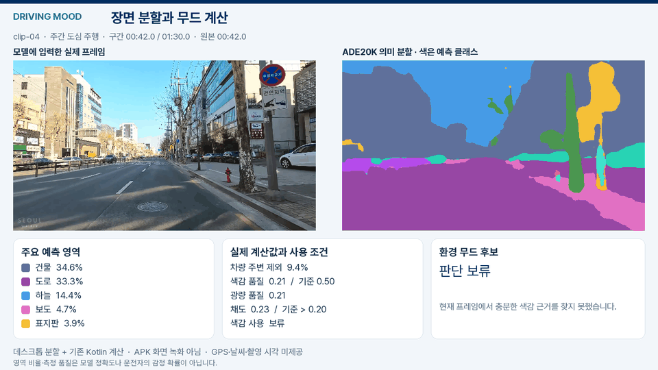
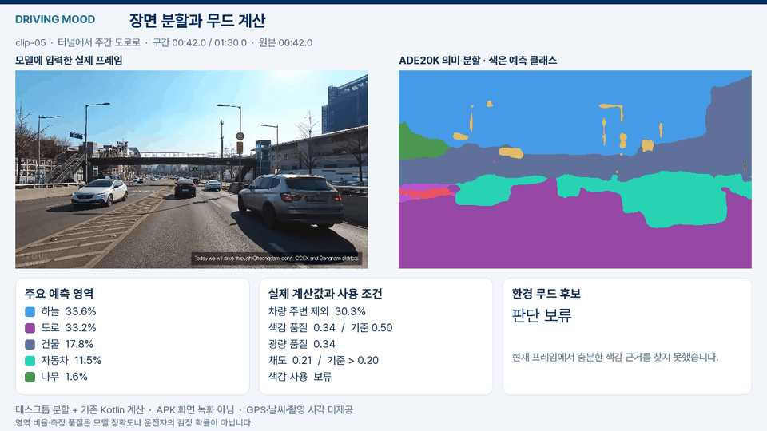
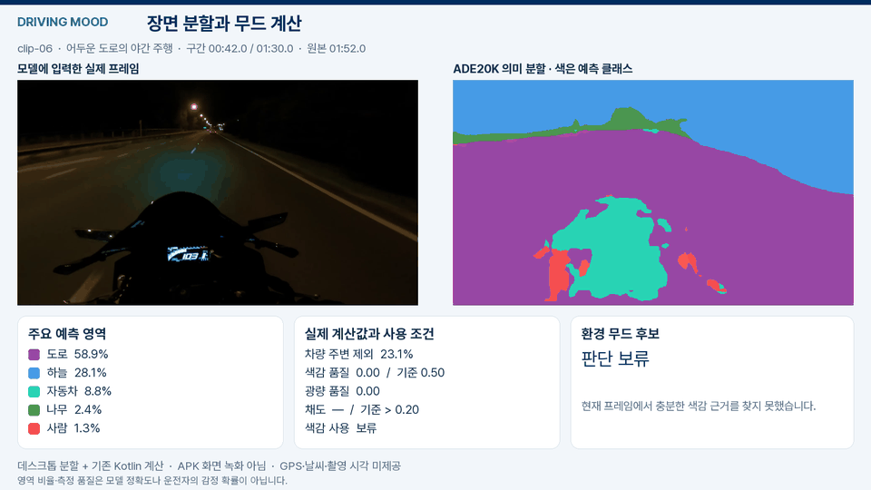

# 실제 주행 영상 분석

실제 차량 주행 영상에서 대표 프레임을 추출해 의미 분할을 실행했다. 각 영상은 대표 90초이며, 90초보다 짧은 영상은 실제 길이를 사용했다. 원본은 구간 추출만 하고, 같은 구간을 분할·계산 화면과 무드 결과 화면으로 만들었다.

## 실험 방법과 결과

**YOLO26n-sem ADE20K**를 ONNX Runtime CPU로 실행하고, 같은 프레임의 RGB와 150개 클래스 분할 결과를 비교했다.

차량 클래스의 연결 영역을 상자로 변환해 당시 Kotlin 영상 측정기와 `SceneInterpreter`에 연결했다. 차량 주변·반사 영역을 추가로 제외하고 색감 사용 조건을 적용했다.

데스크톱 분석 실험으로, 영상의 상대 시각을 사용했다. GPS·도로 종류·날씨·촬영 시각은 제공되지 않았다.

색감 사용 조건을 통과한 프레임은 **4,757개 중 2개**로, 모두 야간 도심에서 ‘몽환적인’ 후보를 반환했다. 낮은 채택률과 단일 색조 중심의 해석을 개선하기 위해, 후속 버전에서는 관측 범위·색 분포·요소별 기여를 분리한다.

## 장면별 결과

### 야간 차량과 거리 조명

[무드 결과 화면](assets/driving/clip-01-result.png) · [프레임 근거](assets/driving/clip-01-evidence.json)

실내가 크게 보이는 구도에서 전방 도로와 일부 차량이 벽·바닥·천장으로 오분류됐다.

### 야간 빗길과 반사광

[무드 결과 화면](assets/driving/clip-02-result.png) · [프레임 근거](assets/driving/clip-02-evidence.json)

도로 안내판과 상점 간판이 같은 `signboard` 클래스로 묶였다. 빗방울·반사광·실내 계기판에서도 오분류가 관측됐다.

### 야간 도심과 상가 조명

[무드 결과 화면](assets/driving/clip-03-result.png) · [프레임 근거](assets/driving/clip-03-evidence.json)

### 주간 도심 주행

[무드 결과 화면](assets/driving/clip-04-result.png) · [프레임 근거](assets/driving/clip-04-evidence.json)

### 터널에서 주간 도로로

[무드 결과 화면](assets/driving/clip-05-result.png) · [프레임 근거](assets/driving/clip-05-evidence.json)

### 어두운 도로의 야간 주행

[무드 결과 화면](assets/driving/clip-06-result.png) · [프레임 근거](assets/driving/clip-06-evidence.json)

## 처리 범위와 출처

| 구간 | 원본에서 사용한 범위 | 길이 | 분석 프레임 |
| --- | --- | --- | --- |
| clip-01 | 0–25.64초 | 25.64초 | 257 |
| clip-02 | 48–138초 | 90초 | 900 |
| clip-03 | 90–180초 | 90초 | 900 |
| clip-04 | 0–90초 | 90초 | 900 |
| clip-05 | 0–90초 | 90초 | 900 |
| clip-06 | 70–160초 | 90초 | 900 |

분석·결과 영상은 초당 10개 실제 추론 프레임을 사용한다. 25.64초 구간의 분석·결과 영상은 마지막 실제 프레임을 포함해 25.7초이며, 원본과의 끝 시각 차이는 0.06초다. GIF는 각 구간의 중간 6초를 초당 5프레임으로 요약했다. 입력 영상의 표시와 워터마크는 유지했고 GIF에는 음원을 넣지 않았다. 원본 영상과 음악의 권리가 이 프로젝트로 이전되거나 공개 소스 라이선스로 재허가된 것은 아니다.

분할 모델: [공식 구현](https://github.com/ultralytics/ultralytics), [공식 가중치](https://github.com/ultralytics/assets/releases/download/v8.4.0/yolo26n-sem-ade20k.pt). AGPL-3.0 또는 별도 Enterprise 조건이며 현재 APK에 포함하지 않았다. 실행 ONNX의 SHA-256은 `f5b30d45110a4fd31ebdbcb61567def157e3d3b8f6a8d3387e038e3a7b2ef4f7`이다. 정답 마스크가 없으므로 분할 정확도는 평가하지 않았다.
