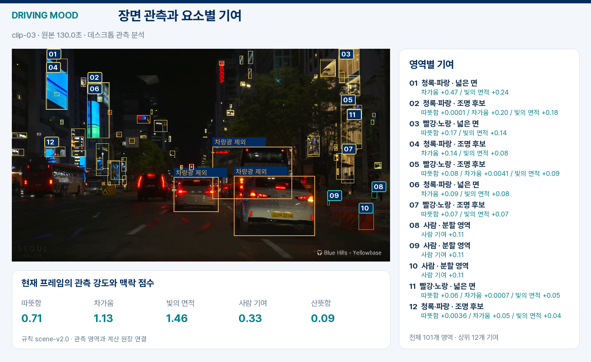
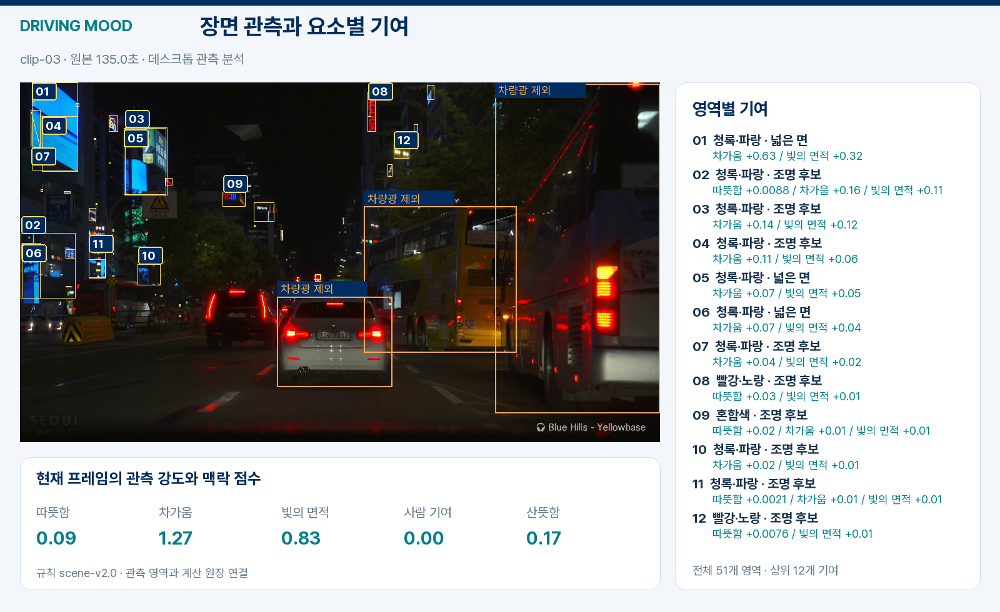
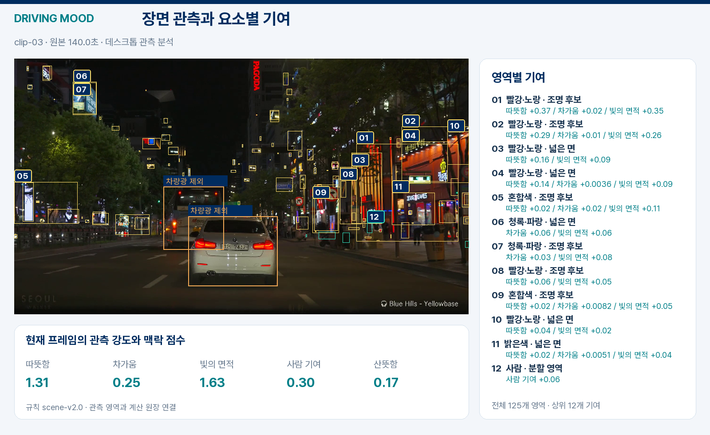
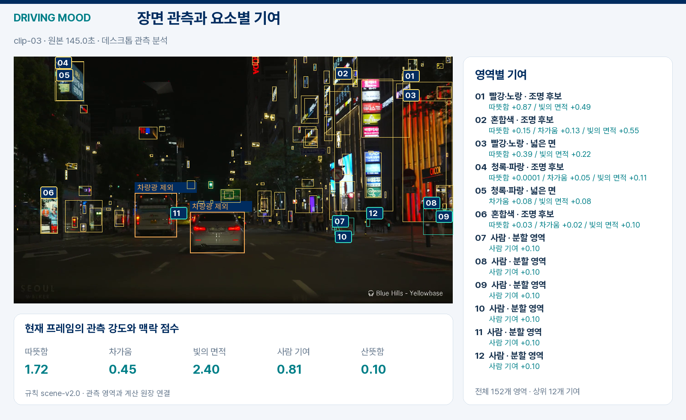
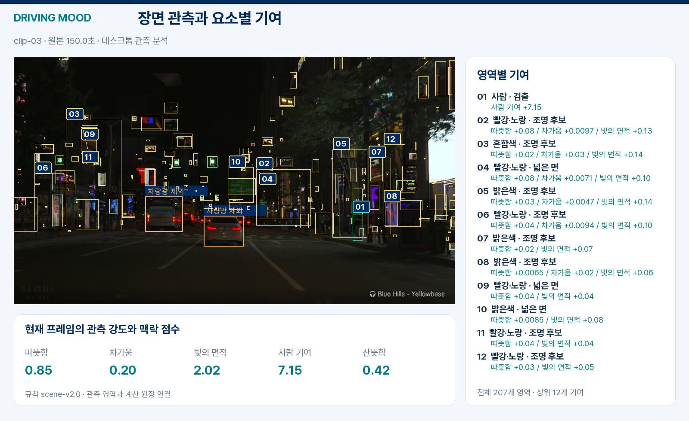
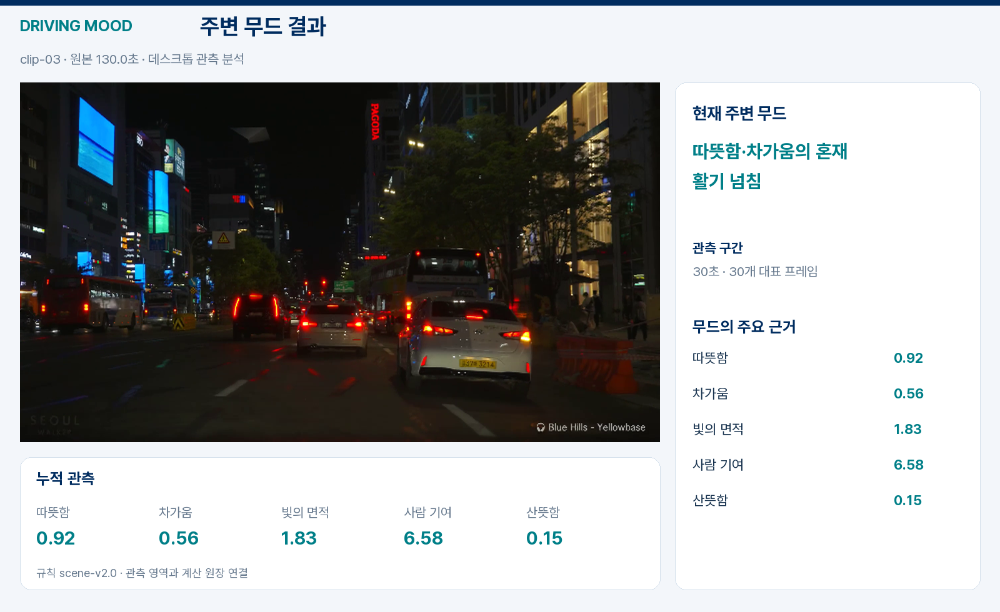

# 작은 간판과 건물 조명 관측 개선

실제 차량 주행 영상의 동일한 프레임으로 기존 픽셀 선택과 의미분할 보조 관측을 비교했다. 각 구간은 30초이며 첫 영상은 원본 길이인 25.64초다. 두 방식 모두 같은 `scene-v2.0` 점수기를 사용했다.

## 무엇을 바꿨나

기존 방식은 작은 글자·세로 간판을 크기와 형태 조건에서 제외하고, 넓은 건물 조명도 놓쳤다. 개선 방식은 건물·창문·간판 분할을 바탕으로 **국소 대비와 넓은 밝은 면**을 측정한다. 차량·교통등·도로 영역을 제외하고 겹치는 픽셀은 한 번 계산한다.

색은 대표 색조 하나로 압축하지 않고 실제 픽셀의 색 분포와 채도 합을 보존한다. 따뜻한 빛과 차가운 빛이 함께 나타나면 두 근거를 함께 남긴다. 관측 강도, 측정 품질, 음악 방향의 해석을 별도로 관리한다.

## 야간 도심의 관측 복구

아래 이미지는 같은 야간 도심 구간의 연속된 장면이다. 작은 네온과 세로 간판, 오른쪽 건물의 밝은 면이 계산 원장에 연결됐다. 번호는 주요 기여 영역이며 전체 영역별 수치는 CSV에서 확인할 수 있다.

[130초 전체 영역 원장](assets/driving-v3/clip-03-000400-ledger.csv)

[135초 전체 영역 원장](assets/driving-v3/clip-03-000450-ledger.csv)

[140초 전체 영역 원장](assets/driving-v3/clip-03-000500-ledger.csv)

[145초 전체 영역 원장](assets/driving-v3/clip-03-000550-ledger.csv)

[150초 전체 영역 원장](assets/driving-v3/clip-03-000600-ledger.csv)

## 구간 결과

야간 도심에서는 따뜻한 빛과 차가운 빛의 혼재, 공간적으로 분포한 밝은 영역이 지속되어 **활기 넘침** 후보가 나왔다.

| 영상 | 기존 픽셀 선택 | 의미분할 보조 관측 |
|---|---|---|
| 야간 차량·거리 조명 | 따뜻한 | 주요 후보 없음 |
| 야간 빗길 | 주요 후보 없음 | 주요 후보 없음 |
| 야간 도심 | 주요 후보 없음 | 따뜻한·차가운·활기 넘침 |
| 주간 도심 | 주요 후보 없음 | 활기 넘침 |
| 터널에서 주간 도로로 | 주요 후보 없음 | 활기 넘침 |
| 어두운 도로 | 주요 후보 없음 | 주요 후보 없음 |

밝은 영역의 관측은 늘었지만, 주간 햇빛과 인공 조명의 구별은 추가 개선 항목이다. 시간대·하늘·날씨·도로 맥락을 결합해 같은 밝기에도 다른 의미를 부여하는 방향으로 확장한다.

## 검증 범위

데스크톱 연구 관측 `semantic-contrast-rgb-v3`의 결과다. Android 0.3.0은 기존 채택 픽셀의 색 분포를 보존하는 `accepted-light-rgb-v1`을 사용한다. 원본 RGB·분할 마스크의 SHA, 프레임 시각, 그룹별 픽셀 합계와 영역별 기여 합계를 대조했다. 이 실험의 평가는 관측 복구와 계산 연결이며, 인식 정확도와 단말 성능은 별도 평가한다.

[비교 수치와 원본 해시](assets/driving-v3/observation-comparison.json) · [초기 시행착오](TRIALS.md) · [모델·영상 출처](DRIVING_DEMO.md)
