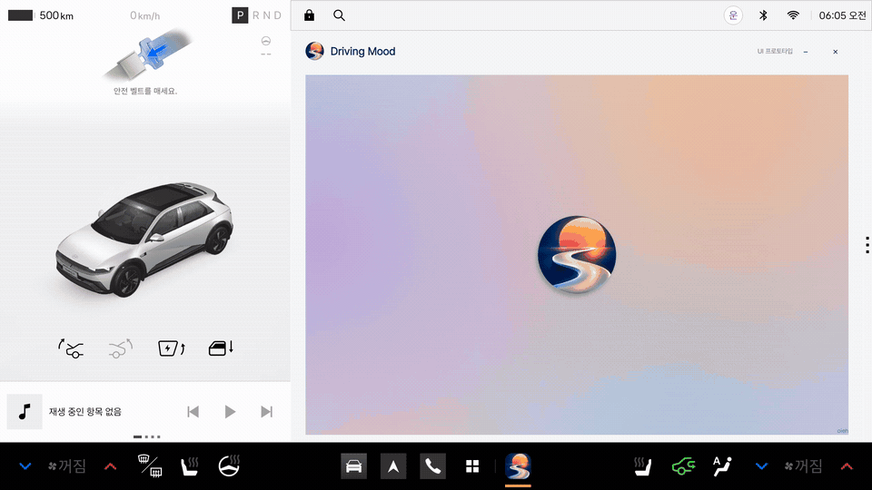
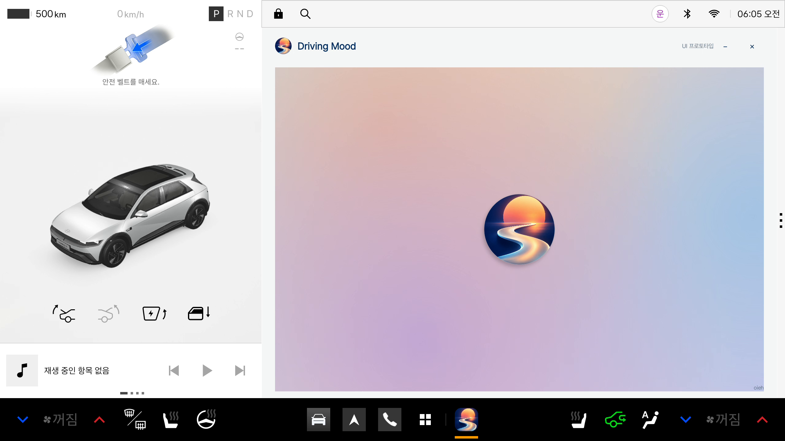
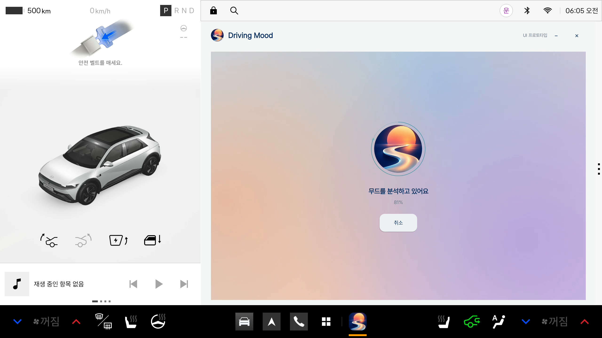
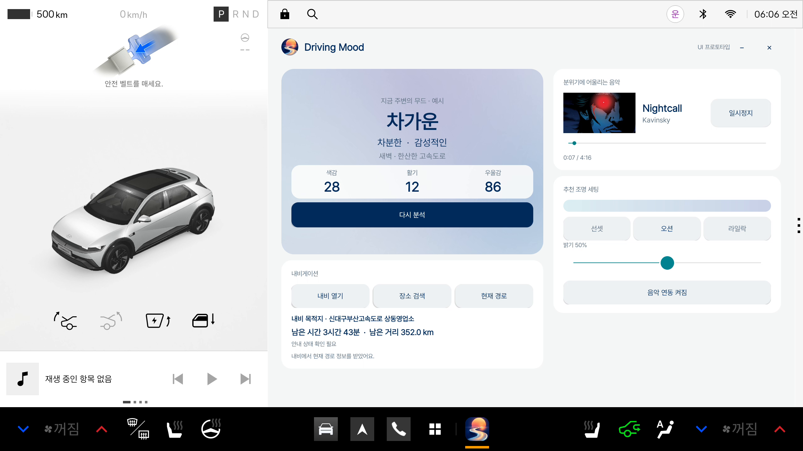
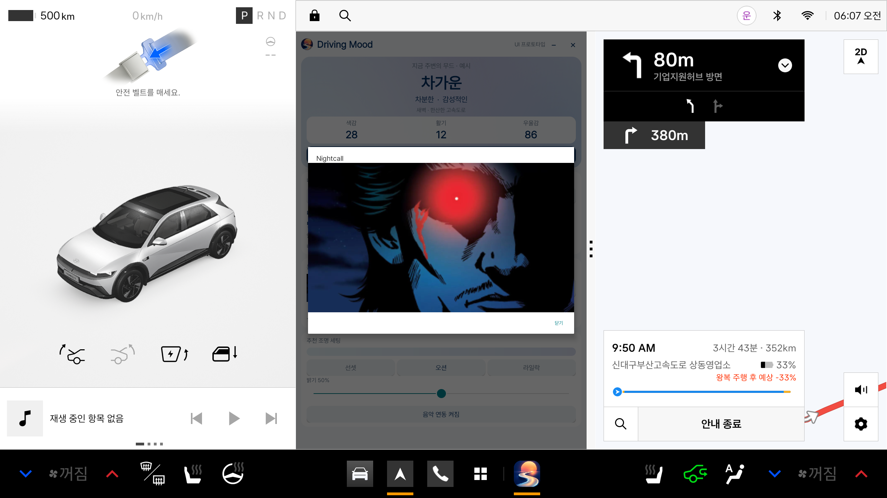
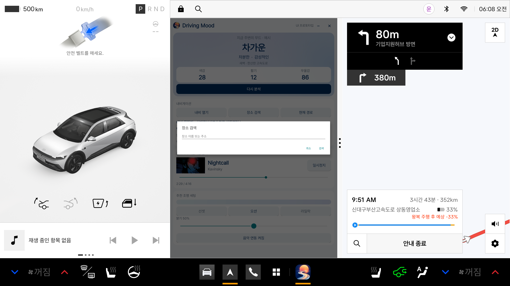
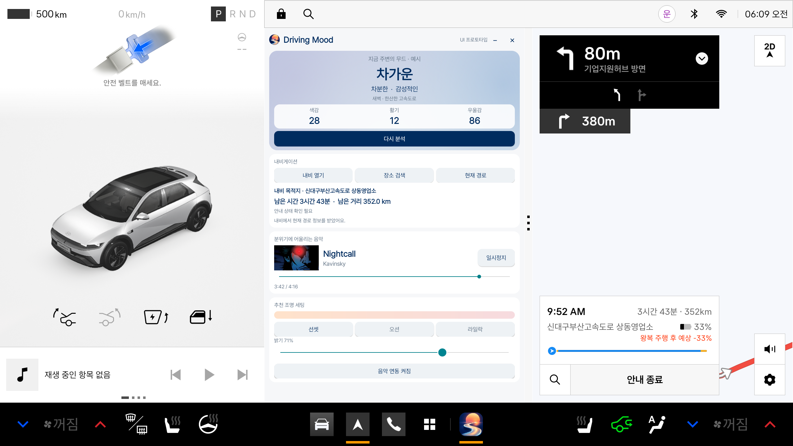
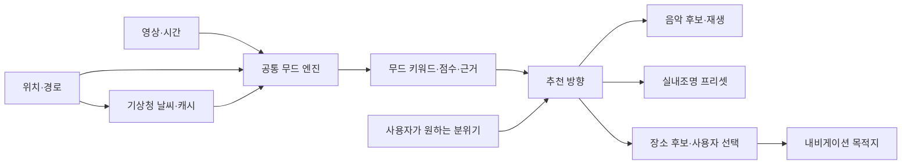

# Pleos에서의 Driving Mood

주변 풍경에서 얻은 무드 키워드를 음악, 실내조명, 다음 목적지 선택에 활용한다. 사용자는 지금의 분위기를 이어갈지 바꿀지 선택할 수 있다.

앱 목록에서 Driving Mood 아이콘을 길게 누른 뒤 하단 GNB의 편집 가능 영역으로 끌어 고정할 수 있다. 설치 후 사용자가 바로가기를 배치하는 [Pleos 공식 편집 방식](https://document.pleos.ai/docs/connect/guide/docs-design/components/gnb)을 따른다.

0.1.1의 무드와 점수는 새벽 고속도로를 가정한 수동 시연 예시이며 조명은 미리보기다. 로컬 음악 재생·최소화·복귀·종료와 내비 목적지·남은 시간·거리 조회를 확인했다. [검증 기록](../VALIDATION-PLEOS-0.1.1.md)

캡처의 하단 로고는 실행 후 표시된 최근 앱 영역이다.

[에뮬레이터 설치 APK](https://github.com/oiehnow/driving-mood/releases/tag/pleos-preview-v0.1.1) · [빌드와 실행](../../pleos-preview/README.md)

[전체화면 영상 · 소리 포함](https://github.com/oiehnow/driving-mood/releases/download/pleos-preview-v0.1.1/DrivingMood-Pleos-0.1.1-wide.mp4) · [3분할·세부 메뉴 영상 · 소리 포함](https://github.com/oiehnow/driving-mood/releases/download/pleos-preview-v0.1.1/DrivingMood-Pleos-0.1.1-split.mp4)

| 시작 | 분석 |
|---|---|
|  |  |

| 음악 재생·조명 연동 | 앨범 이미지 |
|---|---|
|  |  |

| 장소 검색 | 추천 조명 세팅 |
|---|---|
|  |  |

## 목표 사용 흐름

**Driving Mood 열기 → 로고 선택 → 주변 관측·분석 → 무드 결과 → 음악·조명·장소 선택**

분석 요청 시 영상과 시간, 위치 기반 날씨를 모은다. 날씨는 유효한 캐시를 우선 사용하고 새 조회는 요청당 한 번으로 제한한다. 장면 속 색감·빛·사람·하늘의 기여를 누적해 대표 키워드와 근거를 보여준다.

예를 들어 노을과 따뜻한 조명이 관측되면 부드러운 음악과 웜톤 조명을 제안할 수 있다. 사용자가 활기를 원하면 관측 결과는 유지하고 추천 방향을 바꾼다. 장소 추천은 위치·이동 거리·경로 이탈 정도를 함께 고려해 사용자가 선택한 곳을 목적지로 연결하는 확장이다.

## 음악·조명·내비게이션 연결

| 연결 | 현재 기반 | 차량에서 확장할 기능 |
|---|---|---|
| 음악 | MediaPlayer 실제 재생·앨범 이미지 읽기·미디어 세션 확인 | 내비 안내·통화 시 오디오 포커스와 차량 재생 조작 검증 |
| 실내조명 | 색상·밝기와 음악 재생 시간에 맞춘 화면 미리보기 | 순정 음악 동기화 재사용을 우선 확인하고 지원되는 프리셋 제어 연결 |
| 내비게이션 | SDK로 받은 목적지·남은 시간·거리 표시 확인 | 수신 위치·경로의 유효성을 확인한 뒤 분석 입력에 반영 |
| 영상 | 휴대폰 후면 카메라와 저장 영상 분석 | 주행 영상 파일로 차량 환경을 검증한 뒤 승인된 차량 영상 입력을 연결 |

[NaviHelper](https://document.pleos.ai/docs/pleos-only/connect-sdk-pleos/NaviHelper/event-listeners)는 위치·경로·안내 상태 이벤트를 제공한다. 점포 영업시간과 영상 속 간판의 점포 대응은 추가 데이터 연결 항목이다.

서비스 연결, SDK 요청 전달, 내비 앱의 응답은 각각 확인한다. 목적지와 남은 시간·거리는 수신값을 사용하며 값이 없으면 ‘—’로 표시한다. SDK의 안내 상태가 실제 내비 화면과 맞지 않으면 ‘안내 상태 확인 필요’로 남긴다. 현재 위치는 아직 무드 계산에 넣지 않는다.

사용자가 준비한 로컬 음원을 재생하고 파일에 포함된 앨범 이미지를 읽는다. 최소화 후에도 음악은 이어지며 앱을 다시 열면 결과·밝기·재생 위치가 유지된다. 닫기(×)는 재생을 중지한다. [Pleos Music/Audio 가이드](https://document.pleos.ai/docs/pleos-only/vehicle-app-developer-guide/music-audio-app-developement-guide)에 따라 미디어 세션과 재생 서비스를 사용한다. 음원과 앨범 이미지는 APK·저장소에 포함하지 않는다.

‘추천 조명 세팅’의 ‘음악과 연동’은 실제 재생 시간에 맞춰 밝기를 바꾸는 화면 미리보기다. 비트 분석이나 차량 조명 제어는 수행하지 않는다.

음악 반응 조명은 순정 기능 재사용을 먼저 확인한다. [기아 Sound Mood Lamp 설명서](https://ownersmanual.kia.com/ivi/DA_GEN2_V/AV/KOR/English/002_Features_soundmoodlamp.html)에는 음악 동기화 설정이 있다. 대상 차량에서 이를 켠 뒤 순정 재생과 Driving Mood의 동일 음원을 비교해 재생·일시정지·음소거·곡 변경에 반응하는지 확인한다. 해당 설명서는 DA_GEN2_V 기준이며 Pleos와 제3자 앱 출력의 호환, 전용 설정 진입·활성화 API는 아직 확인되지 않았다.

색상·밝기 프리셋은 [Light API](https://document.pleos.ai/en/api-reference/connect-sdk-pleos/Vehicle/vehicle/ai.pleos.playground.vehicle.api/light/entry)와 [차종별 API 가용성](https://document.pleos.ai/docs/pleos-only/vehicle-app-planning-guide/api-compatibility-availability)을 확인해 연결한다. 음악 동기화 지원 여부와 일반 색상 제어 capability는 따로 검증한다. 순정 기능의 활용 가능성을 확인하기 전에는 자체 음악 분석·조명 엔진으로 대체하지 않는다.

## 앱 창 프로토타입

새벽 고속도로 수동 시연은 ‘차가운·차분한·감성적인’, 색감 28·활기 12·우울감 86을 사용한다. 휴대폰의 실제 분석 모델과 점수 규칙은 변경하지 않는다.

[캡처 정보](assets/pleos-0.1.1/capture-info.json) · [이전 0.1.0 화면](assets/pleos/prototype-flow.gif)

[공통 무드 엔진과 차량 연동 설계](ARCHITECTURE.md)
