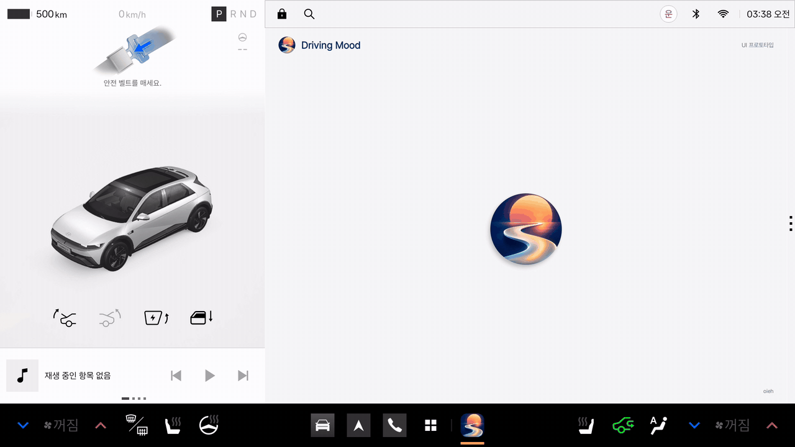
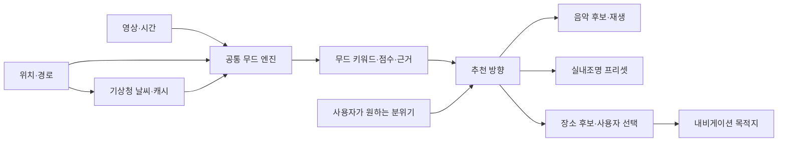
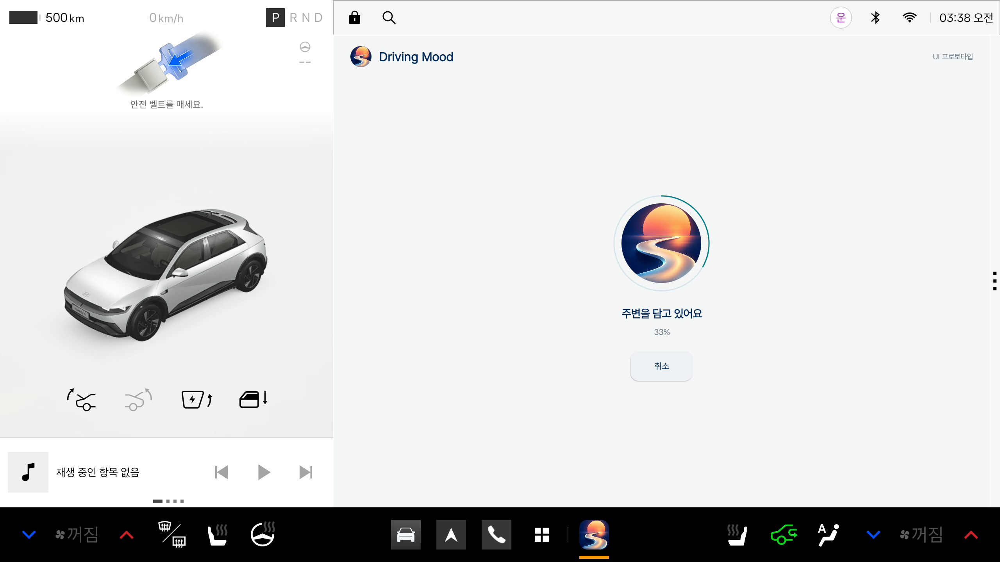
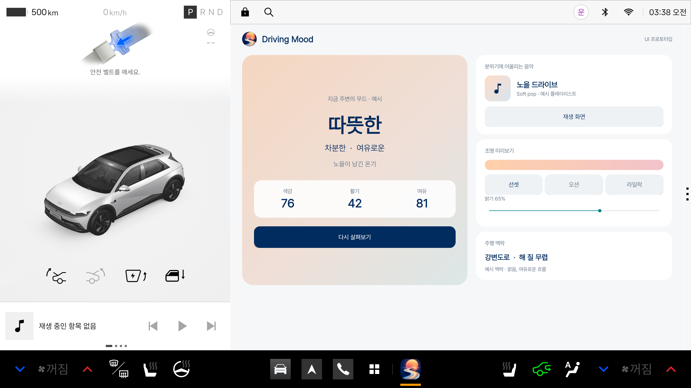

# Pleos에서의 Driving Mood

주변을 관측해 얻은 무드 키워드를 음악, 실내조명, 다음 목적지에 연결한다. 운전자는 분위기를 이어갈지 바꿀지 선택하고, 각 기능은 같은 무드 결과를 사용한다.

앱 목록에서 Driving Mood 아이콘을 길게 누른 뒤 하단 GNB의 편집 가능 영역으로 끌어 고정할 수 있다. 설치 후 사용자가 바로가기를 배치하는 [Pleos 공식 편집 방식](https://document.pleos.ai/docs/connect/guide/docs-design/components/gnb)을 따른다.

아래 화면은 차량 앱 창의 UI 프로토타입이며 차량 SDK 연결과 실시간 차량 분석은 후속 구현이다.

캡처의 하단 로고는 실행 후 표시된 최근 앱 영역이다.

[에뮬레이터 설치 APK](https://github.com/oiehnow/driving-mood/releases/tag/pleos-preview-v0.1.0) · [빌드와 실행](../../pleos-preview/README.md)

## 사용 흐름

**Driving Mood 열기 → 로고 선택 → 주변 관측·분석 → 무드 결과 → 음악·조명·장소 선택**

분석 요청 시 영상과 시간, 위치 기반 날씨를 모은다. 날씨는 유효한 캐시를 우선 사용하고 새 조회는 요청당 한 번으로 제한한다. 장면 속 색감·빛·사람·하늘의 기여를 누적해 대표 키워드와 근거를 보여준다.

예를 들어 노을과 따뜻한 조명이 관측되면 부드러운 음악과 웜톤 조명을 제안할 수 있다. 사용자가 활기를 원하면 관측 결과는 유지하고 추천 방향을 바꾼다. 장소 추천은 위치·이동 거리·경로 이탈 정도를 함께 고려해 사용자가 선택한 곳을 목적지로 연결하는 확장이다.

## 음악·조명·내비게이션 연결

| 연결 | 현재 기반 | 차량에서 확장할 기능 |
|---|---|---|
| 음악 | 무드·선호에 따른 로컬 음원 추천·재생 | Media3 미디어 세션과 오디오 포커스로 내비 안내와 재생을 조율 |
| 실내조명 | 같은 키워드로 만든 색상·밝기 미리보기 | 순정 음악 동기화 재사용을 우선 확인하고 지원되는 프리셋 제어 연결 |
| 내비게이션 | 위치·날씨를 사용하는 입력 구조 | 위치·경로 맥락을 분석에 보태고 선택한 장소를 목적지로 전달 |
| 영상 | 휴대폰 후면 카메라와 저장 영상 분석 | 주행 영상 파일로 차량 환경을 검증한 뒤 승인된 차량 영상 입력을 연결 |

[NaviHelper](https://document.pleos.ai/docs/pleos-only/connect-sdk-pleos/NaviHelper/event-listeners)는 위치·경로·안내 상태 이벤트를 제공한다. 점포 영업시간과 영상 속 간판의 점포 대응은 추가 데이터 연결 항목이다.

음악은 [Pleos Music/Audio 가이드](https://document.pleos.ai/docs/pleos-only/vehicle-app-developer-guide/music-audio-app-developement-guide)의 미디어 세션 구조에 맞춰 연결한다. 외부 음악 서비스는 각 서비스가 제공하는 재생 인터페이스를 사용한다.

음악 반응 조명은 순정 기능 재사용을 먼저 확인한다. [기아 Sound Mood Lamp 설명서](https://ownersmanual.kia.com/ivi/DA_GEN2_V/AV/KOR/English/002_Features_soundmoodlamp.html)에는 음악 동기화 설정이 있다. 대상 차량에서 이를 켠 뒤 순정 재생과 Driving Mood의 동일 음원을 비교해 재생·일시정지·음소거·곡 변경에 반응하는지 확인한다. 해당 설명서는 DA_GEN2_V 기준이며 Pleos와 제3자 앱 출력의 호환, 전용 설정 진입·활성화 API는 아직 확인되지 않았다.

색상·밝기 프리셋은 [Light API](https://document.pleos.ai/en/api-reference/connect-sdk-pleos/Vehicle/vehicle/ai.pleos.playground.vehicle.api/light/entry)와 [차종별 API 가용성](https://document.pleos.ai/docs/pleos-only/vehicle-app-planning-guide/api-compatibility-availability)을 확인해 연결한다. 음악 동기화 지원 여부와 일반 색상 제어 capability는 따로 검증한다. 순정 기능의 활용 가능성을 확인하기 전에는 자체 음악 분석·조명 엔진으로 대체하지 않는다.

## 앱 창 프로토타입

| 분석 | 결과 |
|---|---|
|  |  |

[공통 무드 엔진과 차량 연동 설계](ARCHITECTURE.md)
