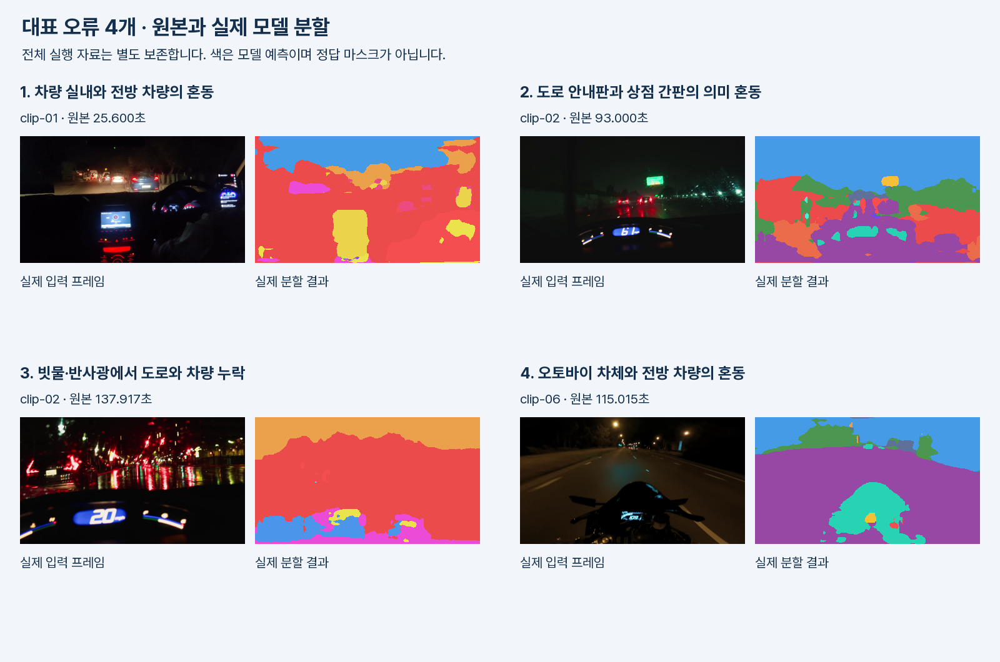

# 시행착오 검토 자료

영상 분할과 장면 해석을 개선하기 위해 대표 오류 4개를 비교했다.

첫 번째와 세 번째는 분할 오류, 두 번째는 도로 표지판과 상점 간판의 의미 구별, 네 번째는 촬영 차량과 전방 차량의 구별 문제다. 이를 기준으로 모델 교체와 후처리 개선 효과를 비교한다.

## 보존한 비교 기준

- [초기 평가 사진과 출처](../vision/evaluation/ATTRIBUTION.md)
- [초기 객체 검출 결과](../vision/evaluation/model-results.json)
- [초기 픽셀 측정값](../vision/evaluation/pixel-results.tsv)
- [실제 주행 영상의 분할·계산 결과](DRIVING_DEMO.md)
- [실제 색감 조건 통과 프레임의 분석 화면](assets/driving/color-candidate-analysis.png)

원본 영상, 모델별 체크포인트, RGB·ID 마스크, 프레임별 계산값과 실행 기록을 함께 보존한다.
