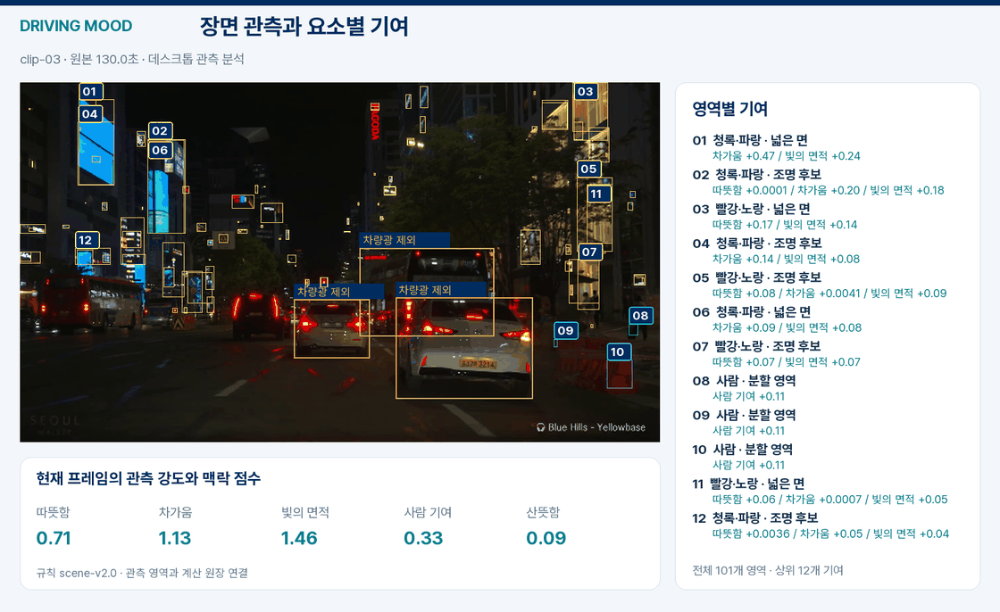
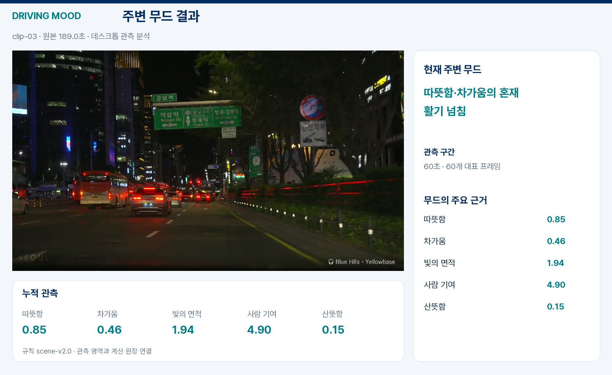

# 주행 장면에서 무드 결과까지

실제 주행 영상 6개에서 326개 대표 프레임을 분석했다. 작은 간판·건물의 밝은 면·사람을 관측하고, 각 영역의 기여를 같은 `scene-v2.0` 점수기로 계산한다.

## 세 가지 화면

| 화면 | 구성 |
|---|---|
| 원본 | 선택한 주행 구간 |
| 분석 | 실제 영역 박스·번호, 요소별 기여, 프레임 점수와 구간 결과 |
| 결과 | 장면 관측, 분석 상태, 최종 무드와 주요 근거 |

분석·결과 영상은 **60초 관측 → 20초 계산 근거 → 10초 결과**의 90초 구성이다. 관측은 1초 간격의 실제 프레임을 사용하며, GIF는 그중 5초 간격 장면과 마지막 결과를 요약했다. 짧은 첫 영상은 실제 25.64초를 관측해 56초로 구성했다.

## 60초 관측 결과

| 구간 | 원본 관측 범위 | 표본 | 주요 무드 |
|---|---|---:|---|
| 야간 차량·거리 조명 | 0–25.64초 | 26 | 주요 후보 없음 |
| 야간 빗길 | 48–108초 | 60 | 주요 후보 없음 |
| 야간 도심 | 130–190초 | 60 | 따뜻한·차가운·활기 넘침 |
| 주간 도심 | 0–60초 | 60 | 활기 넘침 |
| 터널에서 주간 도로로 | 0–60초 | 60 | 활기 넘침 |
| 어두운 도로 | 70–130초 | 60 | 주요 후보 없음 |

야간 도심에서는 작은 네온과 넓은 조명 면이 함께 잡히고, 따뜻함·차가움의 근거가 구간 전체에 남았다. 주간의 밝은 표면도 현재 활력 규칙에 반영되므로, 다음 개선은 시간대·하늘·도로·날씨에 따라 같은 관측의 의미를 구분하는 것이다.

데스크톱 관측 `semantic-contrast-rgb-v3`를 사용했다. 원본 RGB·마스크 해시, 프레임 시각, 영역별 기여 합계와 마지막 누적 결과를 대조했으며, 기존 30초 실험과 겹치는 176개 프레임의 점수도 일치했다.

[영상·입력 검증 수치](assets/driving-v3/video-observation-manifest.json) · [30초 동일 구간 비교](OBSERVATION_IMPROVEMENT.md) · [초기 실험과 모델·영상 출처](DRIVING_DEMO.md)
