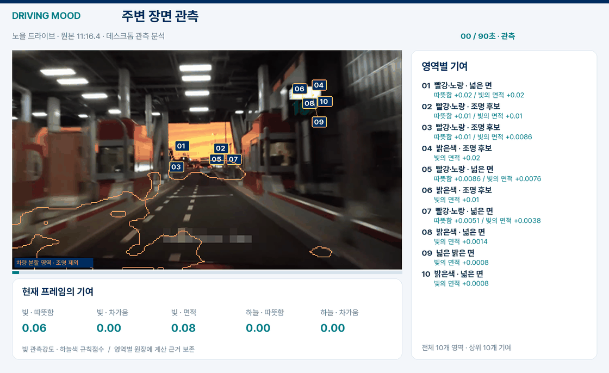

# 주행 장면에서 무드 결과까지

[실제 Android 앱 화면](APP_UI.md) · [APK 다운로드](https://github.com/oiehnow/driving-mood/releases/tag/v0.3.3)

실제 차량 주행 영상과 이미지 자료들을 바탕으로 장면 다양성을 보강했다. 주행 영상의 조명·사람·하늘 근거를 공용 점수기로 계산하고, 같은 시간 구간의 중복 표본을 제외해 관측을 누적했다.

## 세 가지 화면

| 화면 | 구성 |
|---|---|
| 원본 | 같은 시작점의 90초 주행 구간 |
| 분석 | 실제 영역·차량 제외 마스크·요소별 기여와 구간 결과 |
| 결과 | 관측 진행, 계산 근거, 완료음과 공통 주변 무드 |

분석·결과 영상은 **60초 관측 → 20초 계산 근거 → 10초 결과**로 구성했다. 관측 화면은 초당 한 장의 실제 분석 프레임을 사용하고, GIF는 5초 간격 장면과 최종 결과를 요약한다. 곡명·위치 자막·워터마크는 표시 사본에서 모자이크 처리했다.

## 하늘색과 주변 조명을 함께 반영

| 장면 | 원본 관측 시작 | 대표 구간 | 공통 주변 무드 |
|---|---:|---:|---|
| 노을 드라이브 | 676.417초 | 60 | 따뜻한 |
| 서울 낮 도심 | 1,639.800초 | 60 | 활기 넘침·차가운 |
| 서울 밤 도심 | 1,901.317초 | 56 | 활기 넘침 |
| 흐린 날 도로 | 1,588.700초 | 60 | 주요 후보 없음 |

노을에서는 따뜻한 하늘색과 조명 조건이 각각 59/60구간에서 지속됐다. 낮 도심은 차가운 하늘색 60/60구간과 밝은 면적·분포 55/60구간을 함께 반영했다. 밤 도심의 활력은 밝은 면적·분포 49/60구간에 근거한다. 흐린 도로의 차가운 하늘색은 28/60구간으로 채택 기준에 못 미쳤다.

이번 데스크톱 실행은 공식 의미분할 모델의 예측과 제품 Kotlin 점수기를 사용했다. 사람은 분할 면적 근거만 사용했으며 객체 검출 수를 만들지 않았다. 촬영 날짜·GPS·날씨가 없는 입력은 그대로 비워 두었다. ‘활기 넘침’은 밝은 영역의 분포와 지속성에 대한 현재 규칙의 해석이다.

## 계산 근거

그림의 번호와 실제 영역별 기여 원장을 연결했다. 차량 제외는 주황색 분할 경계로 표시한다. 빛의 관측 강도와 하늘색 규칙점수는 서로 다른 항목으로 보존한다.

| 장면 | 영역 원장 | 점수 근거 |
|---|---|---|
| 노을 | [CSV](assets/driving-v4/full-01-regions.csv) | [JSON](assets/driving-v4/full-01-score-evidence.json) |
| 낮 도심 | [CSV](assets/driving-v4/full-02-regions.csv) | [JSON](assets/driving-v4/full-02-score-evidence.json) |
| 밤 도심 | [CSV](assets/driving-v4/full-03-regions.csv) | [JSON](assets/driving-v4/full-03-score-evidence.json) |
| 흐린 도로 | [CSV](assets/driving-v4/full-04-regions.csv) | [JSON](assets/driving-v4/full-04-score-evidence.json) |

[입력·영상 해시와 구간 기록](assets/driving-v4/video-observation-manifest.json) · [원본 영상 출처](assets/driving-v4/ATTRIBUTION.md) · [기존 주행 시연](VIDEO_DEMO-v3.md) · [점수 설계](MOOD_SCORING.md)
