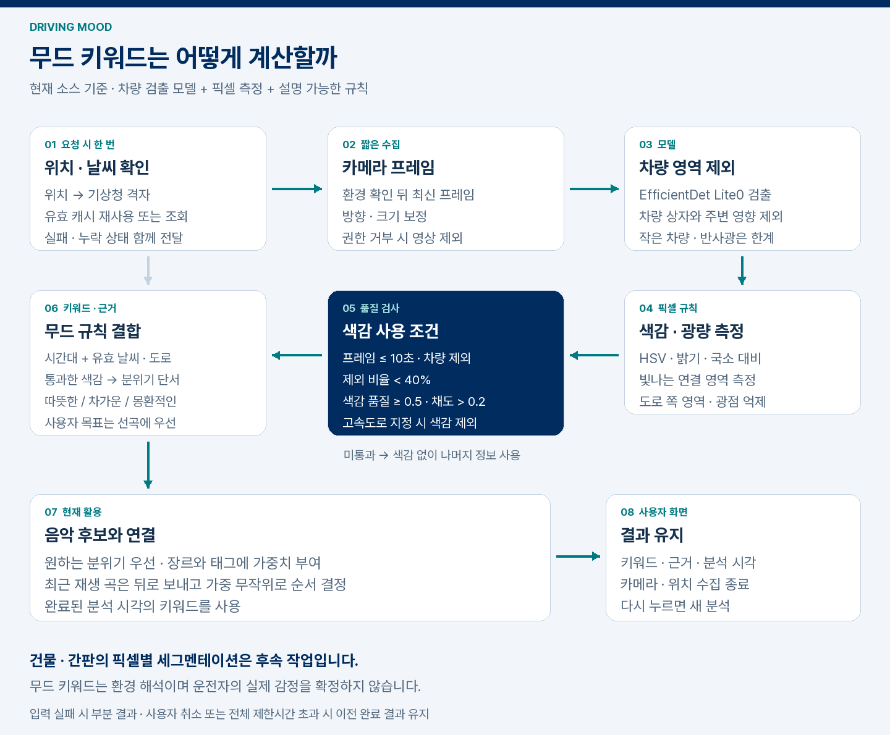

# 그림과 구현 코드

README의 도식은 제품 구조와 현재 알고리즘을 설명합니다. [실제 주행 실험](DRIVING_DEMO.md)과 [점수 설계](MOOD_SCORING.md)에서 계산 근거를 확인할 수 있습니다.

## 제품 구조


현재 키워드는 공용 점수기가 관측별 기여와 지속성을 결합해 생성합니다. 원하는 분위기·선호 장르·곡 태그를 선곡에 사용하고 조명 프리셋을 미리 볼 수 있습니다. 현재 기분과 수정 피드백, 내비게이션·실차 조명·주변 장소 연결은 후속 개발입니다.


## 분석 흐름


실행 흐름: [RecordedRequestRunner](../../app/src/main/java/kr/urbanmood/integration/RecordedRequestRunner.kt)는 환경 조회와 촬영·분석·추천을 연결합니다. [MainActivity](../../app/src/main/java/kr/urbanmood/MainActivity.kt)는 요청 상태와 취소, 완료음·결과 표시를 제어합니다.

## 알고리즘



| 그림 단계 | 구현과 확인할 내용 |
| --- | --- |
| 위치·날씨 | [AndroidEnvironmentProvider](../../app/src/main/java/kr/urbanmood/context/AndroidEnvironmentProvider.kt), [WeatherRequests](../../app/src/main/java/kr/urbanmood/context/WeatherRequests.kt): 1회 수집, 캐시, 중복 요청·재시도 제한 |
| 영상 입력 | [VideoCaptureController](../../app/src/main/java/kr/urbanmood/camera/VideoCaptureController.kt), [RecordedVideoDecoder](../../app/src/main/java/kr/urbanmood/camera/RecordedVideoDecoder.kt): 30/60초 녹화와 실제 영상 시각의 프레임 분석 |
| 차량 제외·픽셀 측정 | [영상 분석 설명](../vision/README.md): 차량 검출과 픽셀 측정의 역할·한계 |
| 관측 사용 조건 | [관측 계약](../../app/src/main/java/kr/urbanmood/contracts/SceneContracts.kt): 실제 출처·관측 종류·품질·미지원 구별 |
| 시간 구간 누적 | [SceneAccumulator](../../app/src/main/java/kr/urbanmood/recommendation/SceneAccumulator.kt): 최대 60초, 1초 구간별 대표·중복·경계 처리 |
| 무드 규칙 | [SceneMoodScorer](../../app/src/main/java/kr/urbanmood/recommendation/SceneMoodScorer.kt), [SceneFeatureScorer](../../app/src/main/java/kr/urbanmood/recommendation/SceneFeatureScorer.kt): 빛·색의 강도, 사람·하늘·날씨의 기여와 시간 지속성 |
| 키워드·선곡 | [MoodRecommendationEngine](../../app/src/main/java/kr/urbanmood/recommendation/MoodRecommendationEngine.kt): 시간·날씨·도로 결합, 태그 가중치와 최근 곡 순서 |

가중치와 적용 조건은 [점수 설계](MOOD_SCORING.md)에서 버전별로 관리합니다.

## 재생성과 출처

도형과 문구는 이 프로젝트에서 작성했습니다. Pillow가 설치된 환경에서 다음 명령으로 PNG와 GIF를 재생성할 수 있습니다. 앱에 포함된 Pretendard Variable을 함께 사용합니다.

```sh
python scripts/render-project-visuals.py
```

주행 분석 장면은 실제 영상과 모델 출력으로 구성합니다.
