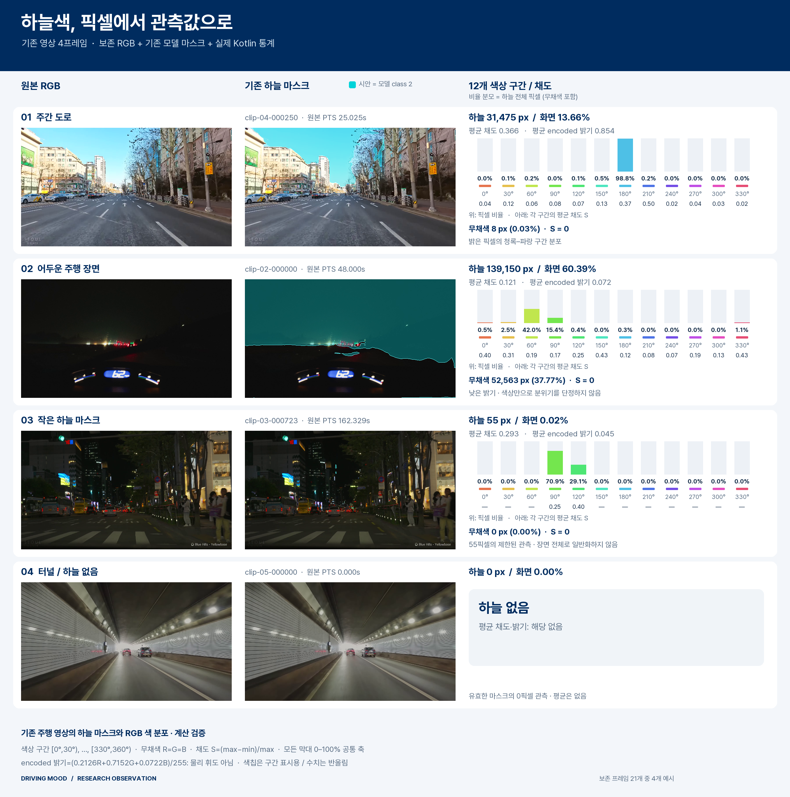
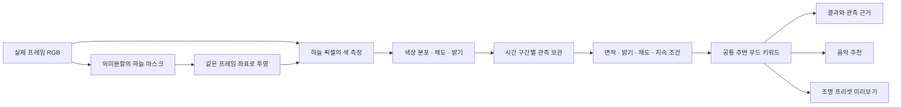

# 하늘색 관측과 무드 해석

하늘의 밝기만 사용하던 관측에 **색 분포와 채도**를 추가했다. 분홍빛 노을뿐 아니라 푸른 여명, 금빛 하늘, 붉은 잔광, 흐린 낮의 옅은 색까지 같은 방식으로 기록한다.

0.3.2는 하늘색을 **따뜻한·차가운·다채로운** 주변 무드 후보로 연결한다. 화면·음악·조명 미리보기는 같은 공통 키워드를 사용하며, 개인 음악 취향은 음악 선택에 따로 적용한다. [0.3.2 APK 검증](../VALIDATION.md)을 완료했으며 이전 배포본도 보존한다.

[그림의 입력 출처·PTS·해시](sky-color-calculation-check.sources.json)

## 계산 흐름

카메라·디코더에서 방향을 보정하고 긴 변을 최대 640픽셀로 축소한 RGB를 사용한다. 의미분할 입력으로 다시 축소하기 전의 색을 측정하며, 하늘 마스크만 같은 좌표에 투영한다. 원시 영상이나 마스크를 누적 창에 저장하지 않는다.

| 관측 | 계산 |
|---|---|
| 하늘 면적 | 하늘 픽셀 수 ÷ 전체 분석 프레임 픽셀 수 |
| 색 분포 | 색상각을 30°씩 나눈 12구간의 픽셀 수와 채도 합 |
| 평균 채도 | 하늘 전체의 채도 합 ÷ 하늘 픽셀 수 |
| 밝기 | 인코딩 RGB의 가중합 `(0.2126R + 0.7152G + 0.0722B) / 255`와 4구간 분포 |
| 화면 내 위치 | 방향 보정된 영상의 위·가운데·아래에 있는 하늘 픽셀 수 |
| 출처 | 프레임 식별값, 실제 영상 PTS, RGB·마스크·모델 해시 |

R=G=B인 픽셀만 무채색으로 구분한다. 옅거나 어두운 유채색은 통계에 남기며, 빨강의 0°/360° 경계를 단순 평균해 다른 색으로 만들지 않는다. 하늘이 없는 유효 관측은 0개와 평균 없음으로, 측정하지 못한 경우는 관측 없음으로 구별한다.

## 무드 계산

| 항목 | 고정 프로토타입 규칙 |
|---|---|
| 따뜻한 색상군 | 0° 이상 60° 미만, 330° 이상 360° 미만 |
| 차가운 색상군 | 150° 이상 270° 미만 |
| 원시 강도 | `70 × 해당 색상군의 채도 합 ÷ 전체 프레임 픽셀 수` |
| 해석 가능한 프레임 | 하늘 면적 ≥ 2%, 평균 인코딩 밝기 ≥ 0.10, 평균 채도 ≥ 0.05 |
| 따뜻한·차가운 후보 | 해당 색상군이 하늘 전체 채도 합의 60% 이상 |
| 다채로운 후보 | 두 색상군이 각각 20% 이상이며 합계 60% 이상 |
| 시간 조건 | 전체 30초·60초 창의 1초 구간 중 절반 이상에서 후보 조건 충족 |

원시 강도는 어둡거나 작은 하늘에서도 보존한다. 자동 키워드에만 위 조건을 적용하며, 누락 구간도 시간 조건의 분모에 포함한다. 유효한 하늘 0개는 측정 0으로, 관측 누락은 미측정으로 처리한다. 같은 구간의 중복 프레임은 첫 표본 하나만 사용한다.

하늘색 강도와 기존 조명·사람·날씨 기여는 근거별로 표시한다. 단위가 다른 값을 하나의 총점으로 합치지 않는다. 이 규칙값은 학습된 감정 확률이 아니며, 주변 색의 해석과 운전자의 감정을 구별한다.

## 현재 연결 검증

새 주행 영상 4개에서 각각 중앙 시점부터 60초를 고정하고, 실제 PTS를 가진 240프레임으로 30초·60초 창 8개를 검사했다. 동일 RGB와 기준 모델의 예측 마스크를 Android에서 계산해 화면·음악·조명 전달을 확인했다.

| 영상 | 30초 하늘색 키워드 | 60초 하늘색 키워드 | 대표 구간 수: 30초 / 60초 |
|---|---|---|---|
| 노을 드라이브 | 따뜻한 | 따뜻한 | 30 / 60 |
| 서울 낮 도심 | 차가운 | 차가운 | 30 / 60 |
| 서울 밤 주행, HDR→SDR | 없음 | 없음 | 29 / 56 |
| 도로 주행 | 없음 | 없음 | 30 / 60 |

표는 **하늘색 경로만의 결과**다. 야간 영상의 대표 구간 수는 실제 PTS가 구간 경계 앞뒤에 놓인 결과를 그대로 반영했다. 도로 주행의 차가운 색 조건은 60초 중 28구간에서 충족되어 자동 키워드가 나오지 않았다. 키워드가 없을 때 조명 제안을 임의로 만들지 않는다.

앱 전체 단위검사 **306개**, 연구 release 앱의 녹화·완료음·취소·구성 및 원시 입력 검사 **8개**, 실제 영상 입력의 Android 연결 검사 **4개**가 통과했다. 별도 실제 30초·60초 카메라 녹화 검사는 디코더와 앱 모델 경로를 사용했다. 검증 환경은 Android 에뮬레이터이며, 위 표는 분할 정확도나 감성 정답률을 뜻하지 않는다. [계산 정책과 창별 검증 결과](sky-mood-verification.json)

본 앱 소스에 통합한 뒤에도 306개 단위검사와 앱 생성·식별자·라이선스 검사 1개가 통과했고 Lint 오류는 0개였다. 검증 중 제품 소스 156개가 유지됐으며 기존 배포 APK를 보존했다.

## 원시 관측 단계의 검증 기록

| 범위 | 결과 |
|---|---|
| 색 계산 단위 검사 | 12개 통과: 무채색, 파스텔, 어두운 색, 색상·밝기 경계, 입력 보존 |
| 보존 RGB·마스크 계산 대조 | 기존 6영상·21프레임, 하늘 803,486픽셀의 구간 개수와 합계 일치 |
| Android 실제 모델 연결 | 기존 6영상·24프레임, 하늘 869,700픽셀; Android 색 변환 API와 구간 개수 일치 |
| 연구 앱 전체 검사 | 단위 검사 289개, 네이티브 검사 4개 통과; Lint 오류 0 |
| 기존 결과 보존 | Android 24프레임에서 새 관측 유무에 따른 기존 점수 차이 없음 |
| 본 앱 소스 통합 | 단위 검사 289개와 실제 앱 생성 경로·라이선스 검사 1개 통과; Lint 오류 0 |

두 프레임 집합은 별개다. 위 검증은 계산과 연결을 확인한 결과이며, 하늘 분할의 정확도나 여명·노을 판정 성능을 측정한 수치가 아니다. Android 검증 환경은 API 35 x86_64 에뮬레이터다. [수치와 입력 해시](sky-color-verification.json)

## 시각·장면 맥락

어두운 영상의 미세한 RGB 차이는 채도가 높게 나타날 수 있다. 따라서 색 분포만으로 노을이나 감성을 확정하지 않고 밝기·하늘 면적·구간 지속성과 주변 활동을 함께 검토한다. 영상 상하 위치는 실제 수평선이나 방위를 뜻하지 않는다.

촬영 시각·위치가 제공되면 여명과 저녁의 맥락을 보완할 수 있다. 시각이 없는 영상에 현재 시각이나 다운로드 시각을 대신 넣지 않는다. 영상 제목·노래·자막도 무드의 정답으로 사용하지 않는다.

## 구현과 출처

`SemanticLightAnalyzer → SkyColorObserver → DefaultSkyColorCalculator`가 관측을 만들고 `SceneAccumulator`가 중첩 목록을 복사해 보존한다. `SkyColorMoodScorer → SceneMoodScorer → MoodRecommendationEngine`이 공통 키워드를 만들며, 의미분할 모델 가중치와 기존 조명 수식은 유지한다.

RGB→HSV 계산은 [Skia의 SkRGBToHSV](https://github.com/google/skia/blob/main/src/core/SkColor.cpp)를 Kotlin으로 옮겨 활용했다. BSD 3-clause 고지와 저작권을 [앱 라이선스](../../app/src/main/assets/licenses/Skia-LICENSE.txt)에 보존하며 별도 Skia 런타임 의존성은 추가하지 않는다.
