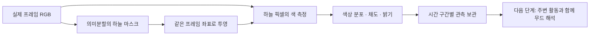

# 하늘색 관측

하늘의 밝기만 사용하던 관측에 **색 분포와 채도**를 추가했다. 분홍빛 노을뿐 아니라 푸른 여명, 금빛 하늘, 붉은 잔광, 흐린 낮의 옅은 색까지 같은 방식으로 기록한다.

현재 소스에는 관측 기능이 연결되어 있다. 배포 APK 0.3.1과 기존 무드 점수는 그대로이며, 새 하늘색의 무드 기여 규칙은 후속 단계다.

[그림의 입력 출처·PTS·해시](sky-color-calculation-check.sources.json)

## 계산 흐름

카메라·디코더에서 방향을 보정하고 긴 변을 최대 640픽셀로 축소한 RGB를 사용한다. 의미분할 입력으로 다시 축소하기 전의 색을 측정하며, 하늘 마스크만 같은 좌표에 투영한다. 원시 영상이나 마스크를 누적 창에 저장하지 않는다.

| 관측 | 계산 |
|---|---|
| 하늘 면적 | 하늘 픽셀 수 ÷ 전체 분석 프레임 픽셀 수 |
| 색 분포 | 색상각을 30°씩 나눈 12구간의 픽셀 수와 채도 합 |
| 평균 채도 | 하늘 전체의 채도 합 ÷ 하늘 픽셀 수 |
| 밝기 | 인코딩 RGB의 가중합 `(0.2126R + 0.7152G + 0.0722B) / 255`와 4구간 분포 |
| 화면 내 위치 | 방향 보정된 영상의 위·가운데·아래에 있는 하늘 픽셀 수 |
| 출처 | 프레임 식별값, 실제 영상 PTS, RGB·마스크·모델 해시 |

R=G=B인 픽셀만 무채색으로 구분한다. 옅거나 어두운 유채색은 통계에 남기며, 빨강의 0°/360° 경계를 단순 평균해 다른 색으로 만들지 않는다. 하늘이 없는 유효 관측은 0개와 평균 없음으로, 측정하지 못한 경우는 관측 없음으로 구별한다.

## 검증

| 범위 | 결과 |
|---|---|
| 색 계산 단위 검사 | 12개 통과: 무채색, 파스텔, 어두운 색, 색상·밝기 경계, 입력 보존 |
| 보존 RGB·마스크 계산 대조 | 기존 6영상·21프레임, 하늘 803,486픽셀의 구간 개수와 합계 일치 |
| Android 실제 모델 연결 | 기존 6영상·24프레임, 하늘 869,700픽셀; Android 색 변환 API와 구간 개수 일치 |
| 연구 앱 전체 검사 | 단위 검사 289개, 네이티브 검사 4개 통과; Lint 오류 0 |
| 기존 결과 보존 | Android 24프레임에서 새 관측 유무에 따른 기존 점수 차이 없음 |
| 본 앱 소스 통합 | 단위 검사 289개와 실제 앱 생성 경로·라이선스 검사 1개 통과; Lint 오류 0 |

두 프레임 집합은 별개다. 위 검증은 계산과 연결을 확인한 결과이며, 하늘 분할의 정확도나 여명·노을 판정 성능을 측정한 수치가 아니다. Android 검증 환경은 API 35 x86_64 에뮬레이터다. [수치와 입력 해시](sky-color-verification.json)

## 무드 해석으로 연결할 때

어두운 영상의 미세한 RGB 차이는 채도가 높게 나타날 수 있다. 따라서 색 분포만으로 노을이나 감성을 확정하지 않고 밝기·하늘 면적·구간 지속성과 주변 활동을 함께 검토한다. 영상 상하 위치는 실제 수평선이나 방위를 뜻하지 않는다.

촬영 시각·위치가 제공되면 여명과 저녁의 맥락을 보완할 수 있다. 시각이 없는 영상에 현재 시각이나 다운로드 시각을 대신 넣지 않는다. 영상 제목·노래·자막도 무드의 정답으로 사용하지 않는다.

## 구현과 출처

`SemanticLightAnalyzer → SkyColorObserver → DefaultSkyColorCalculator`가 관측을 만들고 `SceneAccumulator`가 중첩 목록을 복사해 보존한다. 의미분할 모델과 기존 점수기는 변경하지 않았다.

RGB→HSV 계산은 [Skia의 SkRGBToHSV](https://github.com/google/skia/blob/main/src/core/SkColor.cpp)를 Kotlin으로 옮겨 활용했다. BSD 3-clause 고지와 저작권을 [앱 라이선스](../../app/src/main/assets/licenses/Skia-LICENSE.txt)에 보존하며 별도 Skia 런타임 의존성은 추가하지 않는다.
