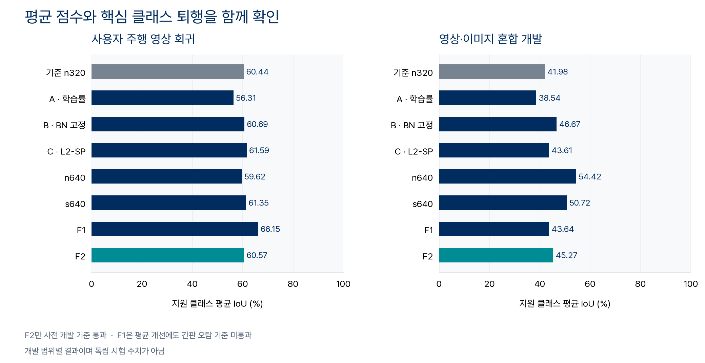
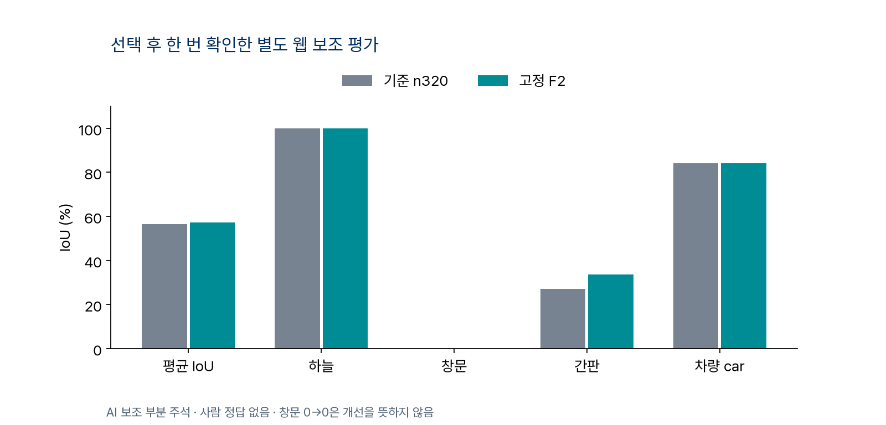

# 모델 개선 실험과 역할 분담

단일 모델의 평균 개선만으로 교체하지 않고 하늘·간판·창문·사람·차량의 개선과 퇴행을 함께 비교했다. 학습률 축소(A), BatchNorm 통계 고정(B), 사전 가중치에서 멀어지는 변화를 억제하는 L2-SP(C), 해상도·모델 크기 변경을 차례로 평가했다.



| 실험 | 관찰 | 결정 |
|---|---|---|
| A · 학습률 축소 | 도로·차량 등 퇴행 | 미채택 |
| B · BN 통계 고정 | 평균 개선, 간판 오탐 증가 | 미채택 |
| C · L2-SP | 평균 개선, 차량 IoU 허용폭 초과 하락 | 단독 교체 미채택 |
| n640 · 해상도 확대 | 하늘·간판 개선, 사람·보도 퇴행 | 단독 교체 미채택 |
| s640 · 모델 확대 | 일부 클래스 개선, 간판 오탐·보도 퇴행 | 단독 교체 미채택 |
| F1 · n320 보호 + n640 확장 | 평균 개선, 간판 정밀도 하락 | 미채택 |
| F2 · n320 보호 + n640 하늘 + C 구조 | 기존 개발 기준과 선택 후 보조 기준 통과 | 후속 통합 후보 |


F2는 먼저 기존 모델의 사람·차량·도로·보도·교통시설 영역을 보존한다. 나머지에서 하늘을 반영하고 건물·창문·간판을 보완한다. 모든 픽셀에 같은 우선순위를 적용하며, 정답에 맞춰 모델을 골라 합치지 않는다. 실제 하늘 관측에도 평가한 결합 결과와 동일한 마스크를 사용한다.

사용자 주행 영상 회귀에서는 평균 IoU가 **60.44% → 60.57%**, 영상·이미지 혼합 개발 범위에서는 **41.98% → 45.27%**였다. F2를 고정한 뒤 별도 웹 보조 범위를 한 번 평가했으며 평균 **56.58% → 57.35%**, 간판 **27.04% → 33.70%**였다. 범위가 다르므로 서로 합산하지 않는다. 창문은 모든 범위에서 개선되지 않았다.



개발 범위는 후보 선정에 반복 사용했다. 별도 보조 자료도 AI가 검수한 부분 주석이며 사람 정답이나 완전히 인증된 독립 벤치마크는 아니다. 보조 범위에는 사람 정답이 없고, 미주석 영역의 오탐·전체 경계·발광과 반사 구분·영업 여부는 측정하지 않았다. 모델 정확도 결과를 무드 정확도나 실차 성능으로 확대하지 않는다.

## 증거

- [실험 수치 CSV](experiment-metrics.csv)와 [모델별 지표](metrics/): 전체 클래스, 정밀도·재현율·오탐, 원본 그룹, 압축된 정수 confusion 행렬.
- [판정](decisions/): 실패한 항목까지 보존한 사전 기준 결과.
- [학습 기록](training/): 실제 가중치 변화, BN 통계, 변환 일치와 설정. 학습 중 축소격자 fitness는 원본격자 평가와 별개다.
- [동결 프로토콜](protocols/): 후보·규칙·코드·입력의 해시와 선택 시각.
- [입력 해시](input-hash-manifest.json), [모델 해시](model-hash-manifest.json), [가공 출처](provenance-manifest.json), [검사 결과](checks.json).

## 재현

원본 영상·이미지와 가중치는 이 문서 폴더에 포함하지 않는다. 사용 권한이 있는 동일 입력과 모델을 해시 목록의 상대 경로 구조에 준비하면 고정 F2를 다시 실행할 수 있다. 다른 입력을 같은 평가 결과로 취급하지 않는다.

```powershell
python -m unittest discover -s src -p test_public_evaluator.py
python src/replay_f2.py --root <자료-루트> --scope pilot01_development_regression --out <새-출력-폴더>
```

측정 환경은 Python 3.14, NumPy 2.4.6, OpenCV 5.0.0, ONNX Runtime 1.31.0이며 Pillow를 함께 사용했다. CPU 비용은 Windows에서 측정한 모델 추론 시간으로, 모바일 전체 분석 지연이 아니다. 공개 검사는 원본 자료 없이도 계산·우선순위·저장 행렬을 확인할 수 있다. 전체 예측 재현에는 해시가 맞는 자료가 필요하다.

평가 구현은 프로젝트의 이전 평가 코드를 재사용했고, [Ultralytics](https://github.com/ultralytics/ultralytics) 모델과 프로젝트의 [AGPL-3.0 라이선스](LICENSE)를 보존했다. 가공본의 상대 경로 표기는 원본 원장과 해시가 다르며, 가공 출처에 두 해시를 함께 기록했다.
